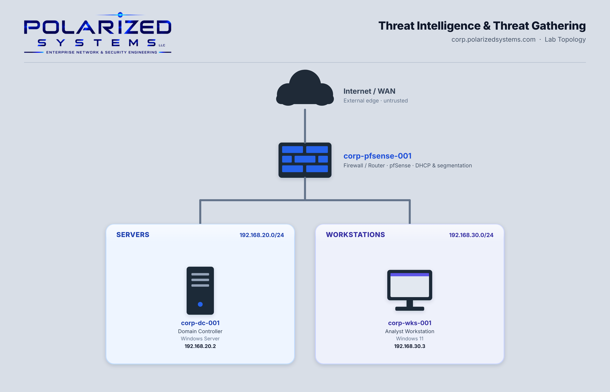

# Threat Intelligence & Threat Gathering

[← Back to Security Operations](../README.md)

**Domain:** Security Operations
**Environment:** Polarized Systems lab — Windows Active Directory domain (`corp.polarizedsystems.com`), research and analysis performed from `corp-wks-001`

---

## Overview

This project demonstrates the application of Open-Source Intelligence (OSINT), threat intelligence analysis, and threat hunting techniques to identify potential security threats, investigate suspicious activity, and strengthen defensive visibility across enterprise infrastructure.

 - **Open-Source Intelligence (OSINT): Conducted external reconnaissance and analyzed publicly available information to assess an organization's digital footprint and potential exposure. Techniques included browser developer tools, web archives, technology profiling, credential leak search engines, WHOIS records, and social media research.
 - **Threat Hunting & Intelligence Analysis: Investigated security events and potential indicators of compromise through Windows Security logs, SIEM platforms, and threat intelligence resources. Activities included analyzing authentication failures, examining attacker behavior through research honeypot telemetry, mapping suspicious activity to the MITRE ATT&CK framework, and enabling Windows Firewall logging through Group Policy.
The objective was to develop practical experience in threat intelligence collection, security event analysis, threat hunting, and adversary behavior identification, while demonstrating techniques used to investigate potential threats and improve security monitoring across enterprise environments.

In this lab, I worked both sides of that problem:

- **Open-source intelligence (OSINT):** I profiled an organization's public footprint the way an adversary would during reconnaissance, using browser developer tools, web archives, technology profilers, leak search engines, WHOIS data and social media search.
- **Threat hunting and intelligence sources:** I reviewed SIEM and commercial threat-intelligence platforms, observed live attacker behavior on a research honeynet, hunted for logon failures in the Windows Security log, mapped activity to MITRE ATT&CK, and enabled firewall logging across the domain with Group Policy.

---

## Lab Topology

---

## Learning Outcomes

By the end of this lab, I was able to:

- Conduct passive OSINT reconnaissance against an organization using only public sources
- Interpret WHOIS, DNS, hosting and technology-profile data to map an external attack surface
- Identify threat-intelligence sources, including SIEM platforms, commercial CTI and research honeynets
- Hunt for successful and failed logons in the Windows Security log
- Map adversary behavior to MITRE ATT&CK tactics and techniques
- Enable domain-wide firewall logging through Group Policy to support investigations

---

## Lab Environment

| Hostname | IP Address | Operating System | Role |
|----------|-----------|------------------|------|
| `corp-pfsense-001` | — | pfSense | Firewall / router between subnets |
| `corp-dc-001` | 192.168.20.2 | Windows Server | Domain Controller (Group Policy) |
| `corp-wks-001` | 192.168.30.3 | Windows 11 | OSINT research, threat intelligence and log analysis |

---

## Exercises

| # | Exercise | Tools |
|---|----------|-------|
| 1 | [Collection Methods and Sources (OSINT)](exercise-1-osint-collection-methods/README.md) | Edge DevTools · Wayback Machine · BuiltWith · Intelligence X · Whois.com · Website Informer · Social Searcher |
| 2 | [Threat Intelligence Hunting and Sharing](exercise-2-threat-intelligence-hunting/README.md) | Microsoft Sentinel · Intel 471 · CIC Honeynet · Event Viewer · MITRE ATT&CK · Group Policy |

---

## Review

### Summary

In this lab, I completed two exercises:

- Exercise 1 – Collection Methods and Sources (OSINT)
- Exercise 2 – Threat Intelligence Hunting and Sharing

### Skills Demonstrated

- Passive reconnaissance and external attack-surface mapping with public OSINT tools
- Interpreting WHOIS, DNS, hosting, redirect and technology-relationship data
- Recognizing data-exposure indicators in leak and paste archives
- Evaluating SIEM, commercial CTI and honeynet intelligence sources
- Hunting authentication events (4624 / 4625) in the Windows Security log
- Mapping observed behavior to MITRE ATT&CK tactics and techniques
- Enforcing domain-wide firewall logging with Group Policy
