# Exercise 1 – Collection Methods and Sources (OSINT)

[← Back to Lab Overview](../README.md)

---

## Overview

Open-source intelligence (OSINT) is information gathered from publicly available sources — and that range is far wider than most people assume. News stories, magazine features, user-uploaded videos and photos on social networks, blogs, forums, government bulletins, and even deep- and dark-web searches are all fair game, alongside websites, archives, domain registries, and data that has leaked onto the public internet. OSINT is a cornerstone of both government and private investigations, and as the volume of data generated online keeps climbing, the real skill shifts from simply *finding* information to developing effective strategies for locating, cataloging, and analyzing the flood of it.

Two properties make OSINT especially powerful for an attacker. First, the information is freely available to anyone who looks. Second, collecting it **leaves no trace** on the target — passively reading public sources is indistinguishable from ordinary internet traffic, so the organization never knows reconnaissance is underway. Defenders use the exact same techniques in reverse: to see the organization through an attacker's eyes and reduce what is exposed before it can be used against them.

> 🔎 **Why a small digital footprint matters.** The "priority information" attackers harvest from public sources includes executive email addresses and phone numbers, employee names and roles, overly detailed *About* and careers pages, the website's code and build stack, wireless-network and packet-level details, and the metadata buried inside published images. Any one of them looks harmless on its own; assembled, they become the blueprint for a convincing phishing or pretexting campaign. Limiting what an organization exposes is a frontline defensive control, not an afterthought — which is exactly why an analyst assesses that footprint first.

> ### 🎯 Target Selection & Scope
>
> All reconnaissance in this exercise is **passive** and uses only publicly available sources. I did not scan, probe or interact with the target's systems beyond viewing its public website as any visitor would.
>
> I first assessed my own domain, `polarizedsystems.com`. Because the domain is newly registered and its public web presence is still in development, it returned minimal data: registrant details are privacy-protected by the registrar, and there is no archived or indexed content yet. A small footprint is a good security outcome, but it doesn't demonstrate the techniques well.
>
> 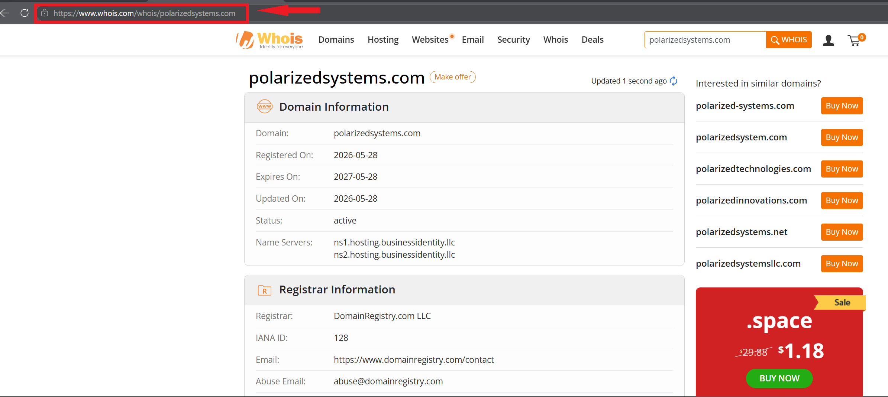
>
> To show what these tools reveal about an established organization, I used **HackerOne (`hackerone.com`)**, a security company that runs a public bug bounty program and openly engages with the security research community.

## Devices

- **corp-wks-001** – Windows 11 – Microsoft Edge (192.168.30.3)

---

## Task 1 – Inspect the Website with Developer Tools

1. In Microsoft Edge, browse to the target:

   ```
   https://www.hackerone.com
   ```

   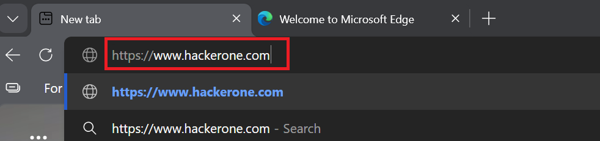

2. Open **⋯ → More tools → Developer tools** (or press **F12**).

   *Developer tools expose the page's source code and every resource it loads.*

   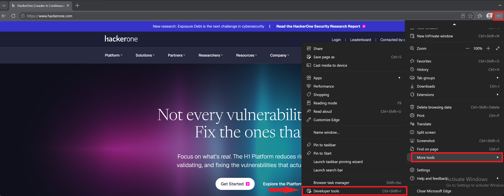

3. Review the **Elements** tab. The HTML reveals the site's structure, the JavaScript libraries it loads (such as jQuery) and the third-party analytics and marketing scripts embedded in the page. Each external script is a dependency an attacker could research for weaknesses.

   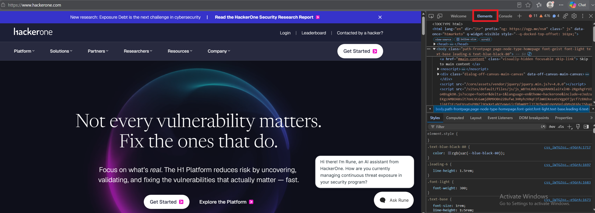

4. Close the DevTools pane and leave the browser open.

   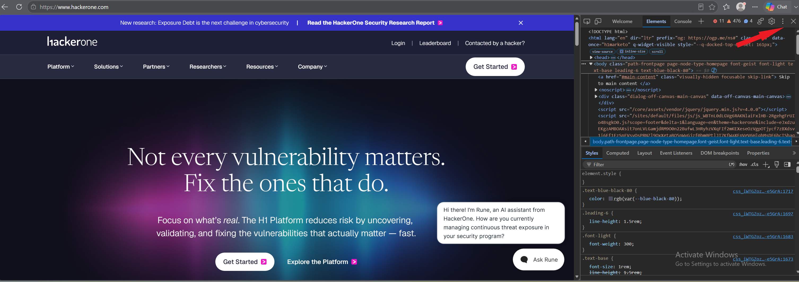

---

## Task 2 – Review Site History with the Wayback Machine

1. Browse to the Internet Archive's Wayback Machine:

   ```
   https://web.archive.org
   ```

   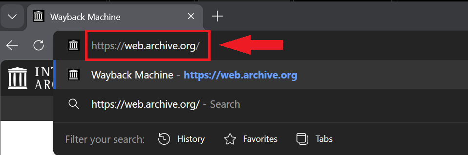

2. Search `hackerone.com`. The site has been archived **10,211 times between February 9, 2005 and October 15, 2026**.

   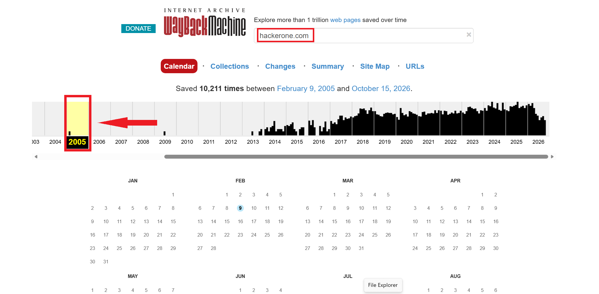

3. Select **2005** and open the earliest capture, **February 9, 2005**.

   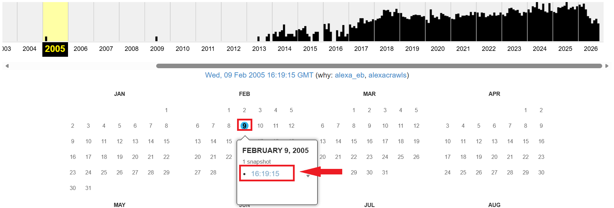

4. The 2005 snapshot shows a placeholder page reading **"This site is under construction."**

   > **Finding:** The domain's current registration dates to **2007** (Task 5), but the archive holds content from **2005**. The domain had history before its current owner. Archives can expose old pages, retired login portals and content an organization has since removed but never fully erased from the internet.

   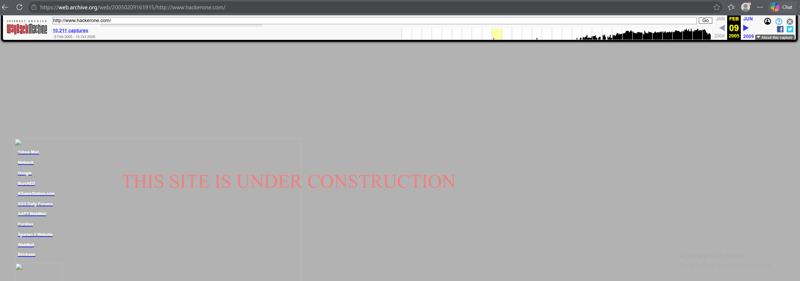

---

## Task 3 – Profile the Technology Stack with BuiltWith

1. Browse to BuiltWith and look up the target:

   ```
   https://builtwith.com
   ```

   ```
   hackerone.com
   ```

   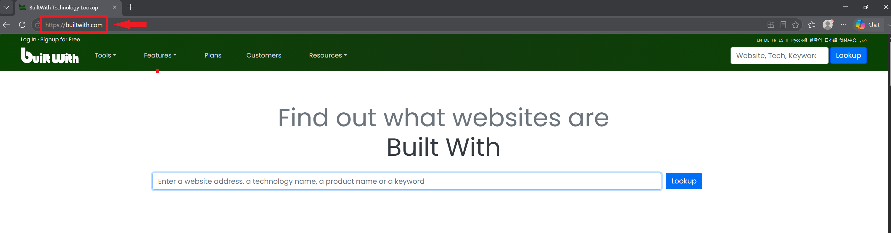

   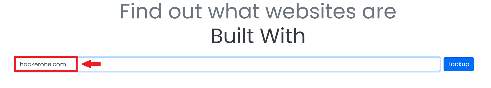

2. Review the **Technology Profile**. BuiltWith detected **159 live technologies** on the site, including marketing and CRM platforms such as Qualified, Navattic and Salesforce.

   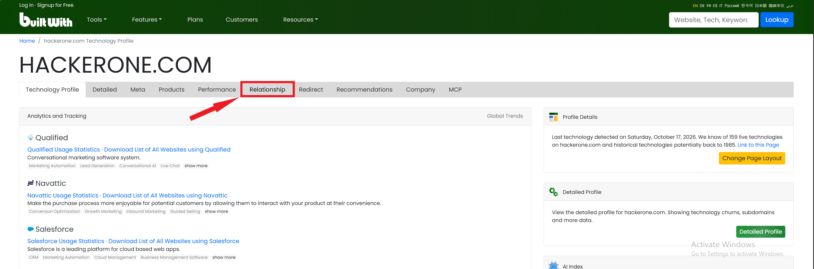

3. Open the **Relationship** tab. BuiltWith links domains that share the same analytics and tag-manager IDs. Here, HackerOne's tracking IDs also appear on related properties such as an onboarding site hosted on Pantheon.

   > **Why it matters:** Shared tracking IDs let an analyst, or an attacker, discover an organization's lesser-known websites, which are often less hardened than the main site.

   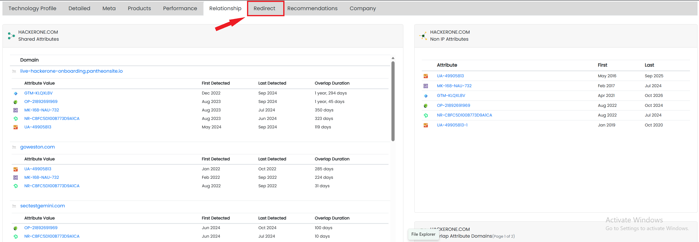

4. Open the **Redirect** tab. Country-code domains such as `hackerone.ca`, `hackerone.com.ec` and `hackerone.com.mw` redirect to the main site, a common defensive practice to stop typosquatters and impersonators from registering them.

   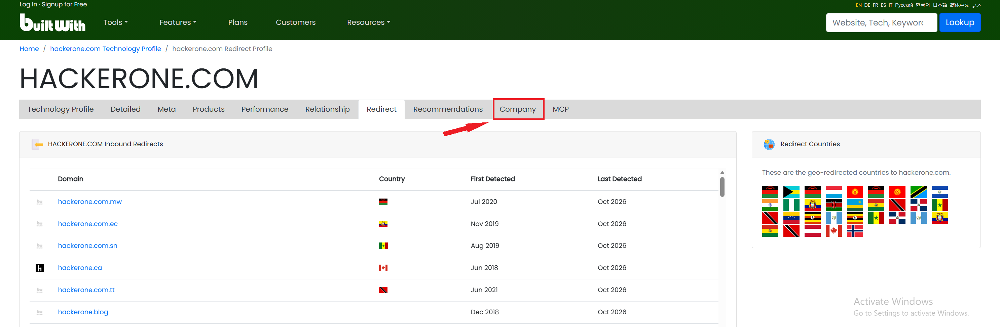

5. Open the **Company** tab: **HackerOne Inc**, first indexed **February 2005**, with steadily rising technology spend.

   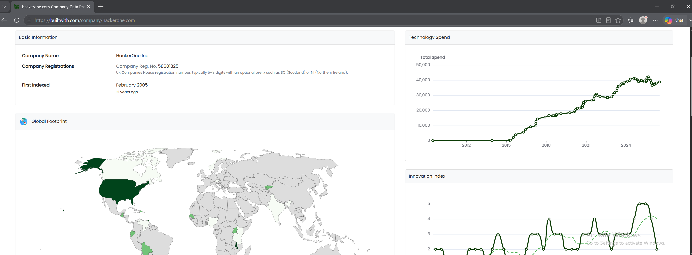

6. Scroll to the **Global Footprint**, which maps the organization's presence by address, top-level domain and redirects.

   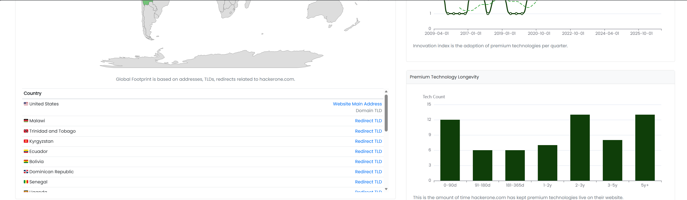

---

## Task 4 – Search Indexed and Leaked Data with Intelligence X

1. Browse to Intelligence X, which indexes public web content, paste sites and historical data leaks:

   ```
   https://intelx.io
   ```

   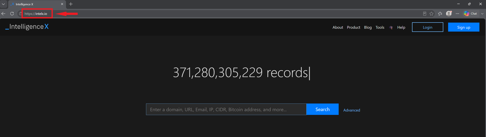

2. Search `hackerone.com`.

   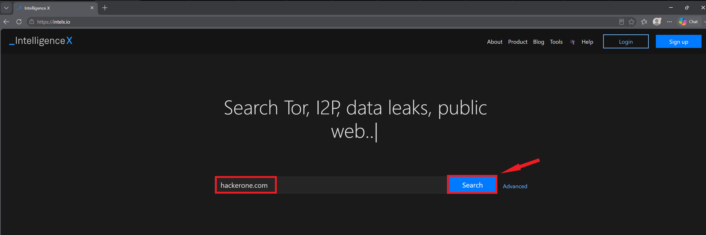

3. Review the results: **804 text files, 488 website HTMLs, 233 CSV files, 203 pastes, 92 PDF files, 5 database files and 5 domains** reference the domain. Several file names indicate large **credential combination lists**, which are collections of leaked email-and-password pairs. Their contents are restricted to paid accounts and are redacted here.

   > **Why it matters:** When a company's domain appears in combo lists, its employees' email addresses are circulating among attackers. The defensive response is to enforce MFA, block reused or breached passwords, and monitor for credential-stuffing attempts.

   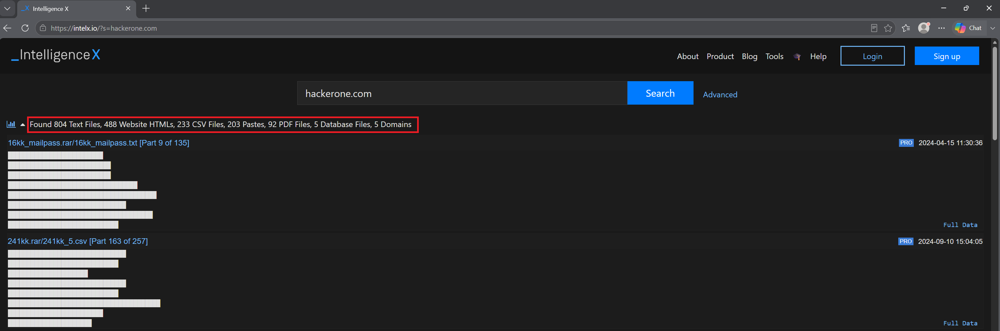

---

## Task 5 – Look Up Domain Registration with Whois.com

1. Browse to Whois.com and search the target:

   ```
   https://www.whois.com/whois/hackerone.com
   ```

   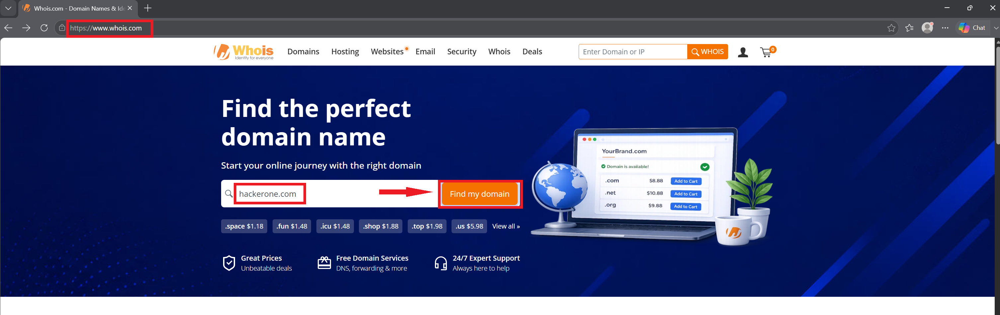

   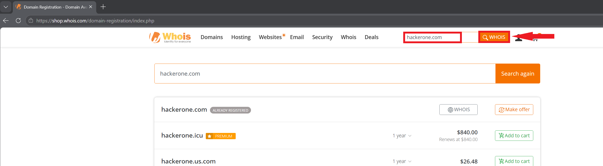

2. Review the domain record:

   | Field | Value |
   |-------|-------|
   | Registered | 2007-11-26 |
   | Expires | 2027-11-26 |
   | Registrar | Cloudflare, Inc. |
   | Name servers | `a.ns.hackerone.com`, `b.ns.hackerone.com` |
   | Status | client and server **delete / transfer / update prohibited** |

   > **Finding:** The six "prohibited" statuses mean the domain is under a **registry lock**, a strong control that stops attackers from hijacking or transferring the domain even if they compromise the registrar account.

   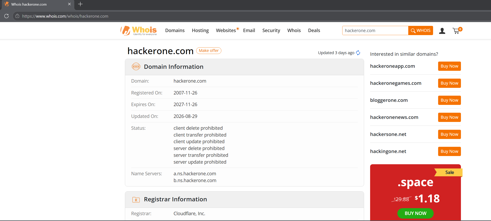

---

## Task 6 – Gather Hosting and WHOIS Details with Website Informer

1. Browse to Website Informer and search the target:

   ```
   https://website.informer.com
   ```

   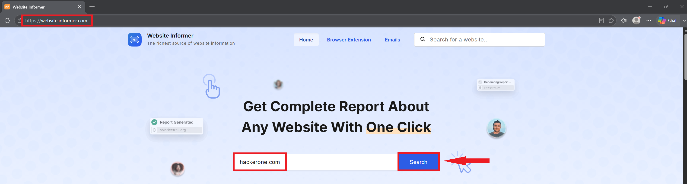

2. Review the overview. The site is hosted behind **Cloudflare** (IP addresses `104.18.36.214` and `172.64.151.42`) and receives roughly **100,000 visitors a day**.

   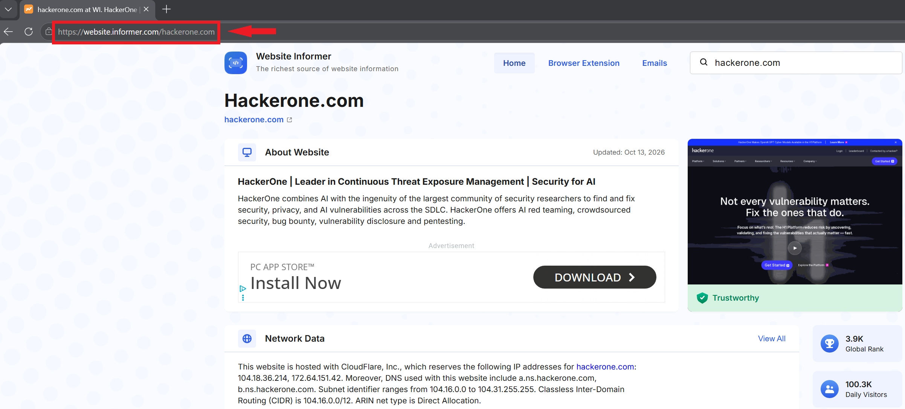

3. Review the **Network** and **WHOIS** panels: network range `104.16.0.0/12`, subdomain `docs.hackerone.com`, registrant details **redacted**, and a public contact address `hostmaster@hackerone.com`. Click **View All**.

   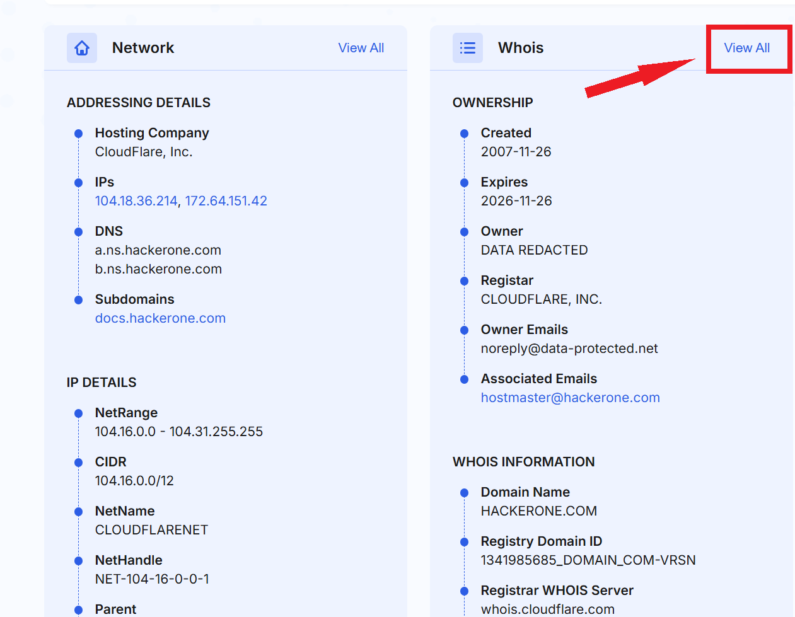

4. The full WHOIS record shows registrant, admin and tech contacts as **DATA REDACTED**.

   > **Analyst note:** Website Informer lists the domain's expiry as **2026-11-26**, while the live WHOIS lookup in Task 5 shows **2027-11-26**. Third-party aggregators cache data and can be out of date. I always verify key facts against the authoritative source before reporting them.

   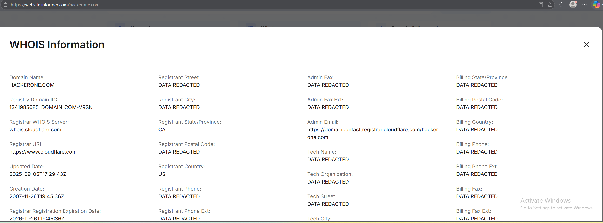

---

## Task 7 – Search Social Media Mentions with Social Searcher

1. Browse to Social Searcher and search the target:

   ```
   https://www.social-searcher.com
   ```

   

2. The search returned about **68,600 results**, including the company's official social media pages and posts.

   > **Why it matters:** Social media is where oversharing happens: employee names and roles, office photos, technology choices and event details. Attackers use these to build convincing phishing and pretexting campaigns. Organizations can set up alerts to monitor new mentions.

   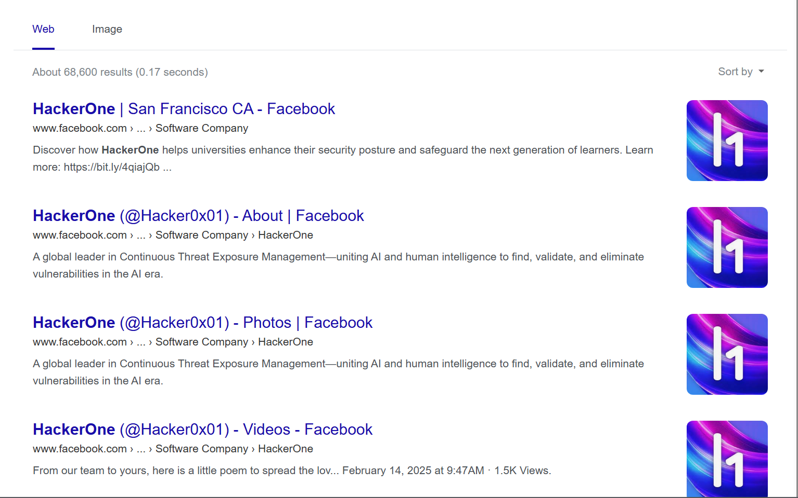

---

### 📋 OSINT Findings Summary

| Source | Key finding | Defensive takeaway |
|--------|-------------|--------------------|
| Developer tools | Many third-party scripts load on the home page | Inventory and review third-party dependencies |
| Wayback Machine | Content archived since 2005, before the current registration | Retired content can persist publicly for decades |
| BuiltWith | 159 technologies; related sites linked by shared tracking IDs | Secondary sites expand the attack surface |
| Intelligence X | Domain referenced in leaked credential lists | Enforce MFA and breached-password protection |
| Whois.com | Registry lock in place; registrant data protected | A strong control against domain hijacking |
| Website Informer | Cloudflare-fronted hosting; one aggregator had stale data | Verify facts against authoritative sources |
| Social Searcher | Broad public social presence | Monitor mentions and train staff on oversharing |

---

> ### 🎤 Stakeholder Takeaway
>
> "Before an attacker sends a single packet, they can learn a great deal about us from public sources: our technology, our related websites, our domain records, and whether our employees' credentials have leaked. I ran that same reconnaissance passively. The defensive value is simple: we can't protect what we don't know is exposed, so we should assess our own footprint the way an attacker would and close the gaps first."

---

[← Back to Lab Overview](../README.md) | [Next: Exercise 2 – Threat Intelligence Hunting →](../exercise-2-threat-intelligence-hunting/README.md)
