# Exercise 2 – Threat Intelligence Hunting and Sharing

[← Back to Lab Overview](../README.md)

---

## Overview

This exercise explores the application of threat hunting and threat intelligence analysis to proactively identify suspicious activity, investigate potential security incidents, and detect indicators of compromise (IOCs) across enterprise infrastructure.

Threat hunting involves examining system logs, network activity, authentication records, and security telemetry to identify malicious behavior that may evade traditional security controls. Particular emphasis is placed on detecting advanced persistent threats (APTs), unauthorized access, privilege escalation, and lateral movement within an organization's network.

Common indicators of potentially malicious activity include:

- **Network Anomalies:** Unusual network traffic, suspicious IP addresses, abnormal DNS activity, and potential distributed denial-of-service (DDoS) activity.

- **Authentication & Access Anomalies:** Repeated failed login attempts, off-hours authentication, unexpected privilege escalation, and unusual access to sensitive files or databases.

- **System Integrity Changes:** Unauthorized modifications to system files, Windows Registry settings, and security configurations.

- **Defense Evasion:** Unexpected clearing of security logs or other attempts to conceal suspicious activity.

The objective of this exercise was to examine threat hunting methodologies, indicators of compromise, and security event analysis techniques used to investigate potential threats and strengthen organizational detection capabilities. This exercise demonstrates foundational knowledge of threat detection, incident investigation, security monitoring, and threat intelligence analysis.

## Devices

- **corp-wks-001** – Windows 11 – Microsoft Edge and Event Viewer (192.168.30.3)
- **corp-dc-001** – Windows Server – Group Policy Management (192.168.20.2)

---

## Task 1 – Review Threat Intelligence Sources

### SIEM: Microsoft Sentinel

1. On **corp-wks-001**, review Microsoft Sentinel, a cloud-native **Security Information and Event Management (SIEM)** platform:

   ```
   https://www.microsoft.com/security/business/siem-and-xdr/microsoft-sentinel
   ```

   A SIEM collects logs from across the environment, correlates them and raises alerts, giving analysts one place to detect, investigate and respond to threats.

   

### Commercial threat intelligence: Intel 471

2. Review Intel 471's **Cyber Threat Exposure** platform, an example of a commercial threat-intelligence provider:

   ```
   https://www.intel471.com/platform/cyber-threat-exposure
   ```

   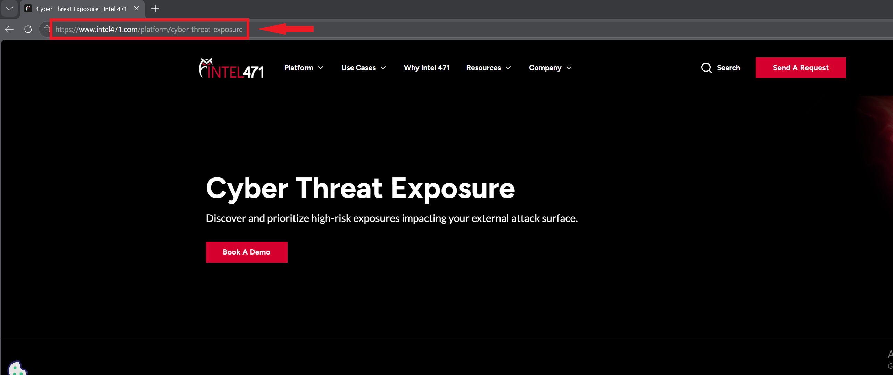

3. Download the product brief.

   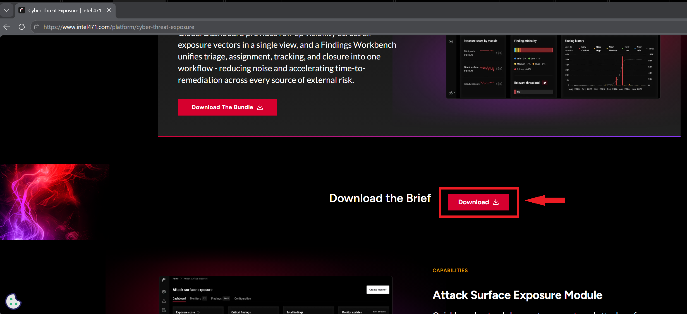

4. The brief describes three monitoring areas: **Attack Surface Exposure** (exposed assets and misconfigurations), **Third-Party Exposure** (risk from vendors and partners) and **Brand Exposure** (impersonation across lookalike sites, social platforms and underground forums). These are the same areas I assessed manually in Exercise 1.

   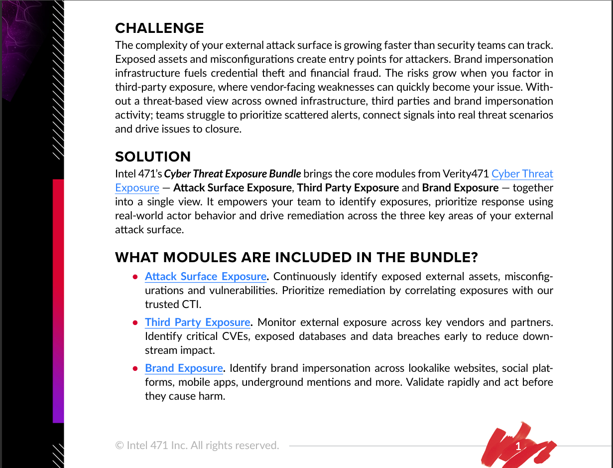

### Research honeynet: CIC Honeynet

5. Browse to the CIC Honeynet project, which runs decoy systems (honeypots) to capture real attacker behavior:

   ```
   https://honeynetproject.com
   ```

   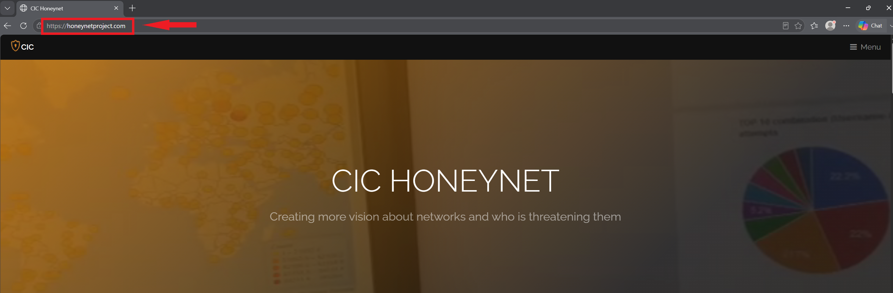

6. Review the project's services: live threat hunting, a real-time attack map and bi-weekly traffic reports.

   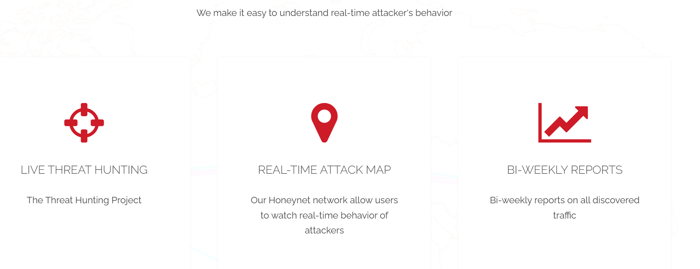

7. Open the **Real-time Attack Map**. The T-Pot honeypot platform recorded **134,593 attacks in 24 hours** (**8,605 in the last hour**), including SSH brute-force attempts captured by **Cowrie** on port 22, VNC probes on port 5900 and VoIP (SIP) abuse on port 5060.

   > **Any internet-facing service is attacked within minutes of going online. Honeynet data shows which services and source regions are most active, which helps prioritize what to harden and monitor.**

   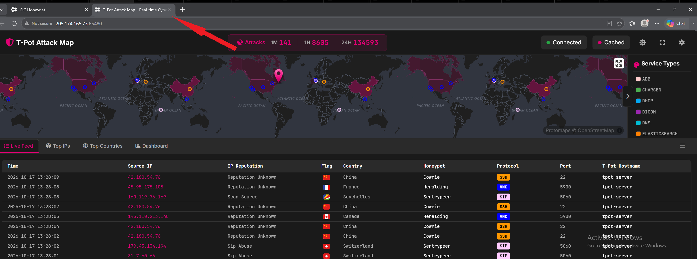

8. Review the honeypot software used in the project, including **T-Pot**, **Cowrie** (SSH/Telnet), **Conpot** (industrial control systems) and **Artillery**.

   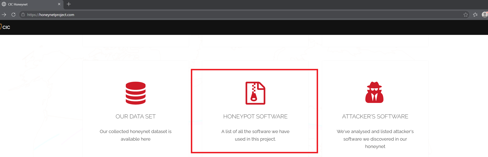

   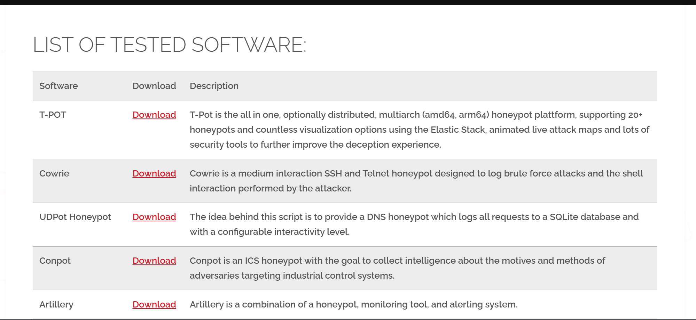

---

## Task 2 – Hunt for Logon Events in the Windows Security Log

1. To generate evidence to hunt for, I deliberately entered an incorrect password several times at the **corp-wks-001** sign-in screen, then signed in successfully.

   

2. Open **Event Viewer** from the Start menu.

   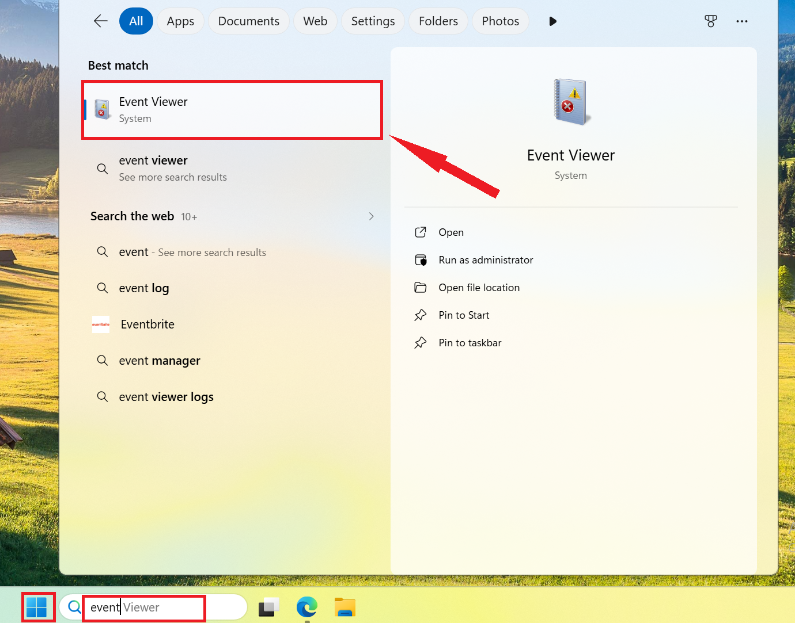

3. Go to **Windows Logs → Security**. In the Actions pane, click **Find…** and search for:

   ```
   4624
   ```

   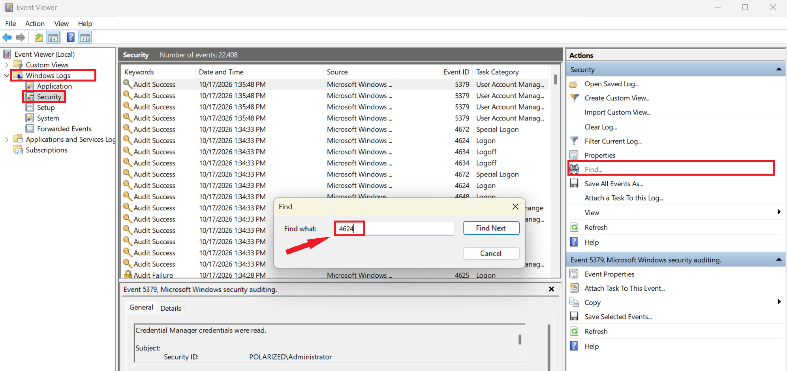

4. **Event ID 4624 – An account was successfully logged on.** The successful logon was recorded at **1:34:33 PM**.

   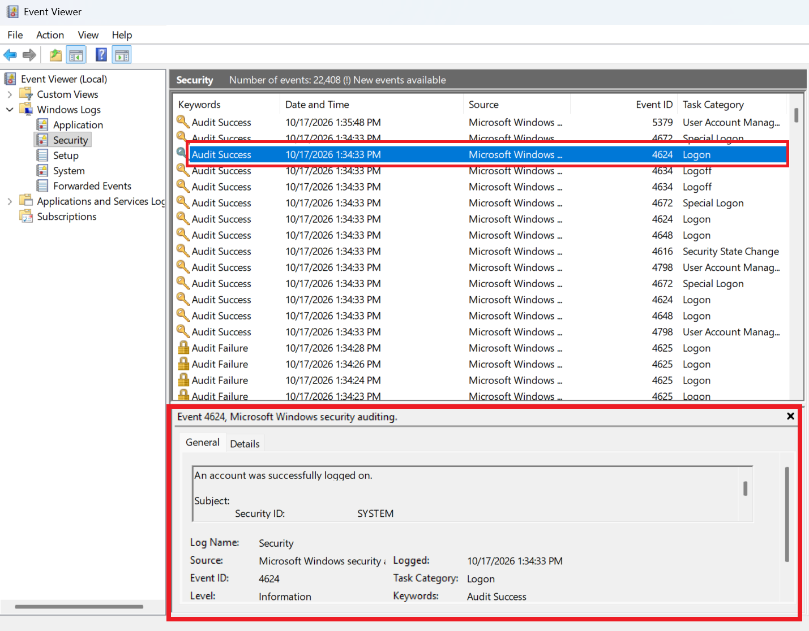

5. Just before it, the log shows a series of **Event ID 4625 – An account failed to log on** entries, flagged as **Audit Failure**, at **1:34:23, 1:34:24, 1:34:26 and 1:34:28 PM**.

   > **Finding:** Four failed logons in five seconds, immediately followed by a success, is the classic signature of a **password-guessing attack that worked**. In a real environment, I would confirm whether the user made the attempts, check the source workstation and logon type, and reset the credential if the activity wasn't legitimate.

   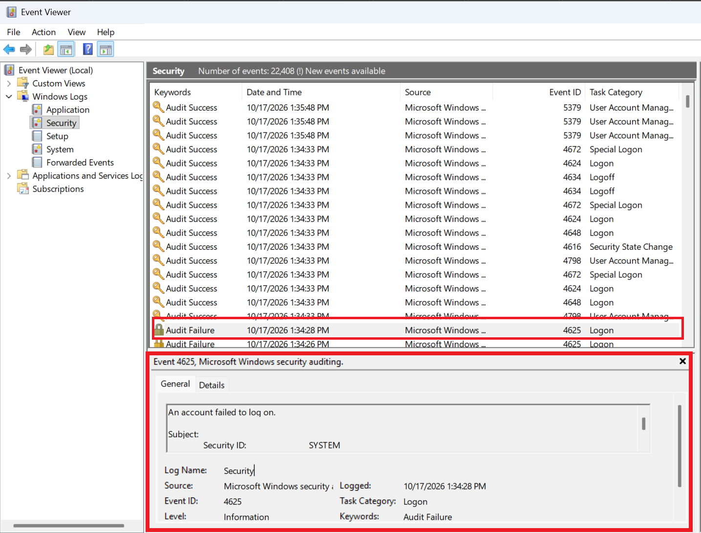

6. The **Details** tab shows each event's raw fields, such as the account name, domain, logon ID and process, which are the data points a SIEM parses and correlates.

   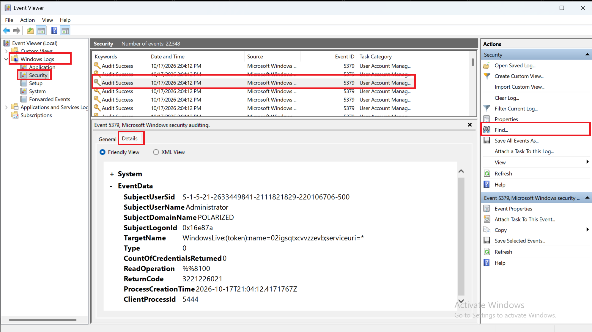

   | Event ID | Meaning | Hunting use |
   |----------|---------|-------------|
   | **4624** | Successful logon | Off-hours logons, unusual source hosts |
   | **4625** | Failed logon | Brute force and password spraying |
   | **4672** | Special privileges assigned | Administrator activity |
   | **4648** | Logon with explicit credentials | Lateral movement, `runas` use |

---

## Task 3 – Map Activity to MITRE ATT&CK

1. Browse to the **Active Scanning (T1595)** technique:

   ```
   https://attack.mitre.org/techniques/T1595/
   ```

   Active scanning is reconnaissance that directly probes victim infrastructure, unlike the passive OSINT in Exercise 1, which never touched the target. Then open **Tactics → Enterprise**.

   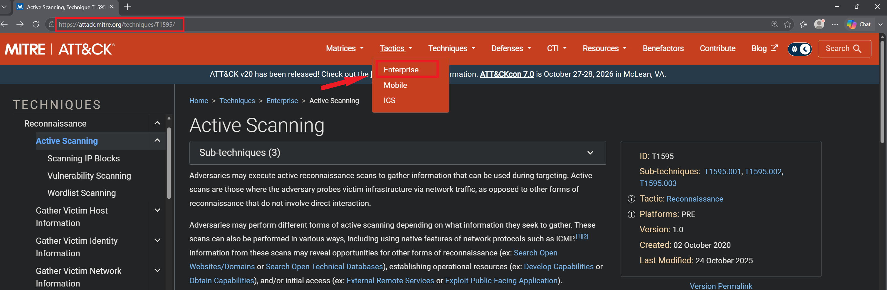

2. The Enterprise matrix organizes adversary behavior into **15 tactics**, each representing the attacker's goal at that stage. Select **Reconnaissance**.

   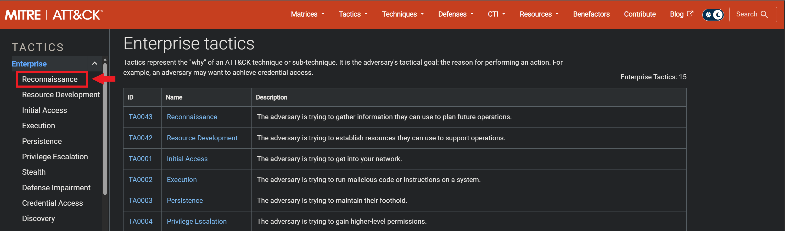

3. **Reconnaissance (TA0043)** contains **12 techniques** that adversaries use to gather information for planning future operations.

   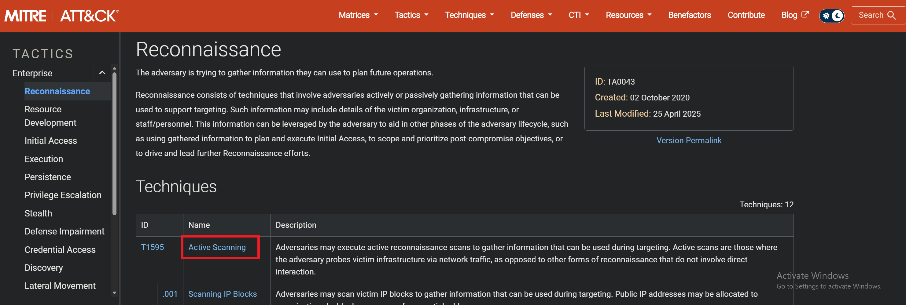

4. Select **Privilege Escalation (TA0004)**, the tactic attackers use to gain higher-level permissions such as SYSTEM, local administrator or domain administrator.

   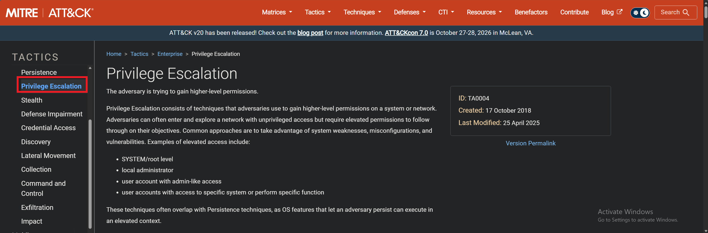

5. Review its **13 techniques** and select **Abuse Elevation Control Mechanism**.

   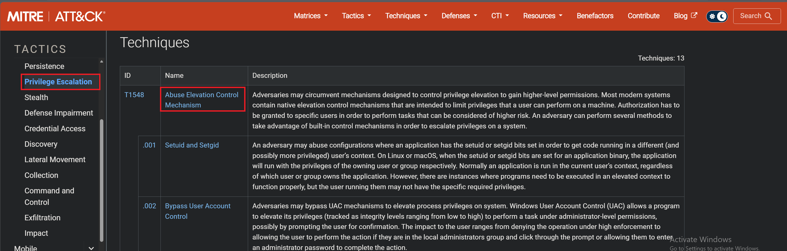

6. **T1548 – Abuse Elevation Control Mechanism** has **6 sub-techniques**, including **Bypass User Account Control**, and applies to Windows, Linux, macOS and cloud platforms.

   > **Mapping a detection to an ATT&CK technique tells the whole team what the alert means, which stage of the attack it represents and what the attacker is likely to try next.**

   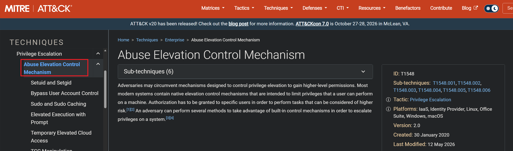

---

## Task 4 – Enable Firewall Logging with Group Policy

Firewall logs record which connections were allowed and blocked. Without them, investigators can't reconstruct network activity during an incident.

1. On **corp-dc-001**, open **Server Manager → Tools → Group Policy Management**.

   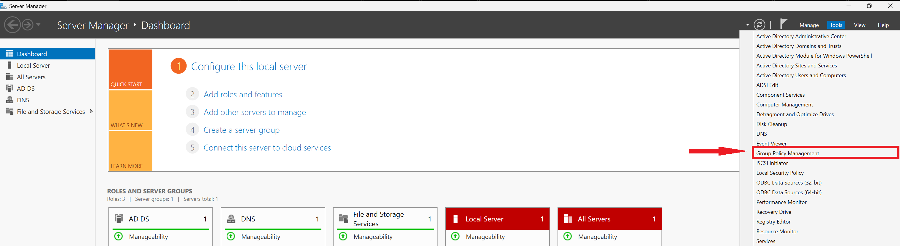

2. Expand **Forest → Domains → corp.polarizedsystems.com**, right-click **Default Domain Policy** and select **Edit**.

   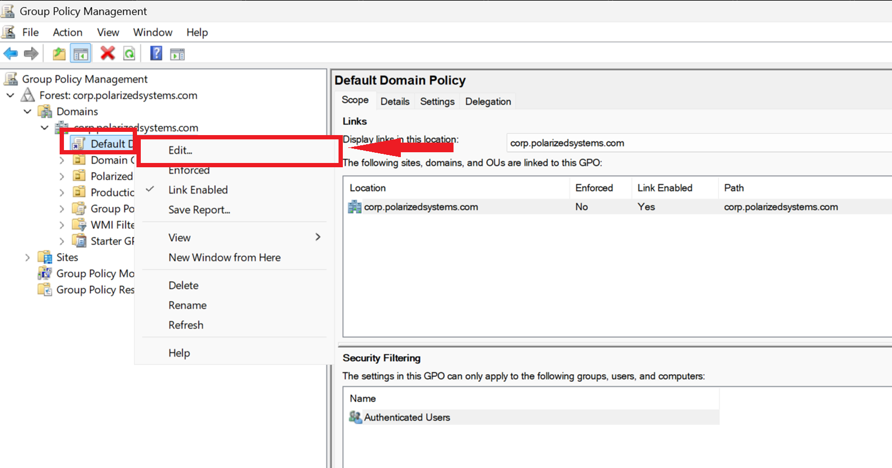

3. Navigate to:

   ```
   Computer Configuration > Policies > Administrative Templates > Network >
   Network Connections > Windows Defender Firewall > Domain Profile
   ```

   Double-click **Windows Defender Firewall: Allow logging**.

   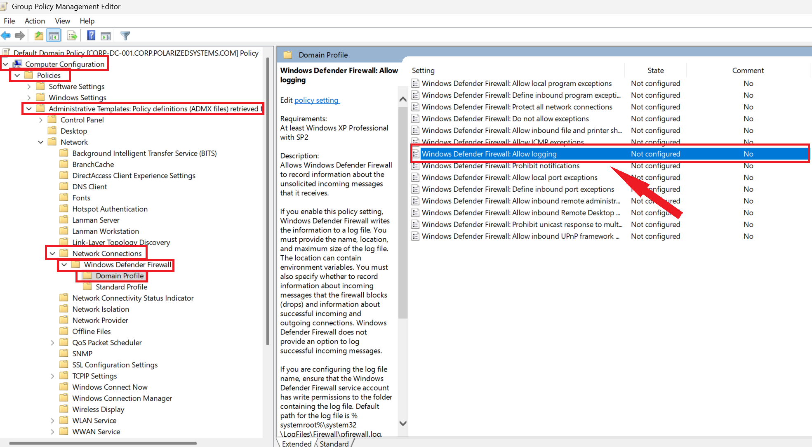

4. Select **Enabled**, check **Log dropped packets** and **Log successful connections**, keep the default log path `%systemroot%\system32\LogFiles\Firewall\pfirewall.log`, and click **OK**.

   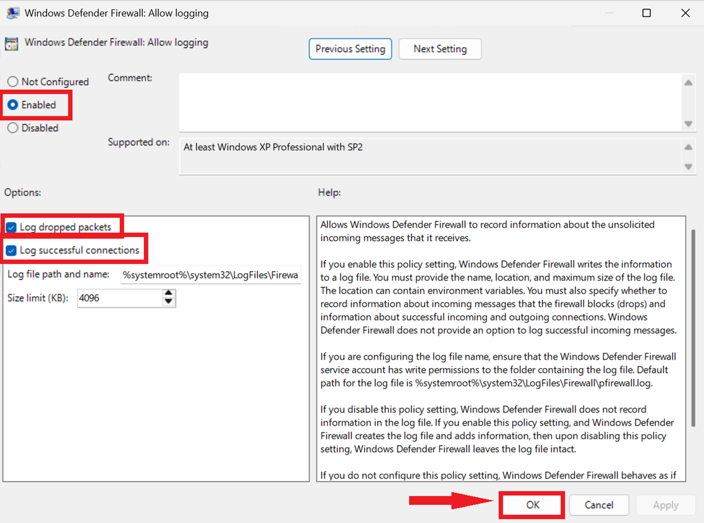

5. The setting now shows **Enabled**. It applies to every domain-joined computer at the next Group Policy refresh.

   > **Production note:** The default **4 MB** log size fills quickly on a busy host. In production I would raise the size limit and forward firewall logs to the SIEM. For newer systems, the same settings can also be managed under *Windows Settings → Security Settings → Windows Defender Firewall with Advanced Security*.

   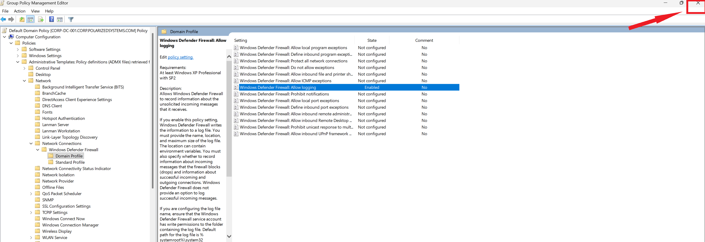

6. Close the Group Policy Management Editor and console.

   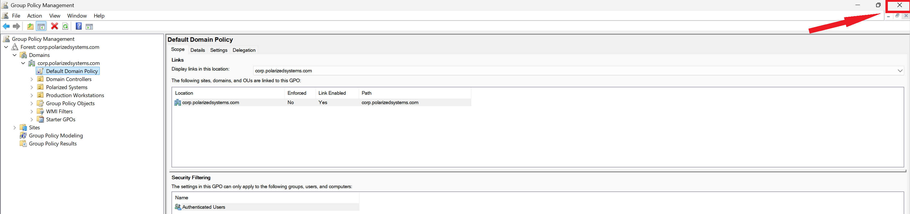

---
>
> "### 🎤 Stakeholder Takeaway

"Effective threat intelligence combines external threat research with internal security monitoring. By analyzing honeypot activity, identifying password-guessing attempts in system logs, and mapping findings to MITRE ATT&CK, we gain better visibility into attacker behavior. **Centralized logging and threat intelligence help us detect, investigate, and respond to security threats more effectively."

---

[← Previous: Exercise 1 – OSINT](../exercise-1-osint-collection-methods/README.md) | [Back to Lab Overview](../README.md)
