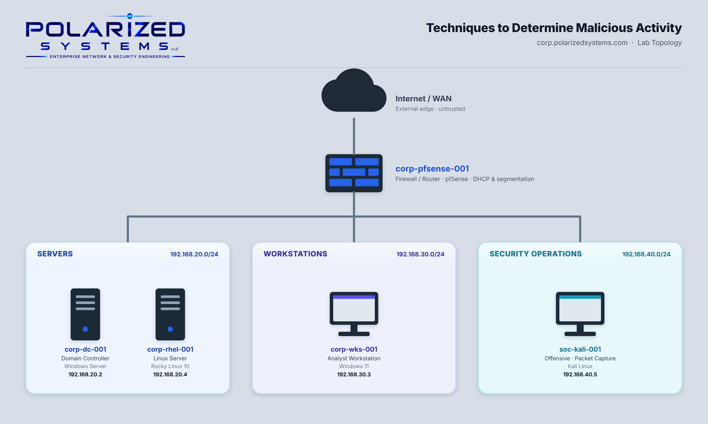

# Techniques to Determine Malicious Activity

[← Back to Security Operations](../README.md)

---

## Overview

My objective here is to demostrate the application of security auditing, authentication monitoring, and threat detection techniques to identify potentially malicious activity across Windows and Linux enterprise environments.

Effective threat detection requires properly configured audit policies, centralized visibility, and the ability to analyze security events for indicators of compromise (IOCs). By generating controlled attack scenarios and examining the resulting authentication records, this project evaluates how security telemetry supports incident investigation and the identification of unauthorized access attempts.

These projects focuses on two core areas of security investigation:

- **Exercise 1 – Windows Security Auditing & Threat Detection:** Configured domain-wide logon auditing and account lockout policies through Active Directory Group Policy. Simulated SMB password-guessing attempts from Kali Linux and developed a PowerShell script to identify and analyze failed authentication events (Windows Security Event ID 4625).

- **Exercise 2 – Linux Authentication Monitoring & Threat Detection:** Examined login activity and system access history on a Rocky Linux server using Linux auditing utilities. Simulated an SSH brute-force attack from Kali Linux and analyzed authentication records to identify failed login attempts and subsequent successful access.

> **The objective of this project was to develop practical experience in security event analysis, authentication monitoring, threat detection, and incident investigation across Windows and Linux systems. These exercises demonstrate the importance of audit configuration, log visibility, and investigative techniques used to identify malicious activity within enterprise Security Operations environments.**

---

## Lab Topology

---

## Learning Outcomes

By the end of this lab, I was able to:

- Enable Windows logon auditing (success and failure) across a domain using Group Policy
- Configure an account-lockout threshold to slow and expose brute-force attacks
- Safely generate failed-logon telemetry for detection testing from an isolated attacker host
- Build a PowerShell event-log hunting script with `Get-WinEvent` and a filter hashtable
- Interpret Windows logon events, including Event ID 4625 and Logon Type codes
- Configure Windows Defender Firewall to support remote, centralized event-log collection
- Monitor interactive and remote login activity on a Linux server with `last`, `last reboot`, and `last -i`
- Recognize the signature of an SSH brute-force attack in Linux authentication records

---

## Lab Environment

| Hostname | IP Address | Operating System | Role in this lab |
|----------|-----------|------------------|------------------|
| `corp-pfsense-001` | — | pfSense | Firewall / router between subnets |
| `corp-dc-001` | 192.168.20.2 | Windows Server | Domain Controller — audit policy, PowerShell hunting, SSH attack source (Ex 2) |
| `corp-rhel-001` | 192.168.20.4 | Rocky Linux 10 | Linux login-monitoring target (Ex 2) |
| `corp-wks-001` | 192.168.30.3 | Windows 11 | Analyst workstation — remote log collection (Ex 1) |
| `soc-kali-001` | 192.168.40.5 | Kali Linux | Attack simulation — SMB brute force (Ex 1) |

---

## Exercises

| # | Exercise | Platform | Key Tools |
|---|----------|----------|-----------|
| 1 | [Monitor Windows Event Logs with PowerShell](exercise-1-monitor-windows-event-logs/README.md) | Windows | Group Policy · smbclient · PowerShell ISE · `Get-WinEvent` · Out-GridView · Windows Defender Firewall |
| 2 | [Monitor Login Events on Linux Devices](exercise-2-monitor-linux-login-events/README.md) | Linux | `last` · `last reboot` · `last -i` · OpenSSH · `hostnamectl` |

---

## Scripts

| Script | Host | Purpose |
|--------|------|---------|
| [`generate-test-logins.sh`](scripts/generate-test-logins.sh) | soc-kali-001 | Authorized detection test — generates failed SMB logons (Event ID 4625) |
| [`Monitor-FailedLogons.ps1`](scripts/Monitor-FailedLogons.ps1) | corp-dc-001 | Hunts failed-logon events in the Windows Security log and displays them in a grid |

---

## Review

### Summary

In this lab I completed two exercises:

- Exercise 1 — Monitor Windows Event Logs with a PowerShell Script
- Exercise 2 — Monitor Login Events on Linux Devices

Across both, I configured the auditing needed to capture authentication activity, generated controlled attacks to produce that activity, and then detected it in the logs — the full "configure, attack, detect" loop a SOC analyst relies on.

### Skills Demonstrated

- Domain-wide audit policy and account-lockout configuration with Group Policy
- Controlled, authorized attack simulation for detection validation
- PowerShell event-log hunting and filtering (`Get-WinEvent` / `-FilterHashtable`)
- Interpreting Windows logon events and Logon Type codes (4625, Type 3)
- Preparing an environment for centralized, remote log collection
- Linux login and session auditing with the `last` command family
- Recognizing brute-force signatures across both Windows and Linux telemetry
