# Exercise 1 – Monitor Windows Event Logs with a PowerShell Script

[← Back to Lab Overview](../README.md)

---

## Overview

Windows Security auditing, PowerShell scripting, and authentication monitoring are essential in identifing suspicious logon activity and detecting potential brute-force attacks within an Active Directory environment.

Windows Event Logs provide valuable security telemetry for investigating authentication failures, unauthorized access attempts, and other potentially malicious activities. By configuring audit policies and automating log analysis through PowerShell, security analysts can efficiently identify abnormal authentication patterns and strengthen threat detection capabilities.

## Objectives

- **Security Auditing:** Configure Windows logon auditing policies to capture authentication events and provide visibility into successful and failed logon attempts.

- **Event Generation:** Generate controlled authentication failures to produce security events for investigation and analysis.

- **PowerShell Log Analysis:** Develop a PowerShell script to retrieve and filter Windows Security Event Logs, including failed logon events (Event ID 4625), to identify potential brute-force activity.

- **Brute-Force Mitigation:** Implement account lockout policies to reduce the risk of unauthorized access through repeated password-guessing attempts.

## Devices

- **corp-dc-001** – Windows Server – Domain Controller – Group Policy, PowerShell ISE (192.168.20.2)
- **soc-kali-001** – Kali Linux – attack simulation (192.168.40.5)
- **corp-wks-001** – Windows 11 – analyst workstation for remote collection (192.168.30.3)

---

## Task 1 – Enable Logon Auditing with Group Policy

1. On **corp-dc-001**, open **Server Manager → Tools → Group Policy Management**.

   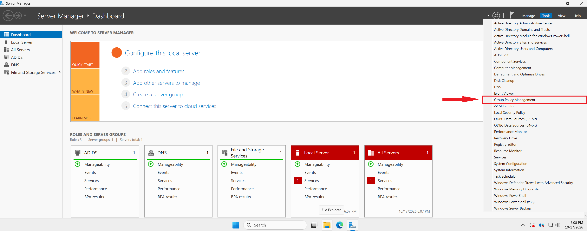

2. Expand **Forest → Domains → corp.polarizedsystems.com**, right-click **Default Domain Policy** and select **Edit**.

   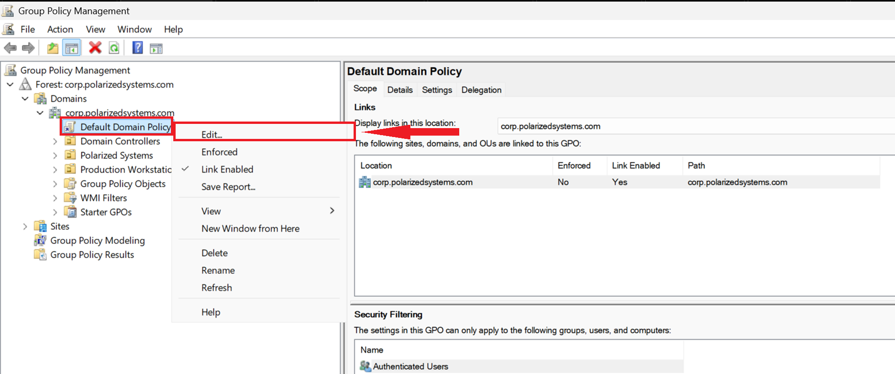

3. Navigate to **Computer Configuration → Policies → Windows Settings → Security Settings → Local Policies → Audit Policy**.

   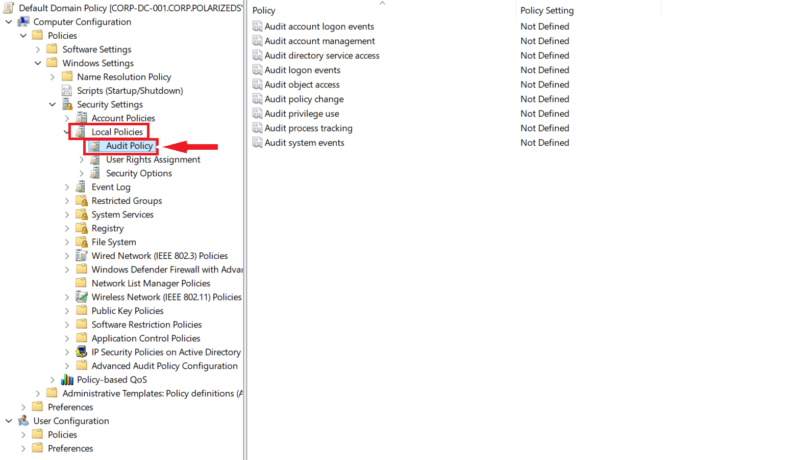

4. Right-click **Audit logon events** and select **Properties**.

   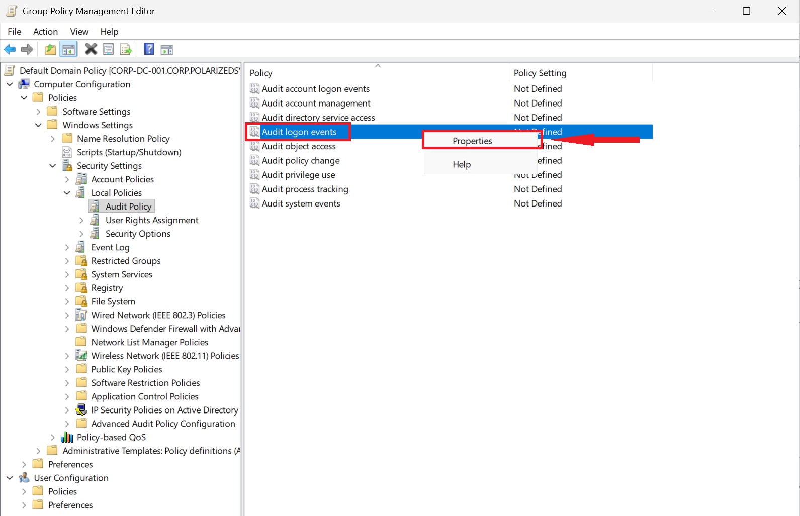

5. Tick **Define these policy settings**, then check both **Success** and **Failure**, and click **OK**.

   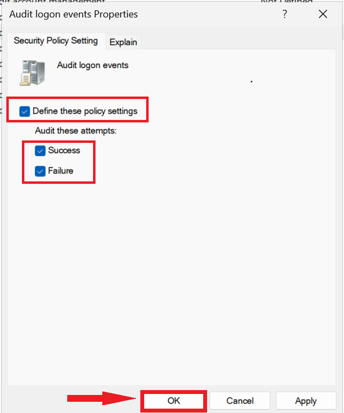


6. Under **Account Policies → Account Lockout Policy**, open **Account lockout threshold**.

   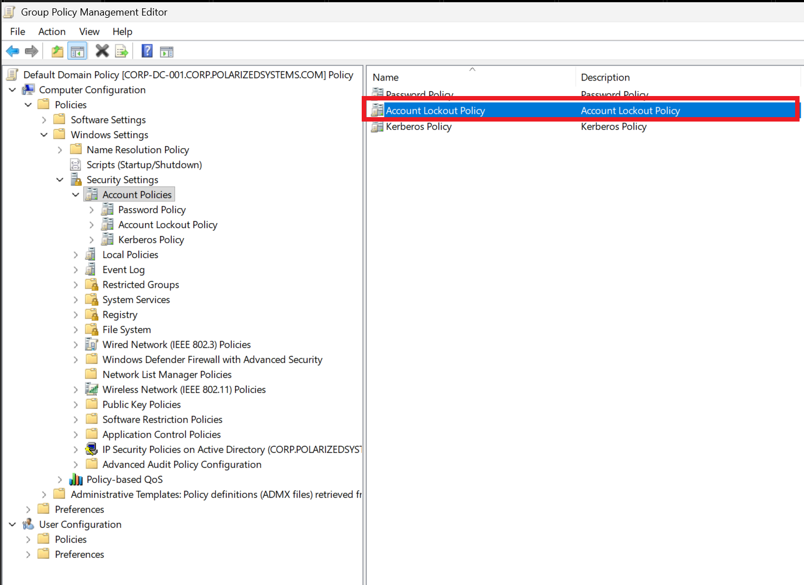

7. Tick **Define this policy setting**, set the account to lock after **4 invalid logon attempts**, and click **OK** (accepting the suggested lockout-duration values).

   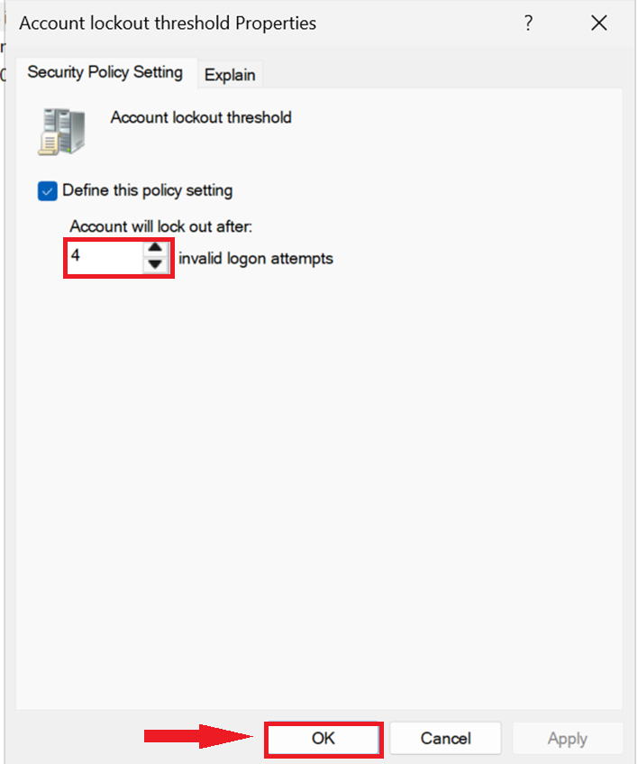


8. Close the editor and, in an elevated **PowerShell** window, apply the policy immediately:

   ```powershell
   gpupdate /force
   ```

   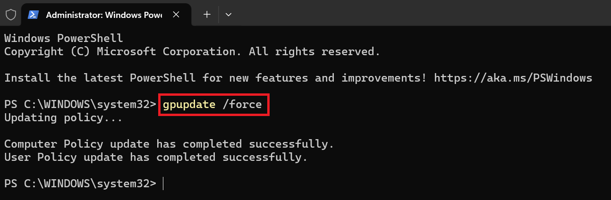

   *Group Policy normally refreshes on a timer; `gpupdate /force` reapplies it now so the new audit settings take effect without waiting.*

---

## Task 2 – Generate Failed Logons for Detection Testing

To confirm the auditing actually works, I generated real failed-logon events from the isolated **soc-kali-001** host. This is deliberate detection testing — producing the exact telemetry an attacker would, in a controlled way, so I can verify it is captured.

1. On **soc-kali-001**, create the attack script with `nano`:

   ```bash
   nano generate-test-logins.sh
   ```

   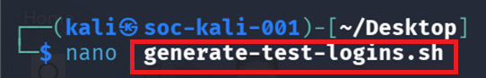

2. The script loops through a series of wrong passwords against the Domain Controller's SMB service:

   ```bash
   #!/bin/bash
   for i in $(seq 15); do
       smbclient -L //192.168.20.2 -U "testuser%WrongPassword$i" 2>/dev/null
   done
   ```

   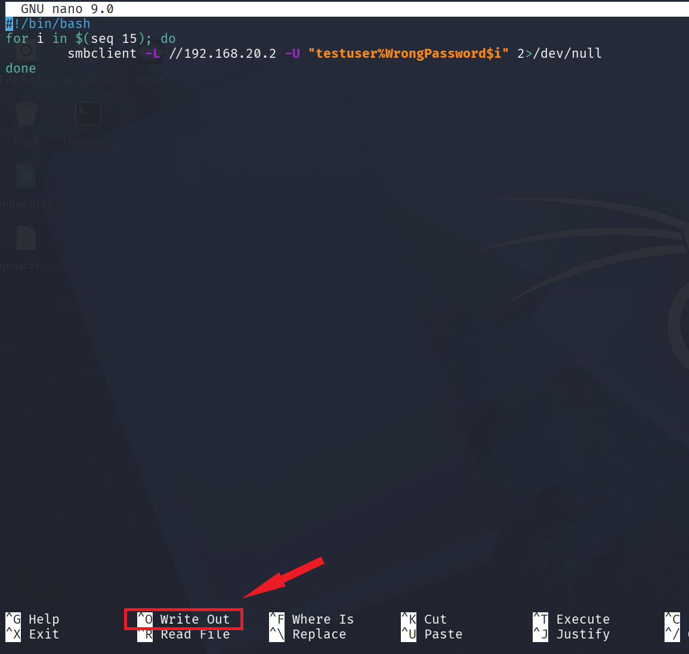

   *Each loop asks the DC's file-sharing service to authenticate as `testuser` with a wrong password. Every rejection is logged on the DC as Event ID 4625. The full script is in [`scripts/generate-test-logins.sh`](../scripts/generate-test-logins.sh).*

3. Make the script executable:

   ```bash
   chmod +x generate-test-logins.sh
   ```

   

4. Run it. Each attempt returns **`NT_STATUS_LOGON_FAILURE`** — the expected, successful result of a detection test, because every rejected logon is one more 4625 event for the hunt to find:

   ```bash
   sudo ./generate-test-logins.sh
   ```

   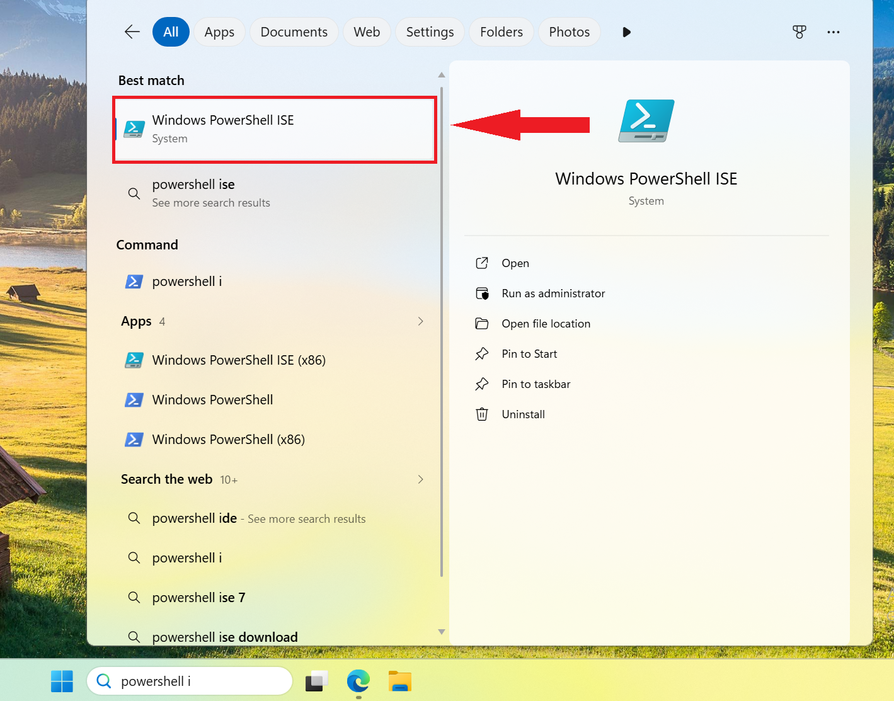

---

## Task 3 – Hunt the Failed Logons with PowerShell

1. On **corp-dc-001**, open **Windows PowerShell ISE** as Administrator and enter the hunting script in the editor pane:

   ```powershell
   Get-WinEvent -ComputerName corp-dc-001 -MaxEvents 100 -FilterHashtable @{
   LogName = "Security"
   ID = (4625)
   StartTime=((Get-Date).AddDays(-1))} |
   Out-GridView
   ```

   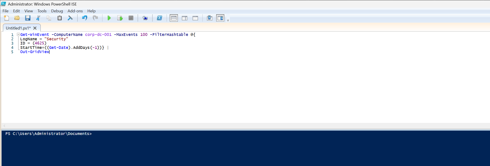

> ### Reading the script
> | Element | What it does |
> |---------|--------------|
> | `Get-WinEvent` | Reads the Windows event logs |
> | `-ComputerName corp-dc-001` | Which host's logs to read (local or remote) |
> | `-MaxEvents 100` | Caps the result at the 100 most recent matches, keeping it fast |
> | `-FilterHashtable @{…}` | Filters **at the source** so only wanted events are returned |
> | `LogName = "Security"` | Logons are recorded in the Security log |
> | `ID = (4625)` | Return only failed-logon events |
> | `StartTime=((Get-Date).AddDays(-1))` | Only the last 24 hours |
> | `Out-GridView` | Displays the results in a sortable, filterable grid window |
>
> Filtering with a hashtable is deliberate: on a busy Domain Controller the Security log holds hundreds of thousands of events, and filtering *as the log is read* is far faster than pulling everything and filtering afterward.

2. Save the script as **Monitor-FailedLogons.ps1** in the Documents folder (**File → Save As**).

   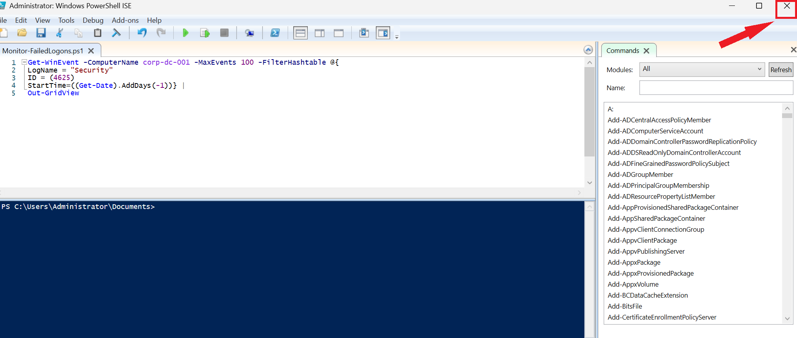

3. Run the script with the green **Run** button (or **F5**).

   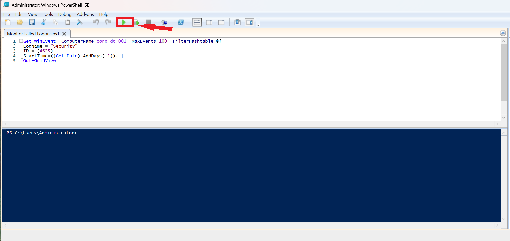

4. The grid opens with the failed logons generated from Kali — each one **Event ID 4625**, seconds apart, with **Logon Type 3**.

   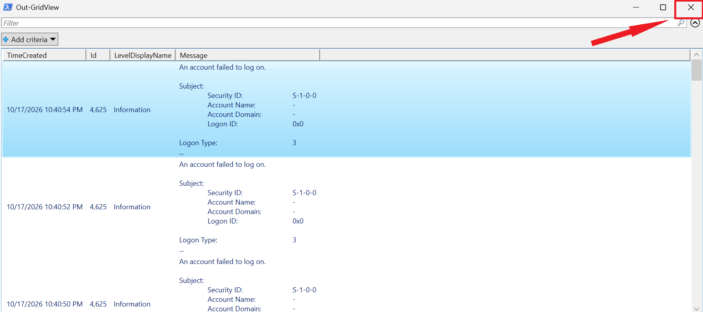

---

## Task 4 – Enable Remote Log Collection

Running the hunt directly on the Domain Controller works, but in production an analyst collects logs *remotely* from a workstation so they never have to log in to the server being monitored. That requires opening the right firewall rule on the host whose logs are being read.

1. On the Domain Controller, open **Windows Defender Firewall** and select **Allow an app or feature through Windows Defender Firewall**. The **Domain** profile is the active, connected network (`corp.polarizedsystems.com`).

   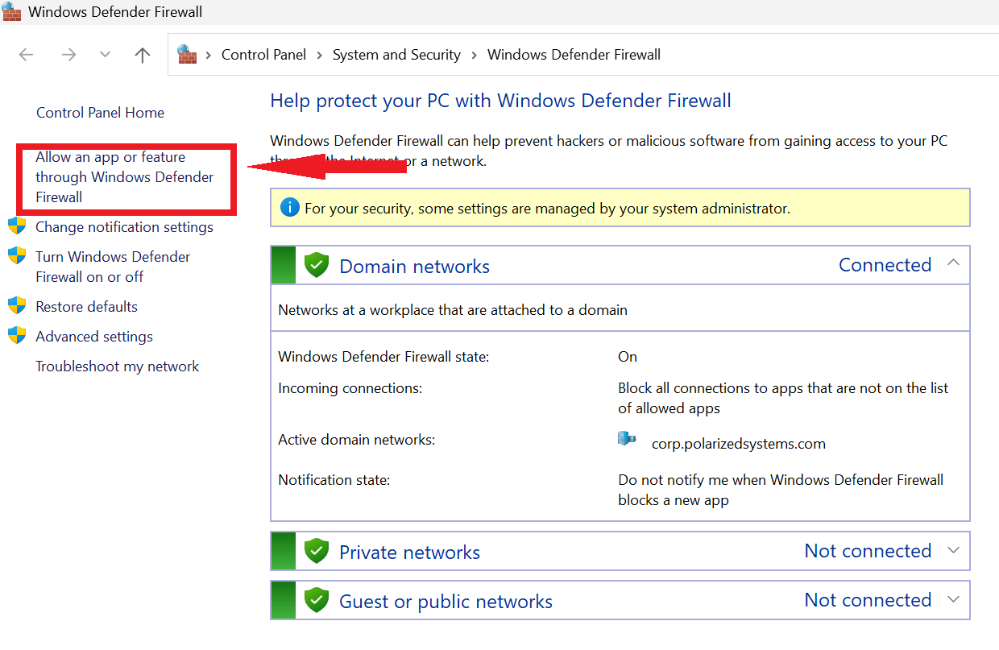

2. Enable **Remote Event Log Management** and **Remote Event Monitor** for the **Domain** profile, then click **OK**.

   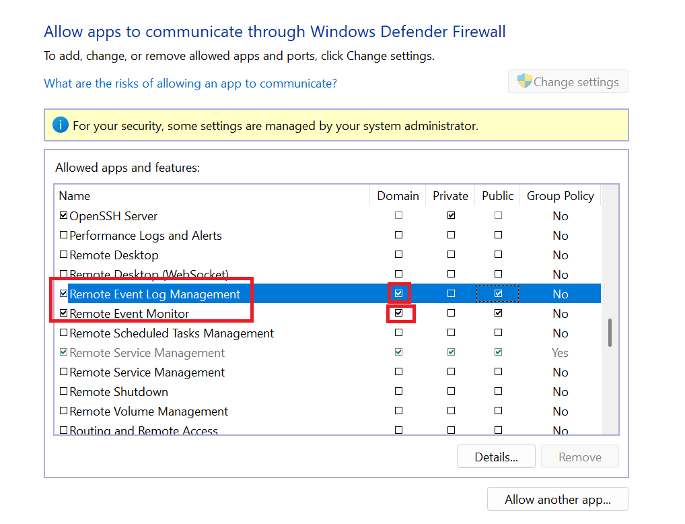

> ### Why this enables centralized monitoring
> By default a server's firewall blocks the remote procedure calls that `Get-WinEvent -ComputerName` relies on. Enabling **Remote Event Log Management** on the **Domain** profile permits trusted, domain-joined hosts to read the server's event log across the network, which is the foundation of centralized monitoring — one analyst console, or a SIEM, pulling from many servers at once instead of logging into each. It is scoped to the Domain profile on purpose: the exception applies on the trusted corporate network, not on public or untrusted networks.
>

---

 Key Findings & Security Outcomes:
>
 - **Security Auditing:** Enabled Windows logon auditing through Group Policy to capture and monitor authentication activity.
 - **Preventive Controls:** Implemented account lockout policies to reduce exposure to brute-force password attacks.
 - **Threat Detection:** Successfully identified 15 failed authentication attempts within Windows Security Event Logs, demonstrating visibility into suspicious network activity.
 - **PowerShell Automation:** Developed a script to retrieve and analyze failed logon events (Event ID `4625`), improving the efficiency of security investigations.
 - **Operational Value:** Established a foundation for centralized authentication monitoring and more efficient incident detection across Windows infrastructure.
>
> **Combining preventive security controls with automated log analysis improves threat visibility, reduces manual investigation efforts, and supports faster identification of potential unauthorized access attempts**

---

[← Back to Lab Overview](../README.md) | [Next: Exercise 2 – Monitor Login Events on Linux →](../exercise-2-monitor-linux-login-events/README.md)
