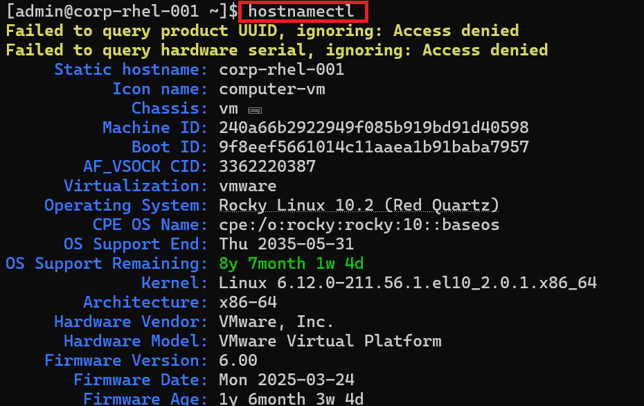
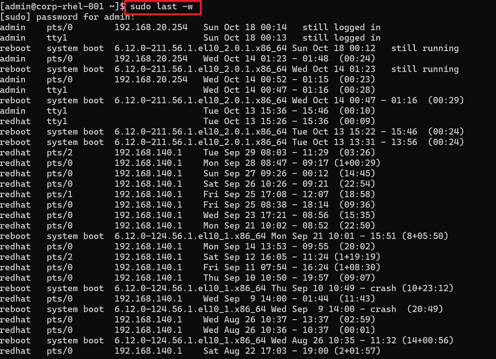
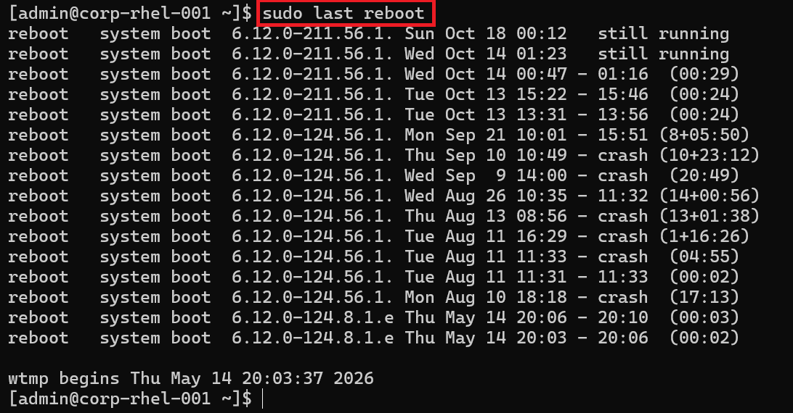
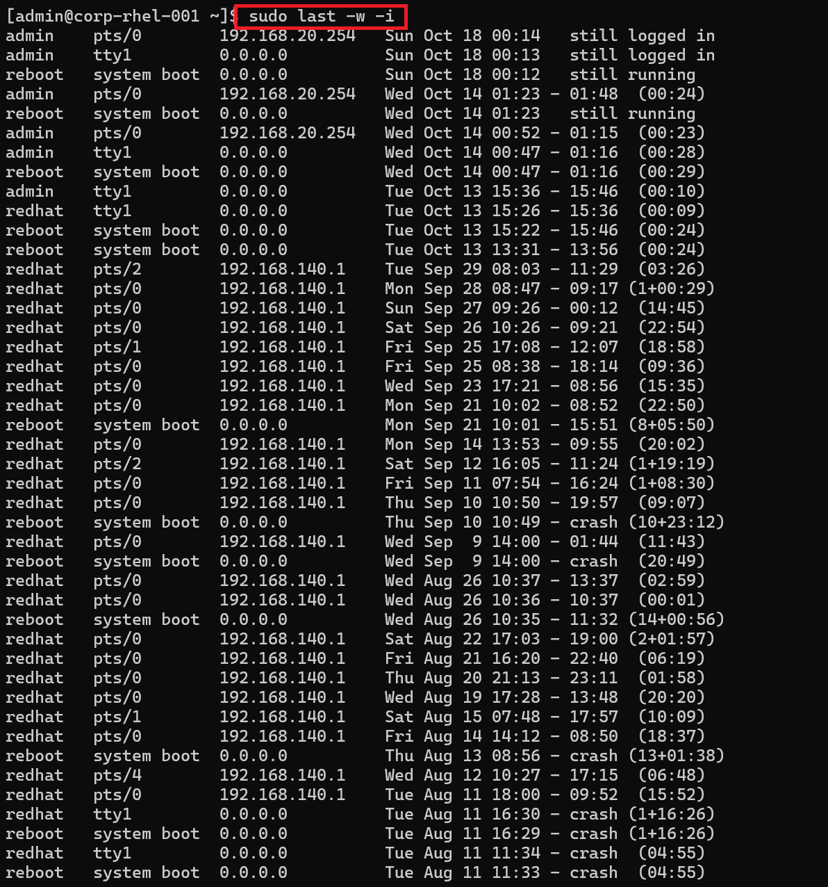
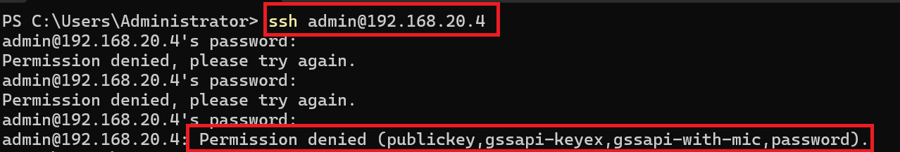
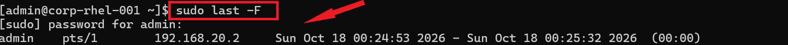
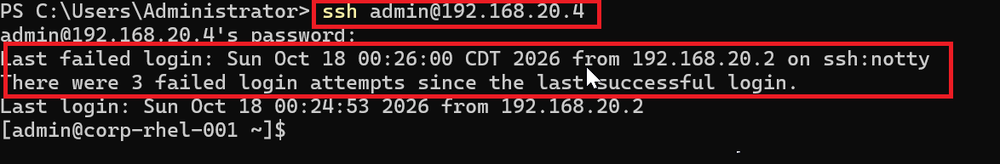
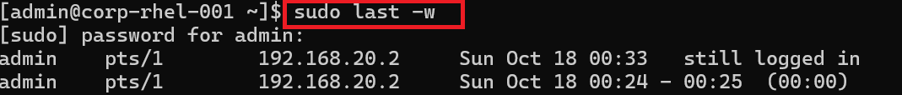

# Exercise 2 – Monitor Login Events on Linux Devices

[← Back to Lab Overview](../README.md)

---

## Overview

Lets take a look at Linux authentication monitoring and security log analysis.
The 'Last' utility allow administrators to view user login history, failed authentication attempts, and system reboot logs. 
This helps identify unusual activity and potential security threats.


## Devices

- **corp-rhel-001** – Rocky Linux 10 – login-monitoring target (192.168.20.4)
- **corp-dc-001** – Windows Server – source of the simulated SSH attack (192.168.20.2)

---

## Task 1 – Review Login and Reboot History

1. On **corp-rhel-001**, confirm the host with `hostnamectl` — a Rocky Linux 10 virtual machine.

   ```bash
   hostnamectl
   ```

   

2. List the login history, full width so no names are truncated:

   ```bash
   sudo last -w
   ```

   

   *Each row is a session: the account, the terminal, the source, and the start/stop time. `admin` sessions on `tty1` are local console logins; sessions on `pts/0` with an IP address are remote. The historical `redhat` logins from `192.168.140.1` show this host's earlier life — exactly the kind of leftover access an analyst reviews.*


3. Show just the reboot history:

   ```bash
   sudo last reboot
   ```

   

   *Each line is a system boot. An unexpected reboot can mean a crash, maintenance — or an attacker forcing a restart, so an unexplained entry here is worth investigating.*

4. Show the login history again, this time resolving the **source IP** of every session:

   ```bash
   sudo last -w -i
   ```

   

   *The `-i` flag prints numeric IPs instead of hostnames. Local console logins show `0.0.0.0`; remote sessions show the real address they came from — the detail you need to decide whether a login was legitimate.*

---

## Task 2 – Simulate and Detect an SSH Brute-Force Attack

With a baseline of normal activity established, I generated an attack from **corp-dc-001** and confirmed it surfaced in the Linux records.

1. From **corp-dc-001**, attempt to SSH into the Rocky server with wrong passwords. After three failures OpenSSH refuses the connection:

   ```
   ssh admin@192.168.20.4
   ```

   

   *Three `Permission denied` responses, then the connection is closed — the server-side defense (`MaxAuthTries`) cutting off a password-guessing attempt.*

2. Back on **corp-rhel-001**, show the full timestamps of the most recent session with `last -F`:

   ```bash
   sudo last -F
   ```

   

   *`-F` prints complete login and logout times. The remote session from `192.168.20.2` is recorded to the second — precise enough to correlate against other logs during an investigation.*

3. Now SSH in from **corp-dc-001** with the **correct** password. The login succeeds, and the server's own login banner reports the attack:

   ```
   ssh admin@192.168.20.4
   ```

   

   > **The system reports the attack itself:** *"Last failed login: Sun Oct 18 00:26:00 … from 192.168.20.2 … There were 3 failed login attempts since the last successful login."*


4. Confirm the intruder's session in the login history. The attacker — now using valid credentials from `192.168.20.2` — is **still logged in**:

   ```bash
   sudo last -w
   ```

   

   *A `pts/1` session from `192.168.20.2` marked **still logged in**: a remote user on the box right now. In a real incident this is where containment begins — verify the session is unauthorized, terminate it, rotate the credential, and investigate what the account did while connected.*

---

> **Effective security monitoring begins with visibility into existing system logs. Regular authentication log analysis enables security teams to identify suspicious access patterns, investigate potential unauthorized activity, and strengthen incident detection capabilities across enterprise Linux infrastructure.**

---

[← Previous: Exercise 1 – Monitor Windows Event Logs](../exercise-1-monitor-windows-event-logs/README.md) | [Back to Lab Overview](../README.md)
