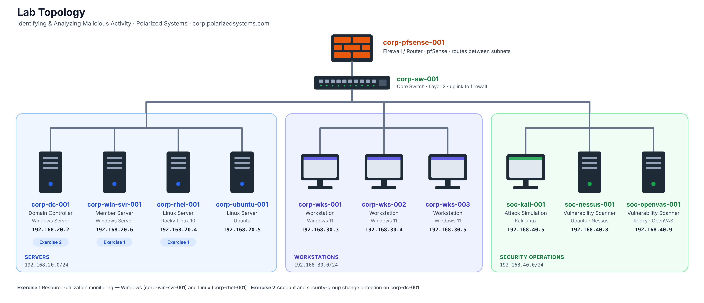

# Identifying & Analyzing Malicious Activity

[← Back to Security Operations](../README.md)

**Domain:** Security Operations
**Environment:** Polarized Systems lab — Windows Active Directory domain (`corp.polarizedsystems.com`) with a Windows member server, a Rocky Linux server, and a Domain Controller

---

## Overview

Attackers don't always break down the door — often they blend in, consuming resources or quietly escalating privileges with legitimate-looking accounts. This lab builds the analyst skills to catch both: reading a system's resource utilization to spot abnormal load, and auditing Active Directory so that privilege escalation leaves a trail.

Across two exercises I monitored live resource usage on Windows and Linux, then configured auditing on the Domain Controller and proved it by simulating a classic attack — adding a newly created user straight into **Domain Admins** — and detecting it in the event log.

- **Exercise 1 — Analyze Resource Utilization:** Inspected processes, CPU, memory, I/O and devices on a Windows member server with Sysinternals Process Explorer, then monitored a Linux server with `top` and `htop`.
- **Exercise 2 — Analyze Account & Group Management:** Enabled Security Group Management auditing with Group Policy, created a test user and escalated it to Domain Admins, then detected the change through Event IDs **4728** and **4737**.

---

## Lab Topology

---

## Learning Outcomes

By the end of this lab, I was able to:

- Monitor Windows processes and resource utilization with Sysinternals Process Explorer
- Interpret CPU, memory, I/O and device activity to establish a baseline and spot anomalies
- Monitor Linux resource utilization with `top` and the interactive `htop`
- Add a third-party repository (EPEL) to install tooling on an enterprise Linux server
- Enable Security Group Management auditing across a domain with Group Policy
- Recognize privilege-escalation activity through Windows Event IDs 4728 and 4737
- Trace a group change back to the account and source that performed it

---

## Lab Environment

| Hostname | IP Address | Operating System | Role in this lab |
|----------|-----------|------------------|------------------|
| `corp-pfsense-001` | — | pfSense | Firewall / router between subnets |
| `corp-sw-001` | — | — | Core switch |
| `corp-dc-001` | 192.168.20.2 | Windows Server | Domain Controller — auditing and event analysis (Ex 2) |
| `corp-win-svr-001` | 192.168.20.6 | Windows Server | Member server — Windows resource monitoring (Ex 1) |
| `corp-rhel-001` | 192.168.20.4 | Rocky Linux 10 | Linux resource monitoring target (Ex 1) |

---

## Exercises

| # | Exercise | Platform | Key Tools |
|---|----------|----------|-----------|
| 1 | [Analyze Resource Utilization](exercise-1-analyze-resource-utilization/README.md) | Windows + Linux | Process Explorer · System Information · `top` · `htop` · EPEL |
| 2 | [Analyze Account & Group Management](exercise-2-analyze-account-and-group-management/README.md) | Windows | Group Policy · Advanced Audit Policy · Active Directory Users and Computers · Event Viewer |

---

## Review

### Summary

In this lab I completed two exercises:

- Exercise 1 — Analyze Resource Utilization
- Exercise 2 — Analyze Account & Group Management

Together they cover both halves of identifying malicious activity: watching how a system *behaves* (resource load) and watching what *changes* inside it (privileged group membership), then proving the detection works by generating the activity and finding it.

### Skills Demonstrated

- Windows process and resource analysis with Sysinternals Process Explorer
- Cross-platform resource monitoring with `top` and `htop`
- Enterprise Linux package management, including enabling the EPEL repository
- Domain-wide audit configuration with Group Policy (Advanced Audit Policy)
- Detecting and attributing privilege escalation through Event IDs 4728 and 4737
