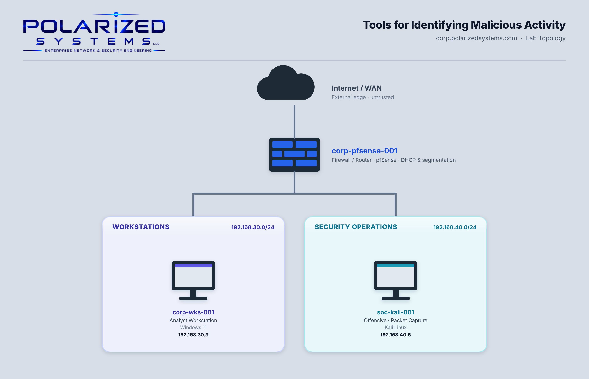

# Tools for Identifying Malicious Activity

[← Back to Security Operations](../README.md)

**Domain:** Security Operations
**Environment:** Polarized Systems lab — a Kali Linux analysis workstation on the Security Operations subnet, a Windows 11 workstation, and internet-based threat-intelligence services

---

## Overview

Identifying malicious activity comes down to two questions: *what is actually crossing my network,* and *can I trust the domains and addresses my systems are talking to?* This lab builds hands-on skill with the core tools that answer both. I captured and analyzed live network traffic with Wireshark and tcpdump, then validated domains and IP addresses against public threat-intelligence services.

- **Exercise 1 — Monitoring Network Activity:** Captured live traffic on Kali Linux with Wireshark, customized the display to surface destination addresses and ports, applied display filters to isolate specific conversations, then captured ICMP and HTTP traffic from the command line with tcpdump and analyzed the saved captures.
- **Exercise 2 — Validating Domain Names & IP Addresses:** Used WHOIS, AbuseIPDB and VirusTotal to research domain ownership, check IP addresses for a history of abuse, and scan URLs and addresses for malicious reputation.

> 🔎 **A packet never lies, but a reputation can be bought.** Traffic analysis and reputation lookups answer different halves of the same question and cover each other's blind spots. Capturing packets shows exactly what a host is doing right now, but not whether the destination is hostile; threat-intelligence services reveal a domain's history, but not what your systems are doing with it this moment. An analyst who leans on only one will eventually be fooled — by a clean reputation on a brand-new malicious domain, or by suspicious-looking traffic to a perfectly legitimate service.

---

## Lab Topology

---

## Learning Outcomes

By the end of this lab, I was able to:

- Capture and analyze live network traffic with Wireshark
- Customize Wireshark columns and time display to highlight the fields that matter for threat hunting
- Write display filters to isolate traffic by port, host and subnet
- Capture targeted traffic from the command line with tcpdump and save it to a file
- Analyze saved packet captures (`.pcap`) in Wireshark
- Research domain ownership and registration with WHOIS
- Check IP addresses for a history of abuse with AbuseIPDB
- Scan URLs and IP addresses for malicious reputation with VirusTotal

---

## Lab Environment

| Hostname | IP Address | Operating System | Role in this lab |
|----------|-----------|------------------|------------------|
| `corp-pfsense-001` | — | pfSense | Firewall / router between subnets |
| `soc-kali-001` | 192.168.40.5 | Kali Linux | Packet capture and analysis — Wireshark, tcpdump (Ex 1) |
| `corp-wks-001` | 192.168.30.3 | Windows 11 | Traffic generation and threat-intel validation (Ex 1 + 2) |

---

## Exercises

| # | Exercise | Platform | Key Tools |
|---|----------|----------|-----------|
| 1 | [Monitoring Network Activity](exercise-1-monitoring-network-activity/README.md) | Linux | Wireshark · tcpdump · display filters · `.pcap` analysis |
| 2 | [Validating Domain Names & IP Addresses](exercise-2-validating-domains-and-ips/README.md) | Web | WHOIS · AbuseIPDB · VirusTotal |

---

## Review

### Summary

In this lab I completed two exercises:

- Exercise 1 — Monitoring Network Activity
- Exercise 2 — Validating Domain Names & IP Addresses

Together they cover the analyst's two core verification skills: reading the traffic on the wire, and checking the reputation of the domains and addresses behind it.

### Skills Demonstrated

- Live packet capture and analysis with Wireshark
- Command-line capture with tcpdump and offline `.pcap` analysis
- Building display filters to isolate suspicious conversations
- Domain and registration research with WHOIS
- IP abuse-history checks with AbuseIPDB
- URL and IP reputation scanning with VirusTotal
