# Exercise 2 – Validating Domain Names & IP Addresses

[← Back to Lab Overview](../README.md)

---

## Overview

When an alert fires on a strange domain or IP address, the first question is always *is this actually dangerous?* Answering it quickly, without touching the suspicious host, is a core analyst skill. This exercise uses three free, authoritative services to do exactly that: **WHOIS** for ownership and registration, **AbuseIPDB** for an IP's history of reported abuse, and **VirusTotal** for the reputation of a URL or address across dozens of security vendors.

> **Why validate before you act:** blocking a legitimate business partner's IP is as disruptive as missing a real attacker. These tools let an analyst make a confident, evidence-based call in seconds.

## Devices

- **corp-wks-001** – Windows 11 – Microsoft Edge (192.168.30.3)

---

## Task 1 – Research Domain Ownership with WHOIS

1. On **corp-wks-001**, open **Microsoft Edge**.

   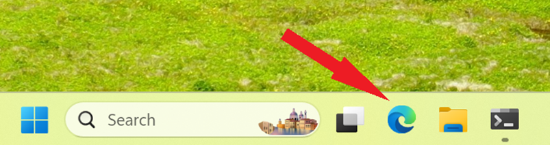

2. Browse to the WHOIS lookup service:

   ```
   https://www.whois.com/whois/
   ```

   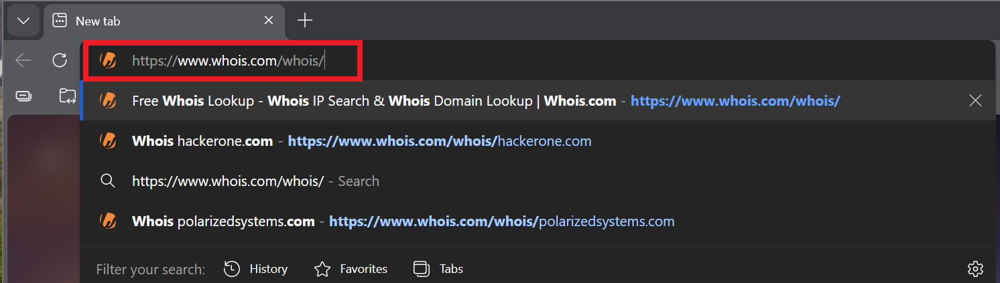

3. Search a domain — here, the bug-bounty platform `bugcrowd.com`.

   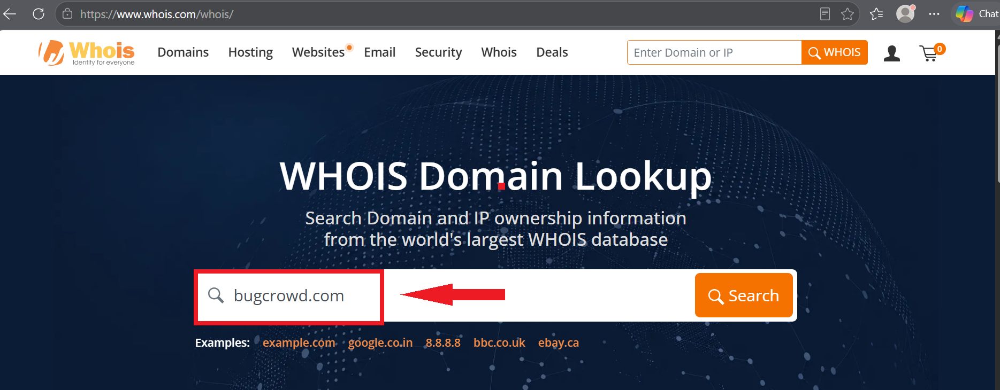

4. The record shows registration date (2012-09-01), registrar (Gandi SAS), name servers (AWS) and status **client transfer prohibited**.

   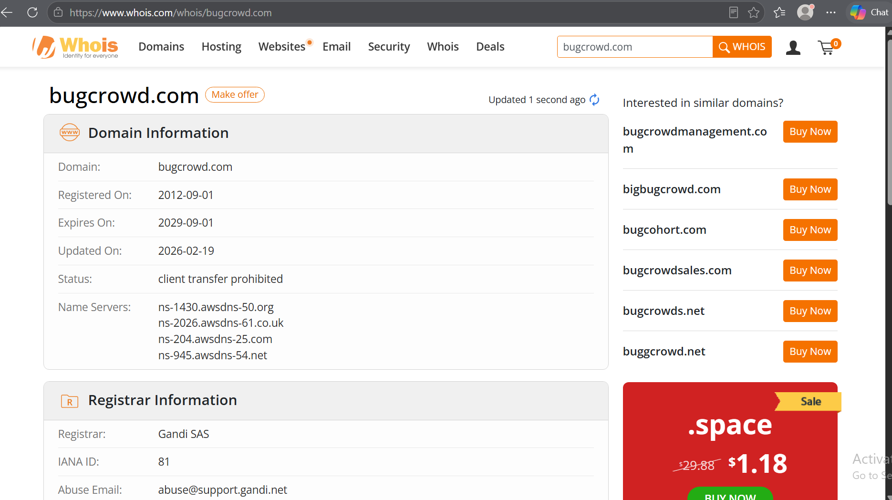

5. A second lookup on `hackerone.com` shows an older registration (2007-11-26), Cloudflare as registrar, and **six "prohibited" status flags**.

   > ### 🔎 Reading a WHOIS record
   > The fields tell a story about how seriously a domain is managed. **Registration age** — a domain registered yesterday is far more suspicious than one that's been live for years. **Registrar and name servers** reveal the hosting provider. And the **status flags**: a stack of `clientTransferProhibited` / `serverUpdateProhibited` locks means a **registry lock** — a strong control that stops attackers from hijacking the domain. A brand-new domain with privacy-hidden ownership and no locks is a classic phishing setup.

   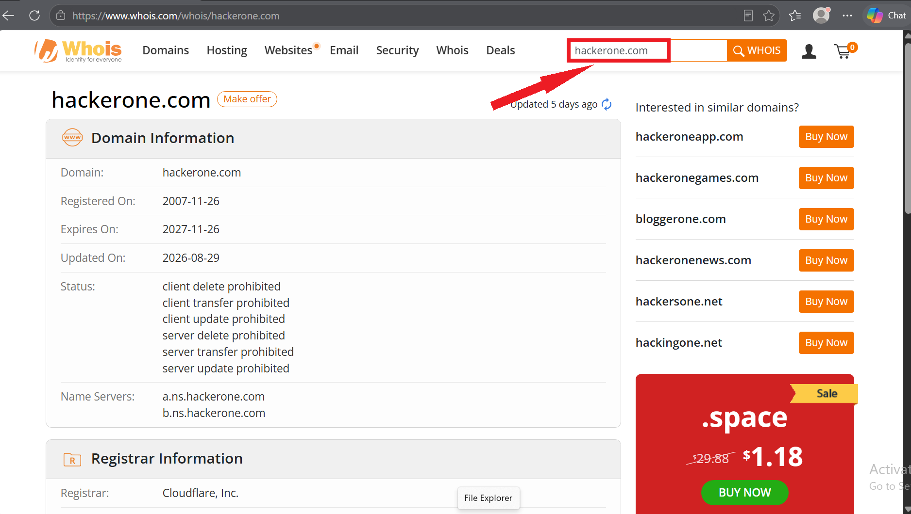

6. The full bugcrowd record, including registrar IANA ID and abuse contact.

   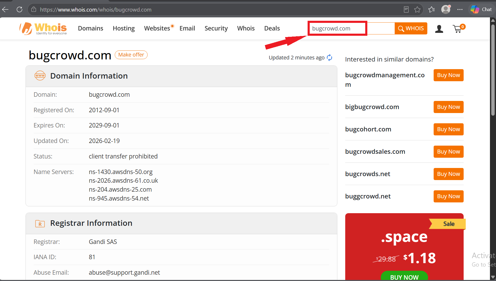

---

## Task 2 – Check IP Abuse History with AbuseIPDB

7. Browse to AbuseIPDB, a crowdsourced database of IP addresses reported for malicious activity:

   ```
   https://www.abuseipdb.com
   ```

   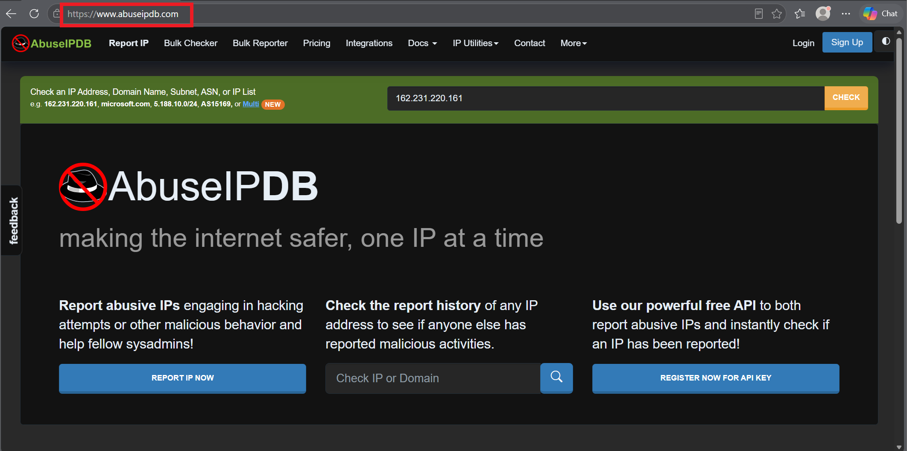

8. Checking an address returns its abuse profile. This IP resolves to a **Cloudflare** content-delivery address and is on AbuseIPDB's **whitelist** — flagged as a trusted reverse proxy, with no abuse reports.

   > ### 🔎 Confidence of Abuse — and whitelists
   > AbuseIPDB scores each IP with a **Confidence of Abuse** percentage based on community reports. **0% with zero reports** means no one has flagged it. The **whitelist note** matters too: large shared providers like Cloudflare, Google and Microsoft front millions of legitimate sites, so their addresses are trusted by default — but the same infrastructure can also host abuse, so the guidance is to weigh the *specific* activity, not just the owner.

   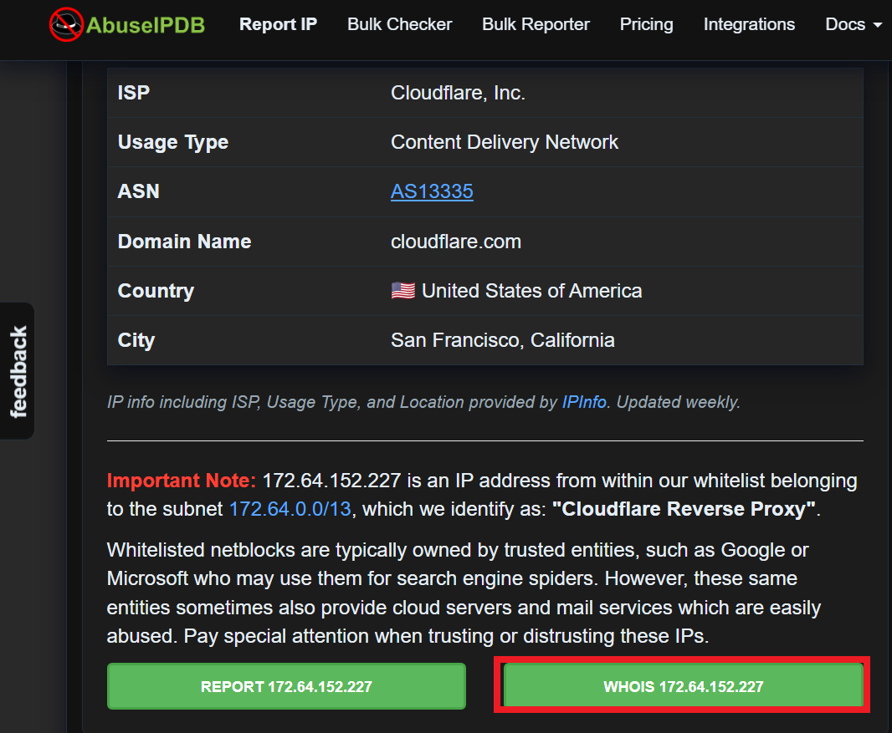

9. AbuseIPDB links straight to a WHOIS lookup for the same address, tying ownership to reputation in one place.

   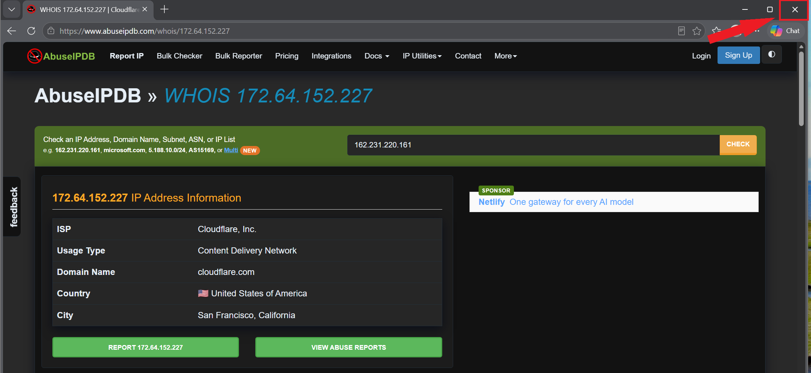

---

## Task 3 – Scan Reputation with VirusTotal

10. Browse to VirusTotal, which checks files, URLs, domains and IPs against 90+ security vendors at once:

    ```
    https://www.virustotal.com
    ```

    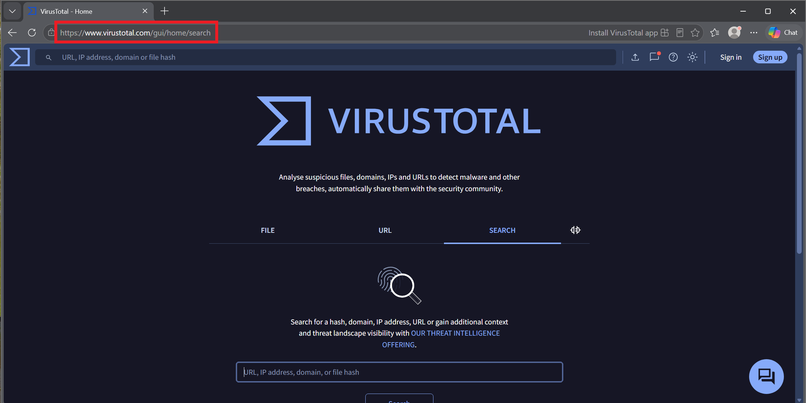

11. Select the **Search** tab to look up an existing indicator.

    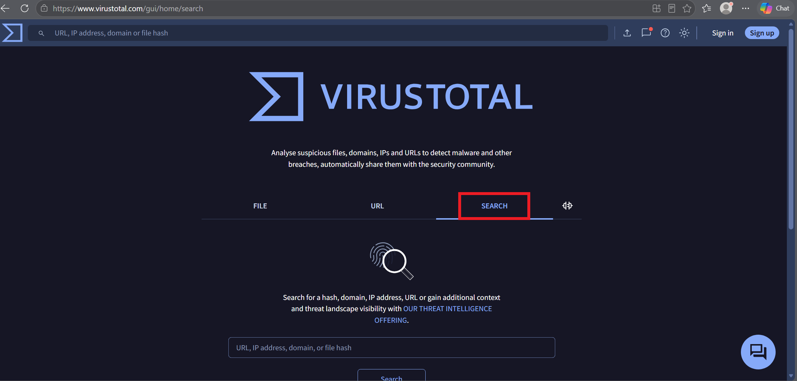

12. Search an IP address.

    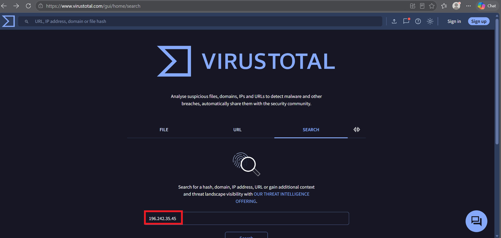

13. The result shows **0 / 92 vendors flagged** the address as malicious — a clean verdict, with the owning network (AS 37518) and location.

    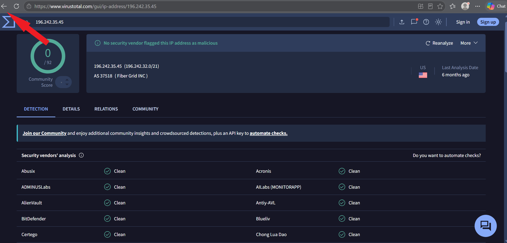

14. Switch to the **URL** tab to scan a full web address.

    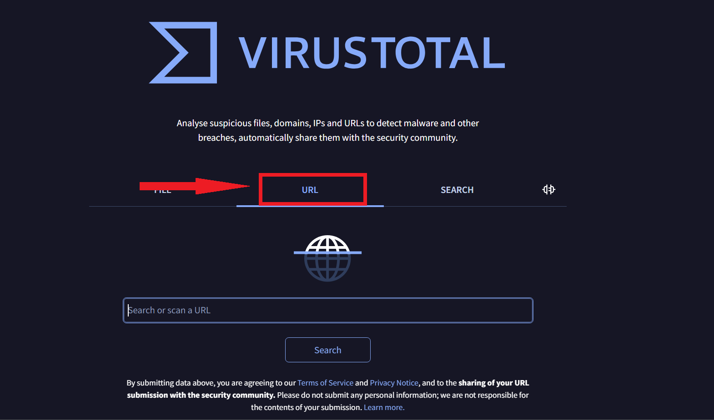

15. Enter a URL to scan — `https://www.bugcrowd.com/`.

    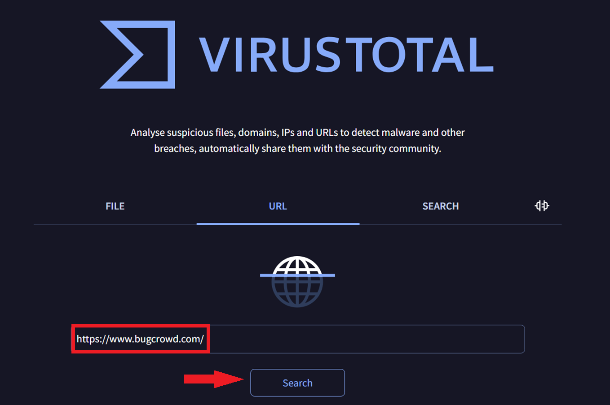

16. The URL report returns **0 / 93 vendors**, an HTTP 200 status, and the categories vendors assign it (information technology, technology).

    > ### 🔎 Reading a VirusTotal verdict
    > The score is **detections over total vendors** — `0/93` means every engine considers it clean, while even `2/93` is worth a closer look, since a handful of vendors often catch a threat first. VirusTotal also surfaces context an analyst uses: the content type, redirects, categories and when it was last analyzed. One caveat — a *clean* result isn't a guarantee of safety for a brand-new malicious site that nobody has reported yet, so VirusTotal is one strong input, not the only one.

    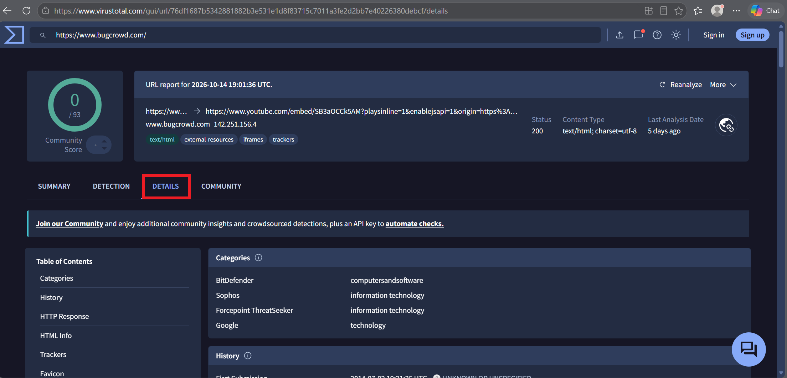

17. The full URL report, including the detection score, redirect chain and category breakdown.

    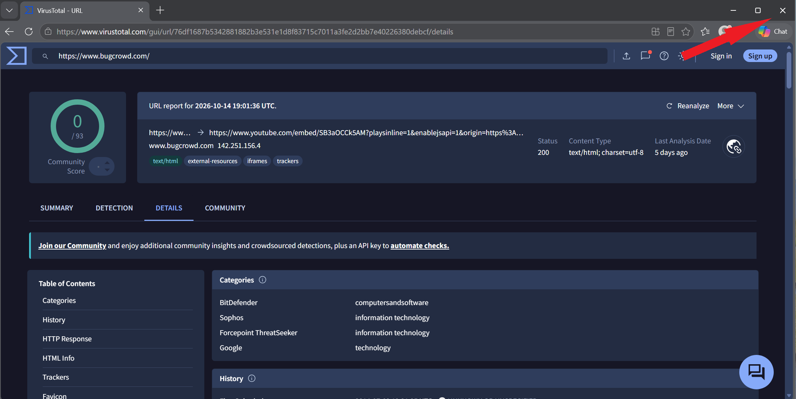

> ### 🔎 Three tools, three questions
> | Tool | Answers | Best for |
> |------|---------|----------|
> | **WHOIS** | Who owns this domain, and how long has it existed? | Spotting newly registered or anonymously owned domains |
> | **AbuseIPDB** | Has this IP been reported for attacks before? | Checking an address's community abuse history |
> | **VirusTotal** | Do security vendors consider this malicious? | A broad reputation check across 90+ engines |
>
> Used together they triangulate a verdict: a young domain (WHOIS) on an IP with abuse reports (AbuseIPDB) that several vendors already flag (VirusTotal) is one you block with confidence.

---

> ### 🎤 Stakeholder Takeaway
>
> "When something suspicious shows up — a strange link in an email, an unfamiliar address in our logs — we can verify whether it's actually dangerous in seconds, without ever touching it. We check who owns the domain and how long it's existed, whether the address has a history of attacks, and whether security vendors across the industry consider it malicious. That means fewer false alarms, faster decisions, and the confidence to block a real threat or clear a harmless one without guessing."

---

[← Previous: Exercise 1 – Monitoring Network Activity](../exercise-1-monitoring-network-activity/README.md) | [Back to Lab Overview](../README.md)
