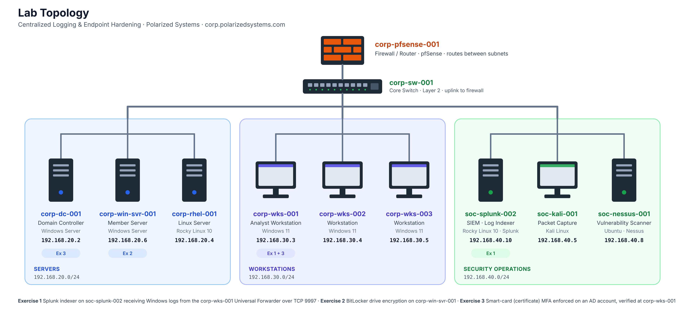

# Centralized Logging & Endpoint Hardening

[← Back to Security Operations](../README.md)

**Domain:** Security Operations
**Environment:** Polarized Systems lab — a Splunk SIEM on an enterprise Linux server, a Windows Universal Forwarder endpoint, a Windows member server, and an Active Directory domain controller

---

## Overview

Detection is only as good as the data behind it — and the data is only useful if it is *collected centrally*, *trustworthy*, and *protected*. This lab builds all three. I stood up a **Splunk Enterprise SIEM on enterprise Linux** for centralized log collection, then layered on two core endpoint-hardening controls: **BitLocker drive encryption** to protect sensitive data at rest, and **smart-card-required multi-factor authentication** to protect the accounts that access it.

- **Exercise 1 — Deploy Splunk Enterprise on Linux:** Installed Splunk Enterprise on Rocky Linux as a `systemd`-managed service, enabled receiving on TCP 9997, deployed a Universal Forwarder on a Windows endpoint, and confirmed Windows Security, System and Application logs flowing into Splunk and searchable in real time.
- **Exercise 2 — Encrypting Sensitive Data:** Installed the BitLocker Drive Encryption feature on a Windows member server and encrypted a dedicated data volume with password unlock and an escrowed recovery key.
- **Exercise 3 — Enabling Multi-Factor Authentication:** Created an Active Directory user and enforced smart-card (certificate-based) MFA, then demonstrated the control refusing single-factor password logon at the workstation.

---

## Lab Topology

---

## Learning Outcomes

By the end of this lab, I was able to:

- Install and configure Splunk Enterprise for centralized log collection on enterprise Linux
- Run Splunk as a hardened `systemd` service under a dedicated least-privilege account
- Manage the host firewall (`firewalld`) to expose only the required ports (8000, 9997)
- Deploy and configure a Splunk Universal Forwarder on a Windows endpoint
- Confirm and troubleshoot forwarder-to-indexer data flow using Splunk's own `_internal` index and SPL searches
- Install BitLocker Drive Encryption and encrypt a data volume to protect data at rest
- Create Active Directory users and enforce smart-card-required multi-factor authentication
- Verify that an enforced MFA control actually blocks single-factor logon

---

## Lab Environment

| Hostname | IP Address | Operating System | Role in this lab |
|----------|-----------|------------------|------------------|
| `corp-pfsense-001` | — | pfSense | Firewall / router between subnets |
| `corp-sw-001` | — | — | Core switch |
| `soc-splunk-002` | 192.168.40.10 | Rocky Linux 10 | Splunk Enterprise indexer / SIEM (Ex 1) |
| `corp-wks-001` | 192.168.30.3 | Windows 11 | Universal Forwarder log source (Ex 1) · MFA logon test (Ex 3) |
| `corp-win-svr-001` | 192.168.20.6 | Windows Server | Member server — BitLocker data volume (Ex 2) |
| `corp-dc-001` | 192.168.20.2 | Windows Server | Domain Controller — Active Directory / MFA (Ex 3) |

---

## Exercises

| # | Exercise | Platform | Key Skills |
|---|----------|----------|-----------|
| 1 | [Deploy Splunk Enterprise on Linux](exercise-1-deploy-splunk-enterprise-on-linux/README.md) | Linux + Windows | Splunk indexer · `systemd` service · `firewalld` · Universal Forwarder · SPL verification |
| 2 | [Encrypting Sensitive Data](exercise-2-encrypting-sensitive-data/README.md) | Windows Server | BitLocker Drive Encryption · encryption at rest · recovery-key escrow |
| 3 | [Enabling Multi-Factor Authentication](exercise-3-enabling-multi-factor-authentication/README.md) | Windows / Active Directory | Smart-card (certificate) MFA · AD account hardening · control verification |

---

## Review

### Summary

In this lab I completed three exercises that together cover the full arc of *collect it, protect the data, protect the access*:

- Exercise 1 — Deploy Splunk Enterprise on Linux (centralized logging)
- Exercise 2 — Encrypting Sensitive Data (BitLocker, data at rest)
- Exercise 3 — Enabling Multi-Factor Authentication (smart-card MFA, access hardening)

Centralized logging gives the environment a single, trustworthy place to search every endpoint's events; encryption at rest ensures the data those endpoints hold is useless if the hardware is lost; and enforced MFA ensures a stolen password can't be used to reach any of it. Each control reinforces the others — and in production the hardening events themselves would feed back into the SIEM from Exercise 1.

### Skills Demonstrated

- SIEM deployment and log centralization with Splunk Enterprise on Linux
- Hardened service configuration (least-privilege account, `systemd`, minimal firewall exposure)
- Endpoint log forwarding with the Splunk Universal Forwarder
- Data-flow verification and troubleshooting with SPL
- Encryption at rest with BitLocker Drive Encryption
- Account hardening with enforced certificate-based multi-factor authentication

---

[← Back to Security Operations](../README.md)
