# Exercise 2 – Encrypting Sensitive Data with BitLocker

[← Back to Lab Overview](../README.md)

---

## Overview

As a **Cybersecurity Analyst**, protecting sensitive information is essential for maintaining data confidentiality, preventing unauthorized access, and strengthening enterprise security. Sensitive information, including **Personally Identifiable Information (PII)** and **Cardholder Data (CHD)**, requires appropriate security controls to protect it from potential exposure.

In this exercise, I implemented **Microsoft BitLocker Drive Encryption** on a Windows server within the Polarized Systems environment to protect locally stored data through drive-level encryption.

The exercise focuses on two primary objectives:

- **BitLocker Deployment:** Installed the BitLocker Drive Encryption feature on a Windows server to enable data protection capabilities.
- **Drive Encryption:** Configured BitLocker to encrypt a local server drive, protecting sensitive information stored on the volume.

This exercise demonstrated practical experience in **data encryption, Windows Server security, and data protection**, highlighting the importance of securing sensitive information at rest within enterprise infrastructure.

## Device

- **corp-win-svr-001** – Windows Server – member server hosting the sensitive data volume (192.168.20.7)

---

## Task 1 – Install the BitLocker Drive Encryption Feature

1. On **corp-win-svr-001**, open **Server Manager → Manage → Add Roles and Features**.

   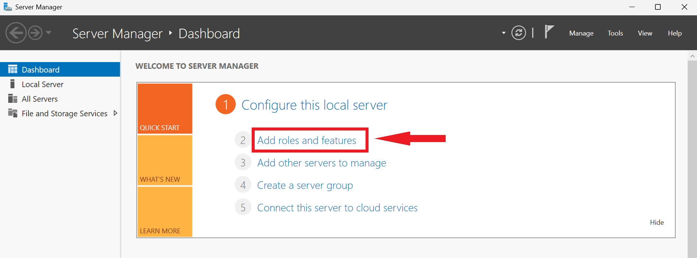

2. Click **Next** past *Before You Begin*.

   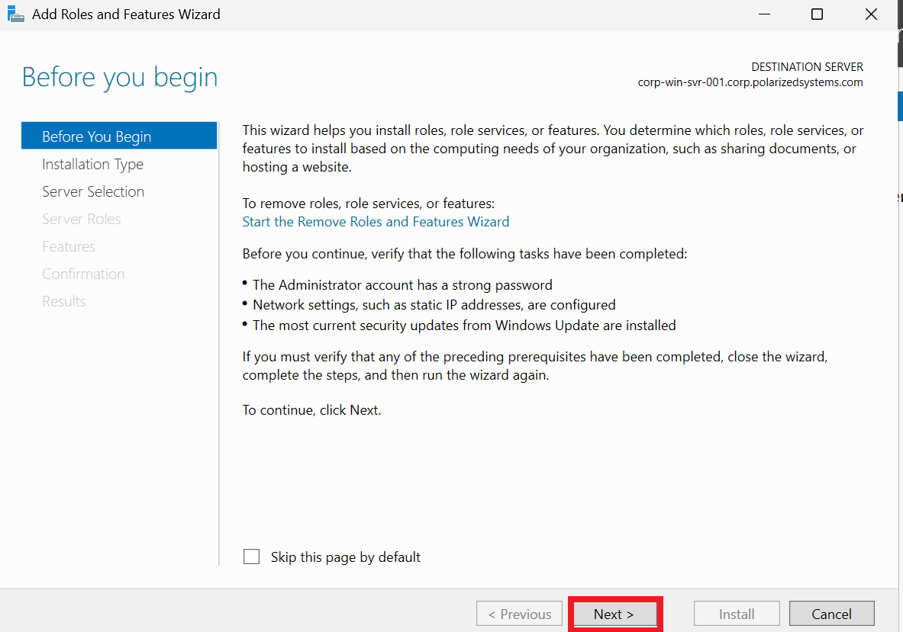

3. Select **Role-based or feature-based installation** and continue.

   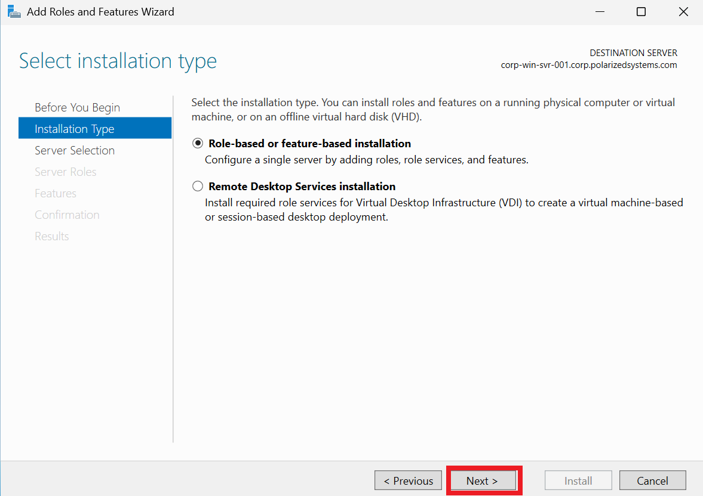

4. On the **Features** list, tick **BitLocker Drive Encryption**. A prompt appears for the required management tools — click **Add Features**.

   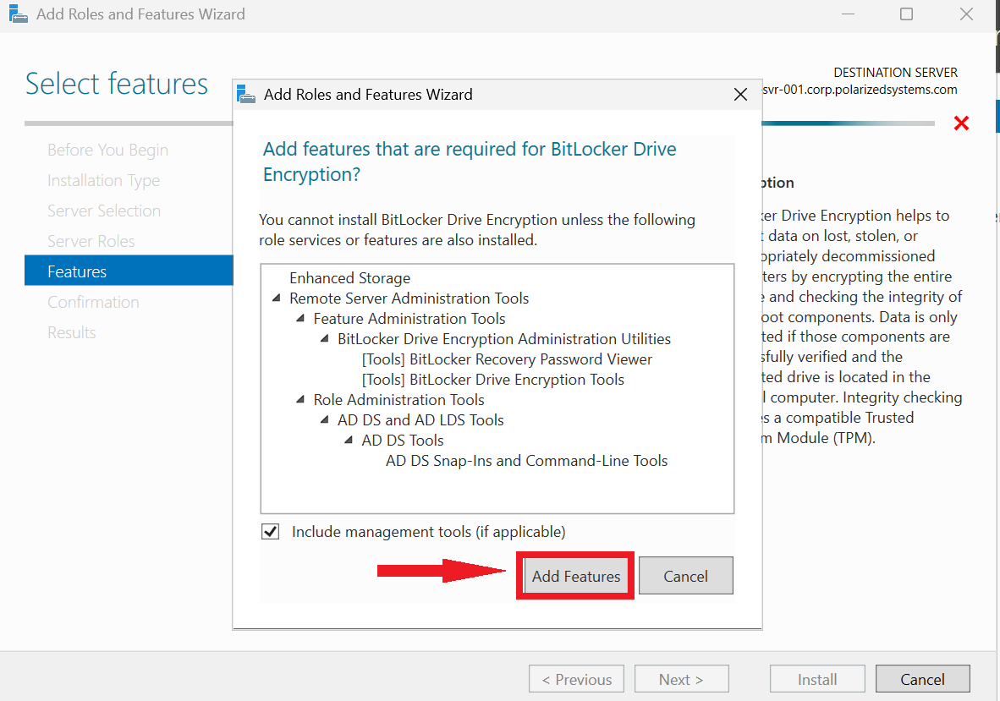

5. With **BitLocker Drive Encryption** selected, continue.

   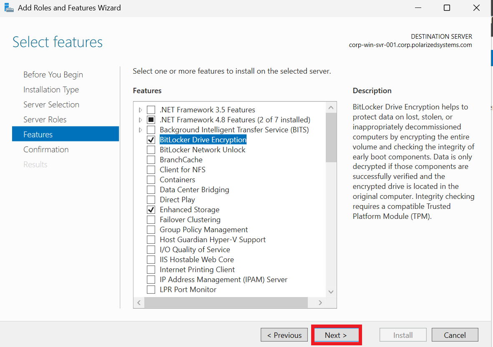

6. Review the confirmation and click **Install**.

   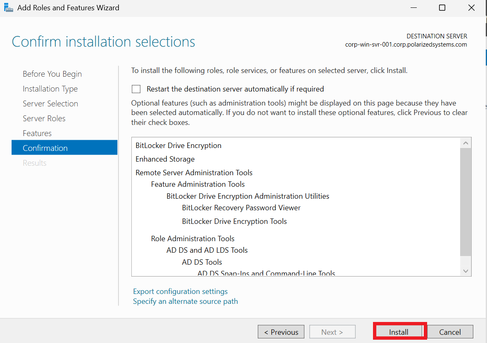

7. The feature installs.

   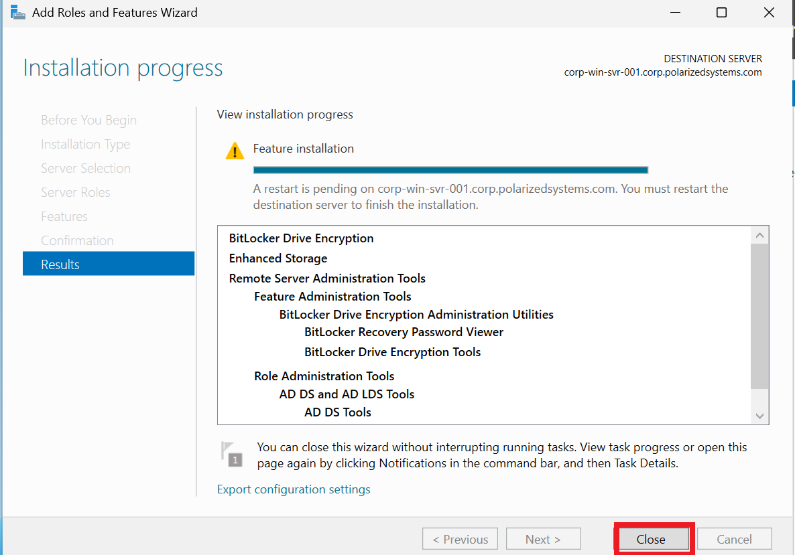

8. BitLocker requires a reboot to finish wiring itself into the OS — restart the server.

   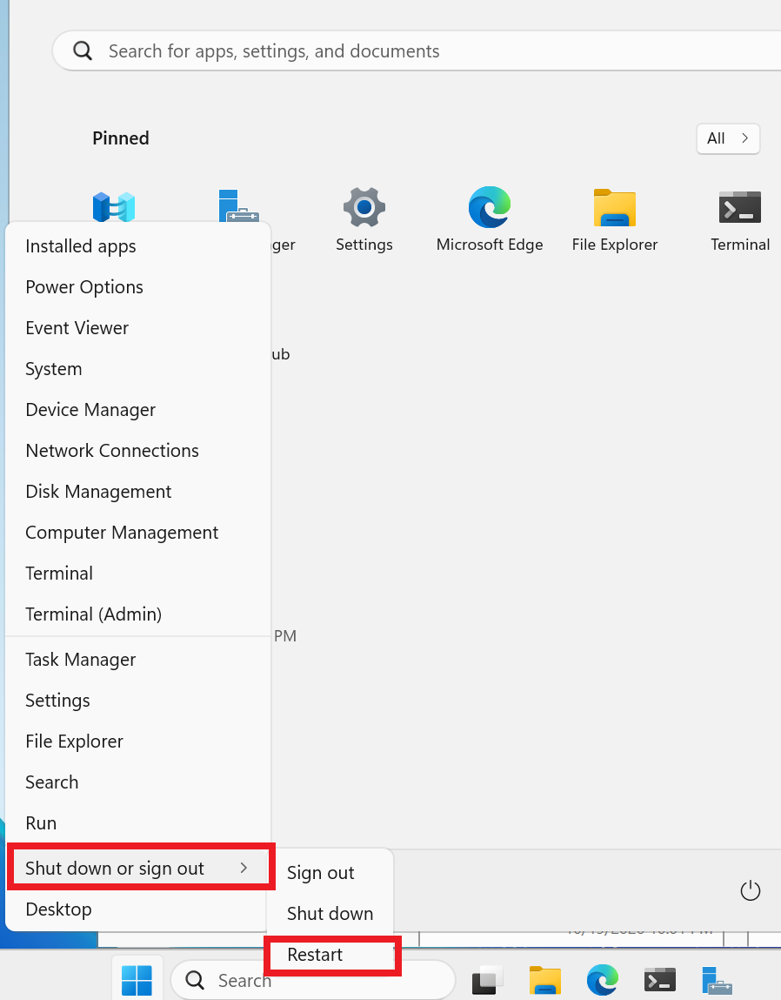

9. Provide a planned-shutdown reason and continue.

   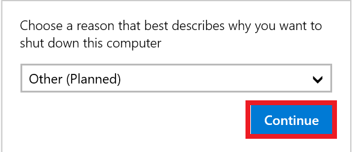

---

## Task 2 – Encrypt the Data Volume

10. After the reboot, open **File Explorer**.

    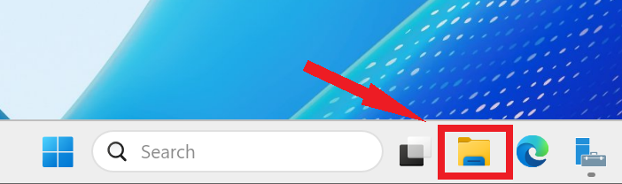

11. Right-click the data volume **New Volume (E:)** and choose **Turn on BitLocker**.

    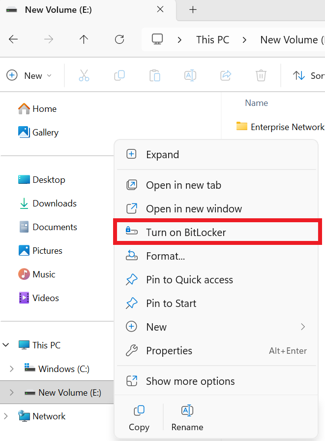

12. Choose **Use a password to unlock the drive** and set a strong password. This is what will be required to mount the volume.

    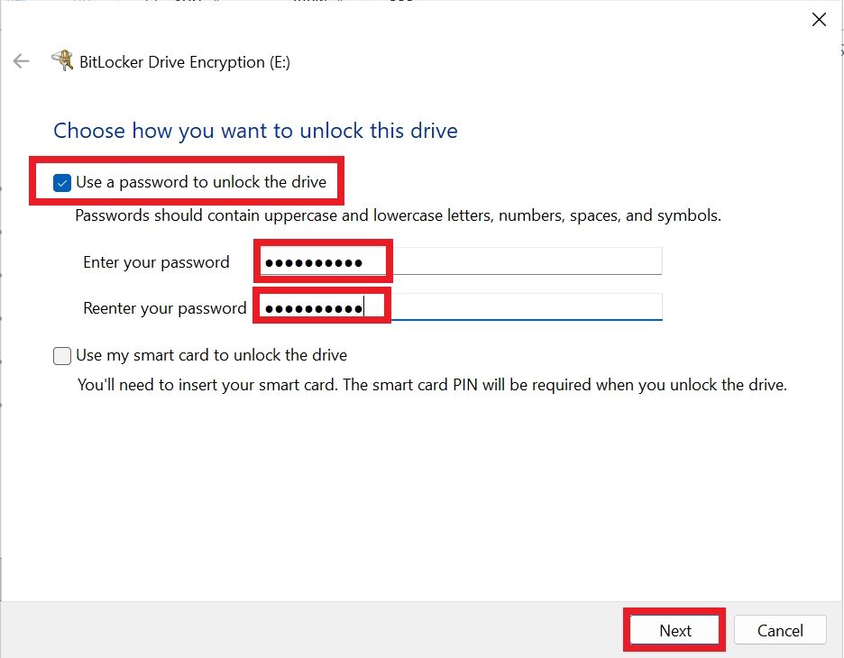

> 🔎 **Password unlock vs. TPM.** On a data volume, BitLocker can unlock with a password and needs no Trusted Platform Module — ideal for a server data drive or a virtualized host. On an OS drive you would typically bind the key to the machine's **TPM** so the disk only decrypts on that specific, un-tampered hardware. Different unlock methods, same underlying protection: the data is ciphertext until the correct key is presented.

13. Back up the **recovery key**. Save it to a file in a safe location (never on the volume being encrypted).

    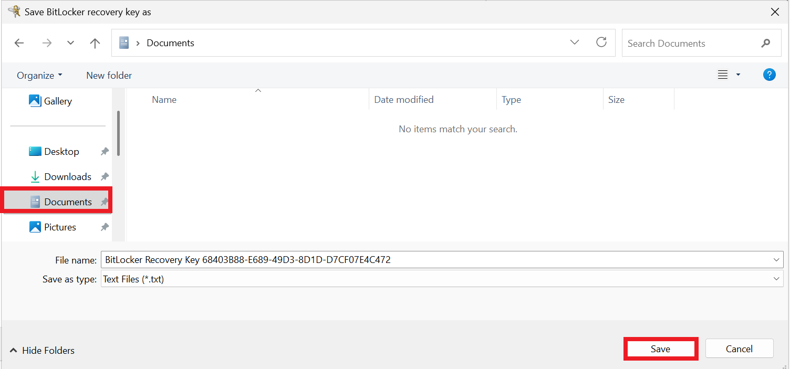

> 🔎 **The recovery key is the whole ballgame.** If the password is forgotten or the hardware changes, the recovery key is the *only* way back into the data — and anyone who has it can unlock the volume. In production this key is escrowed automatically into **Active Directory** (or Microsoft Entra / Intune) so it is centrally held, access-controlled and auditable, never saved to a loose file or a sticky note. This lab saves it to a file to demonstrate the step; the Stakeholder Takeaway notes the production control.

14. Choose **Encrypt used disk space only** — faster, and appropriate for a freshly created volume.

    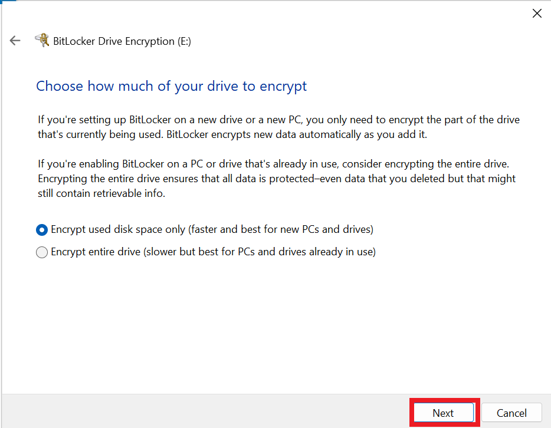

15. Confirm and **Start encrypting**.

    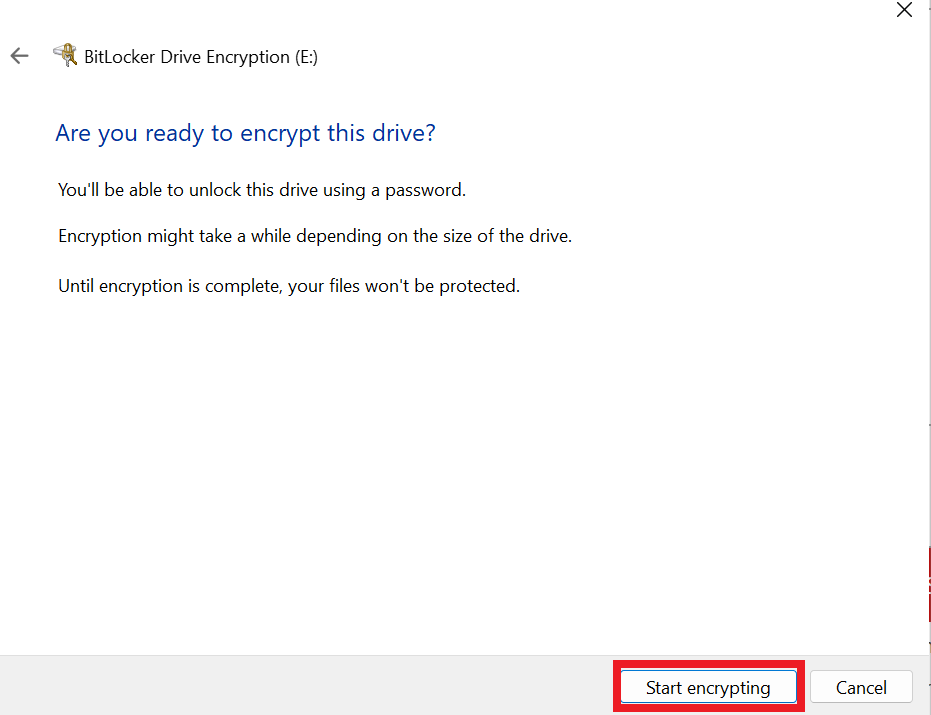

16. Encryption runs and the recovery key file is saved. The **E:** volume is now protected at rest — unreadable without the password or recovery key.

    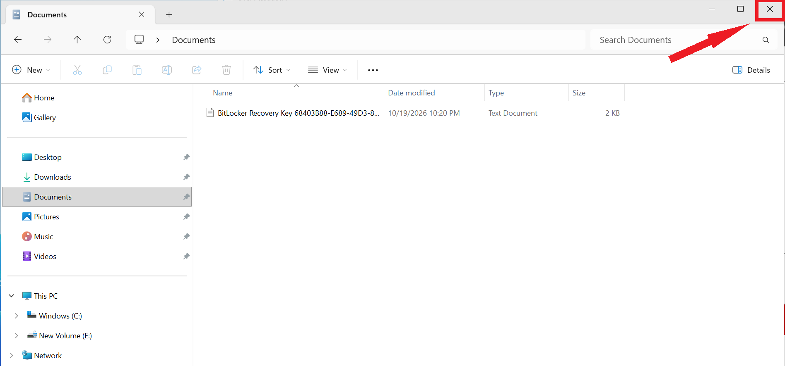

---

>
 This exercise demonstrated how **Microsoft BitLocker Drive Encryption** protects sensitive data at rest on Windows Server infrastructure.
>
 **Key Findings & Security Outcomes:**
>
 - **Data Encryption:** Encrypted a server volume to protect sensitive information.
 - **Data Protection:** Reduced the risk of unauthorized access if a physical or virtual disk is stolen or copied.
 - **Compliance:** Demonstrated an encryption control relevant to protecting PII and regulated data.
 - **Strengthens data confidentiality, reduces exposure risks, and supports enterprise security and compliance requirements.

---

[← Previous: Exercise 1 – Deploy Splunk Enterprise on Linux](../exercise-1-deploy-splunk-enterprise-on-linux/README.md) | [Back to Lab Overview](../README.md) | [Next: Exercise 3 – Enabling Multi-Factor Authentication →](../exercise-3-enabling-multi-factor-authentication/README.md)
