# Exercise 3 – Enabling Multi-Factor Authentication

[← Back to Lab Overview](../README.md)

---

## Overview

**Multifactor Authentication (MFA)** is essential for protecting user accounts, strengthening access controls, and reducing the risk of unauthorized access within enterprise environments.

Multifactor authentication adds an additional layer of security by requiring users to verify their identity through multiple authentication factors. Common authentication methods include **smart cards, authentication applications, and security keys**, which can provide additional protection beyond traditional password-based authentication.

## Objectives:

- **Active Directory User Management:** Create a new user account in Active Directory to establish an identity for authentication configuration.
- **Multifactor Authentication Configuration:** Enable multifactor authentication for the Active Directory user to strengthen account protection and access security.

## Devices

- **corp-dc-001** – Windows Server – Domain Controller, Active Directory Users and Computers (192.168.20.2)
- **corp-wks-001** – Windows 11 – domain workstation used to test the enforced logon (192.168.30.3)

---

## Task 1 – Create the Active Directory User

1. Log into the **corp-dc-001** domain controller.

   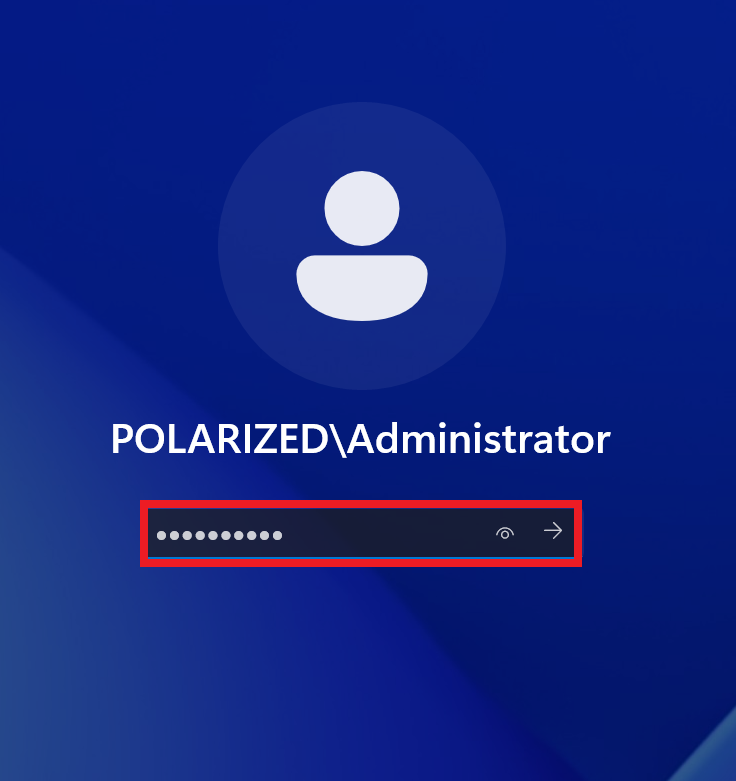

2. Open **Server Manager → Tools → Active Directory Users and Computers**.

   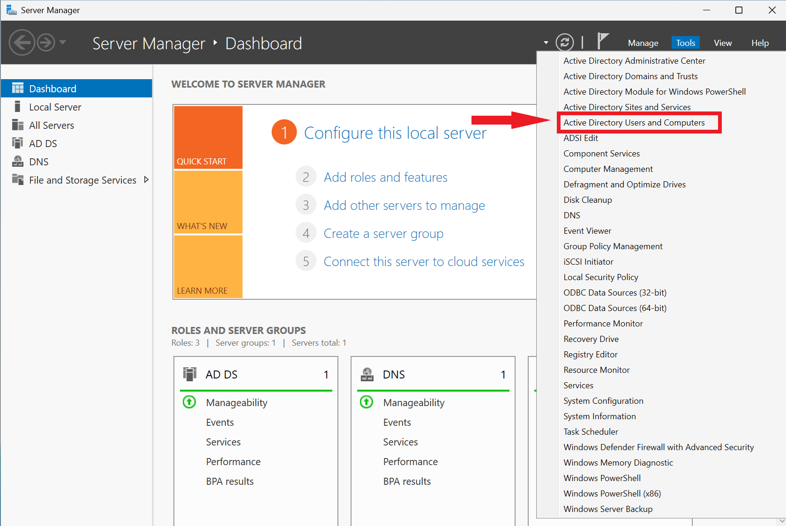

3. Under **Polarized Systems → Users → Finance**, right-click and choose **New → User**.

   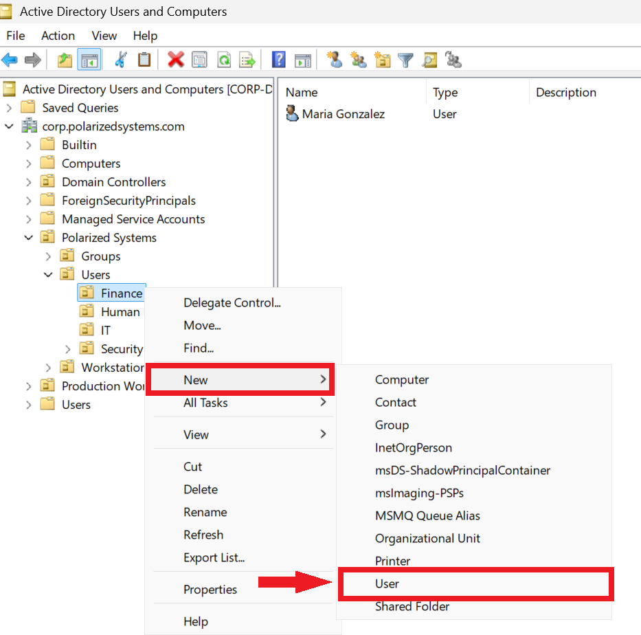

4. Set the account's password and options.

   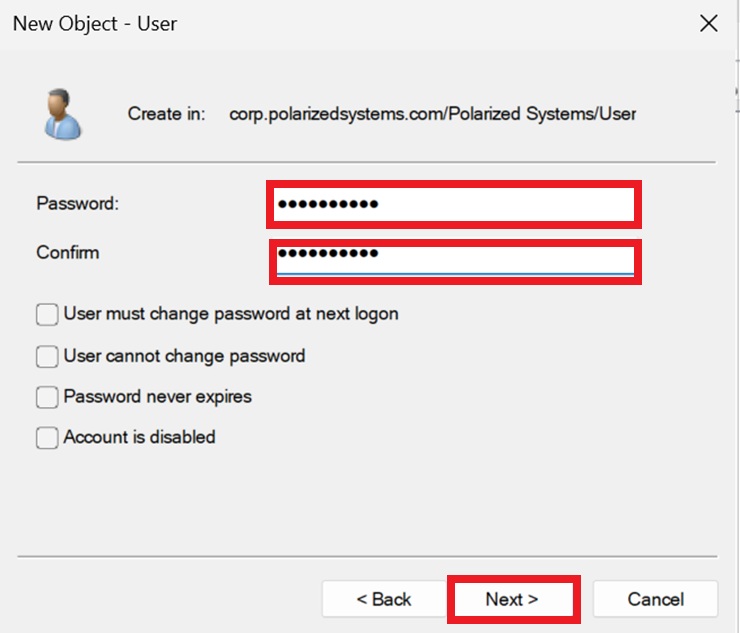

5. Review the new-account summary.

   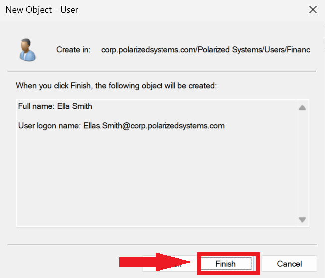

6. Finish — the user **Ella Smith** (`ella.smith@corp.polarizedsystems.com`) is created in the Finance OU.

   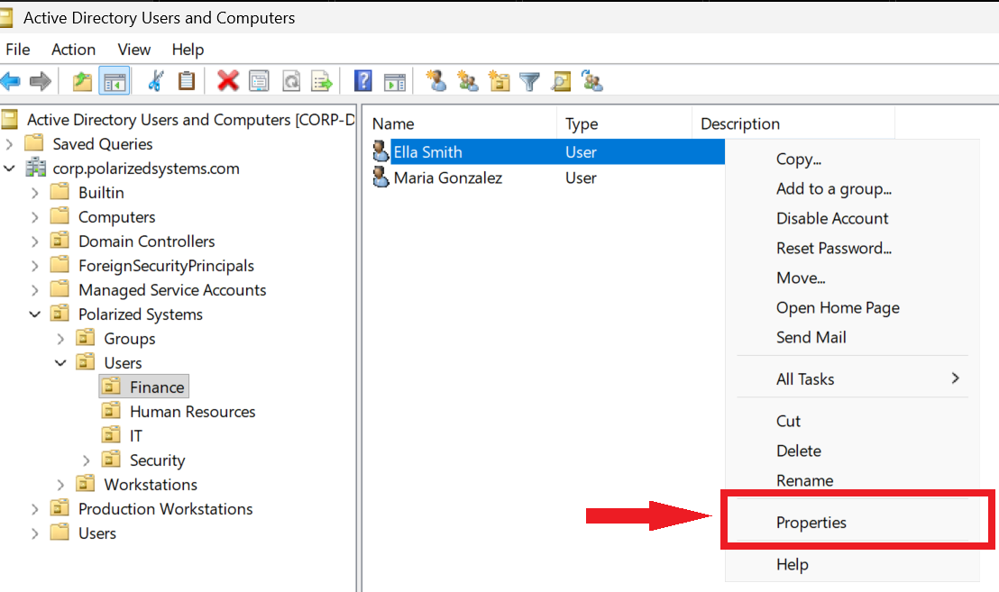

---

## Task 2 – Enforce Smart-Card MFA

7. Right-click the new user and open **Properties → Account** tab. Under **Account options**, tick **Smart card is required for interactive logon**, then **Apply**.

   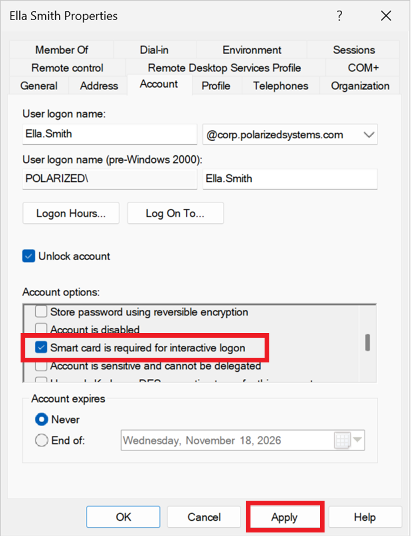

8. The account is created and the control is set.

   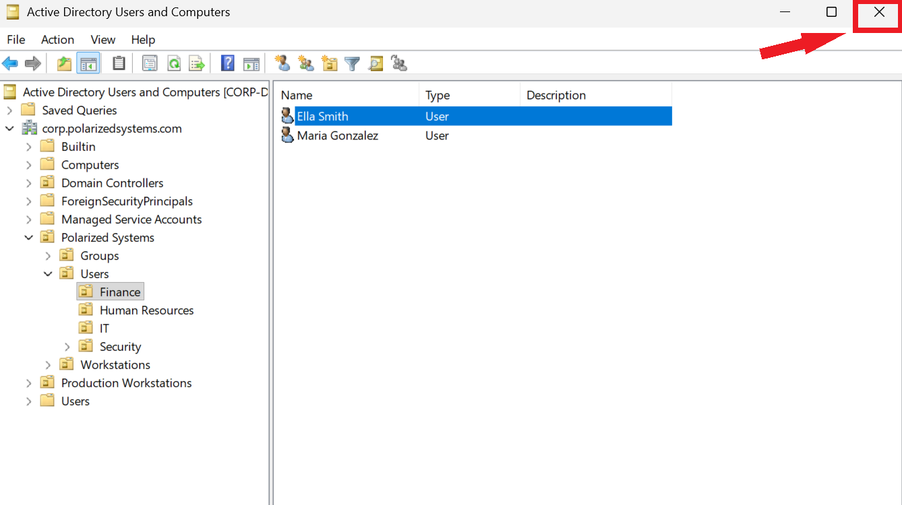

---

## Task 3 – Verify the Control Is Enforced

9. On **corp-wks-001**, at the logon screen choose **Other user**.

   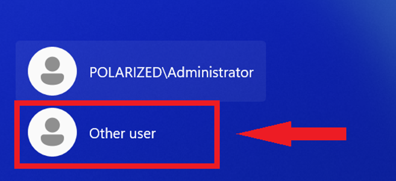

10. Attempt a normal **password** logon as `POLARIZED\Ella.Smith`.

    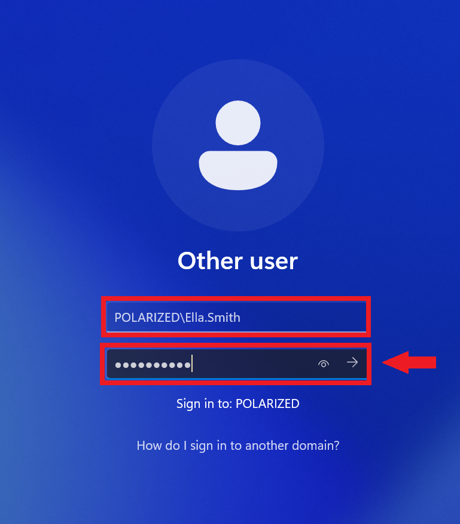

11. The logon is refused with **"You must use Windows Hello or a smart card to sign in."** — the MFA requirement is enforced exactly as configured.

    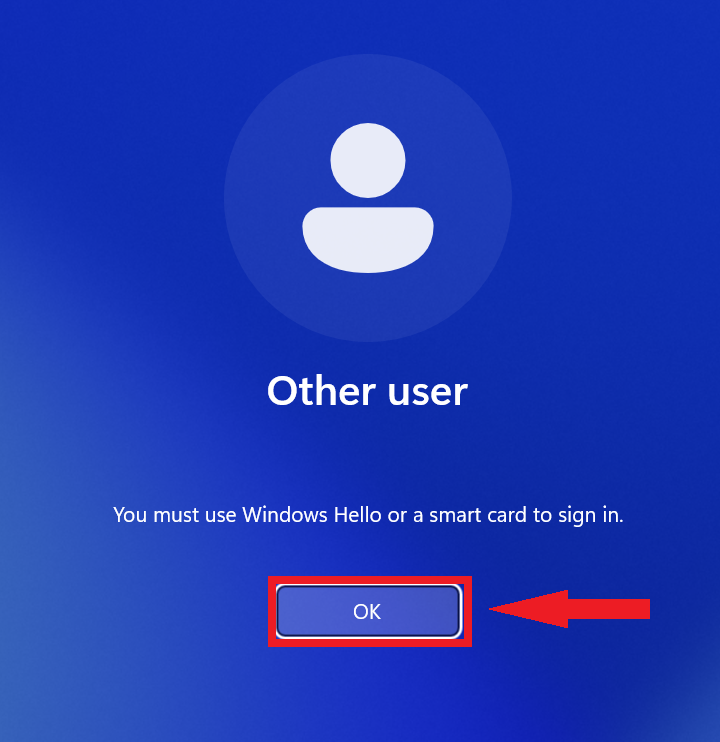

---

> This exercise demonstrated how **multifactor authentication (MFA)** strengthens Active Directory security by protecting user accounts against compromised credentials.
>
Key Findings & Security Outcomes:
>
 - **Account Protection:** Enforced smart-card authentication to prevent password-only access.
 - **Credential Security:** Reduced exposure to unauthorized access through stolen passwords.
 - **Privileged Access:** Highlighted the importance of MFA for administrative and high-risk accounts.
 - **Security Monitoring:** Identified opportunities to monitor authentication events through Splunk.
 - **Strengthens identity security, reduces credential-based attack, and improves enterprise access controls.**

---

[← Previous: Exercise 2 – Encrypting Sensitive Data](../exercise-2-encrypting-sensitive-data/README.md) | [Back to Lab Overview](../README.md)
