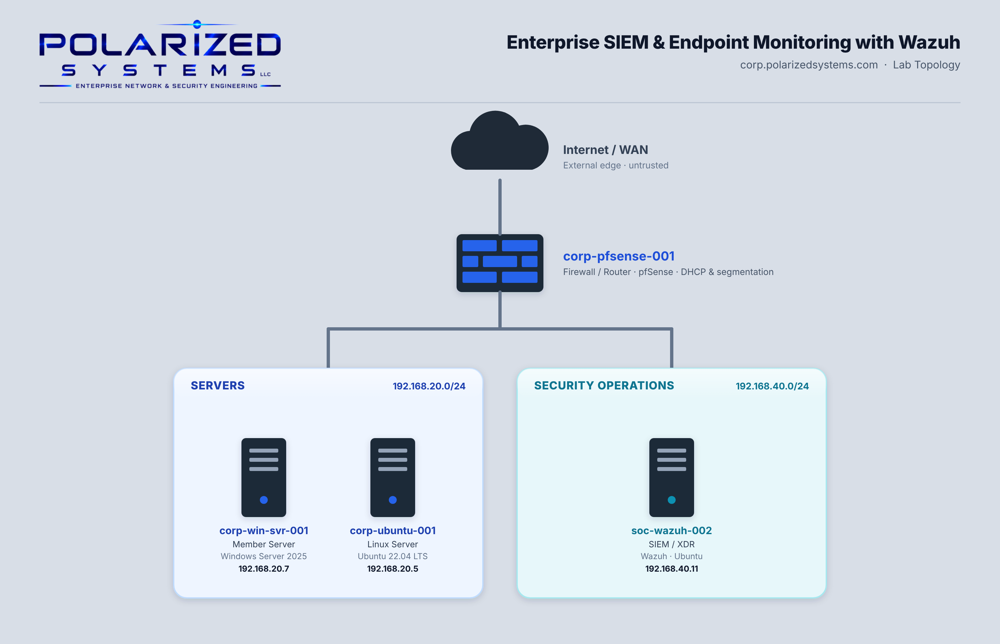

# Enterprise SIEM & Endpoint Monitoring with Wazuh

[← Back to Security Operations](../README.md)

**Domain:** Security Operations
**Environment:** Polarized Systems lab — a Wazuh all-in-one SIEM on Ubuntu, a Windows Server endpoint, and an Ubuntu Linux endpoint

---

## Overview

As a **Cybersecurity Analyst**, centralized security monitoring and endpoint visibility are essential for detecting suspicious activity, identifying potential threats, and strengthening security operations across enterprise infrastructure.

In this project, I deployed **Wazuh, an open-source SIEM and XDR platform**, on an Ubuntu Linux server within the Polarized Systems SOC environment. The platform provides centralized security monitoring, event correlation, and alerting across Windows and Linux endpoints.

The project focuses on three primary objectives:

- **Exercise 1 – Wazuh Server Deployment:** Installed and configured the Wazuh all-in-one platform, including the manager, indexer, and dashboard, on Ubuntu Linux. Configured firewall access, verified service functionality, and accessed the management dashboard.

- **Exercise 2 – Windows Endpoint Monitoring:** Installed and configured the Wazuh agent on a Windows Server endpoint, confirming successful agent enrollment and active communication with the Wazuh manager.

- **Exercise 3 – Linux Endpoint Monitoring:** Deployed the Wazuh agent on an Ubuntu Linux endpoint using the Debian package and configured it as a `systemd` service for centralized monitoring.

---

This project demonstrates practical **SIEM deployment, endpoint security monitoring, agent management, and cross-platform security operations**, while establishing a centralized monitoring environment for Windows and Linux infrastructure.

## Lab Topology

---

## Learning Outcomes

By the end of this lab, I was able to:

- Deploy an all-in-one Wazuh SIEM (indexer, manager and dashboard) on enterprise Linux
- Harden the host firewall (`ufw`) to expose only the dashboard and agent ports (443, 1514, 1515)
- Verify multi-component service health with `systemctl`
- Enroll a Windows endpoint as a Wazuh agent and confirm it reporting
- Enroll a Linux endpoint with the native `.deb` package as a `systemd` service
- Manage agent services with `systemctl enable`/`start` for durable coverage
- Confirm cross-platform visibility across Windows and Linux from a single dashboard

---

## Lab Environment

| Hostname | IP Address | Operating System | Role in this lab |
|----------|-----------|------------------|------------------|
| `corp-pfsense-001` | — | pfSense | Firewall / router between subnets |
| `soc-wazuh-002` | 192.168.40.11 | Ubuntu 22.04 LTS | Wazuh all-in-one SIEM (Ex 1) |
| `corp-win-svr-001` | 192.168.20.7 | Windows Server 2025 | Windows agent endpoint (Ex 2) |
| `corp-ubuntu-001` | 192.168.20.5 | Ubuntu 22.04 LTS | Linux agent endpoint (Ex 3) |

---

## Exercises

| # | Exercise | Platform | Key Skills |
|---|----------|----------|-----------|
| 1 | [Deploy the Wazuh Server](exercise-1-deploy-the-wazuh-server/README.md) | Linux | Wazuh all-in-one install · `ufw` · `systemctl` service verification · dashboard |
| 2 | [Deploy a Windows Agent](exercise-2-deploy-a-windows-agent/README.md) | Windows | Agent enrollment · PowerShell MSI install · dashboard confirmation |
| 3 | [Deploy a Linux Agent](exercise-3-deploy-a-linux-agent/README.md) | Linux | `.deb` agent install · `systemd` service · cross-platform visibility |

---

## Review

### Summary

In this lab I completed three exercises that build a working, cross-platform SIEM from the ground up:

- Exercise 1 — Deploy the Wazuh Server (the central monitoring stack)
- Exercise 2 — Deploy a Windows Agent (first endpoint onboarded)
- Exercise 3 — Deploy a Linux Agent (cross-platform coverage)

The result is a live Wazuh deployment with two endpoints — one Windows, one Linux — actively reporting security telemetry to a single dashboard. Paired with the Splunk logging from Lab 05, it demonstrates fluency across two of the most widely used SIEM platforms in the industry.

### Skills Demonstrated

- All-in-one SIEM deployment with Wazuh on enterprise Linux
- Hardened service configuration and minimal firewall exposure
- Cross-platform endpoint agent enrollment (Windows MSI and Linux `.deb`)
- Service management and verification with `systemctl`
- Confirming end-to-end agent-to-manager data flow from the dashboard

---

[← Back to Security Operations](../README.md)
