# Exercise 1 – Deploy the Wazuh Server on Linux

[← Back to Lab Overview](../README.md)

---

## Overview


## Section 1 – What Is a SIEM?

### Introduction

A **Security Information and Event Management (SIEM)** system is a centralized security platform that enables organizations to collect, analyze, and monitor security events across enterprise infrastructure. By aggregating logs from servers, firewalls, applications, intrusion detection systems, and endpoints, SIEM solutions provide greater visibility into potential threats and suspicious activity.

A core capability of SIEM technology is **event correlation**, which identifies patterns across multiple systems that may indicate malicious activity. SIEM platforms can also integrate threat intelligence, generate automated alerts, and support security investigations and incident response.

SIEM solutions play a critical role in modern **Security Operations Centers (SOCs)** by providing three essential capabilities:

- **Centralized Log Management:** Collect and organize security events from multiple systems for monitoring and analysis.
- **Threat Detection & Incident Response:** Correlate events, identify suspicious behavior, and support timely investigation of potential security incidents.
- **Security Compliance & Reporting:** Maintain audit trails and generate reports that support regulatory requirements, including HIPAA, PCI DSS, and GDPR.

SIEM technology strengthens **enterprise threat visibility, security monitoring, and incident response capabilities**, providing a foundation for effective security operations across on-premises and cloud environments.


## Device

- **soc-wazuh-002** – Ubuntu 22.04 LTS – Wazuh all-in-one server (indexer + manager + dashboard) (192.168.40.11)

---

## Task 1 – Verify and Prepare the Server

1. On **soc-wazuh-002**, open a terminal and confirm the hostname and OS:

   ```bash
   hostnamectl
   ```

   Confirms the host **`soc-wazuh-002`** running **Ubuntu 22.04 LTS** on VMware.

   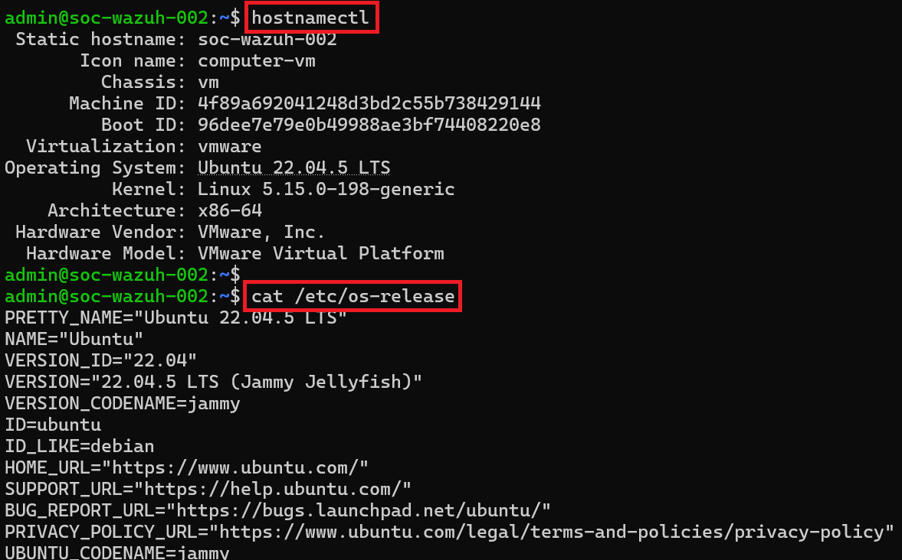

2. Confirm the OS release details:

   ```bash
   cat /etc/os-release
   ```

   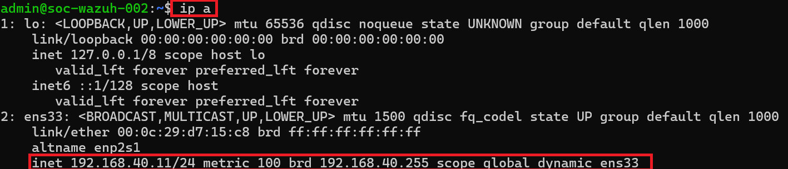

3. Patch the server to current before installing:

   ```bash
   sudo apt update && sudo apt upgrade -y
   ```

   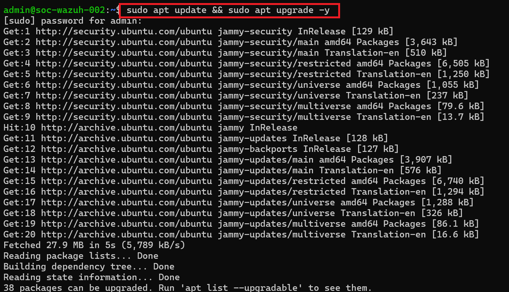

---

## Task 2 – Download and Run the Wazuh Installer

4. Open a browser to the official Wazuh source.

   

5. The Wazuh install documentation shows the exact quickstart commands — the official, trusted source for the installer.

   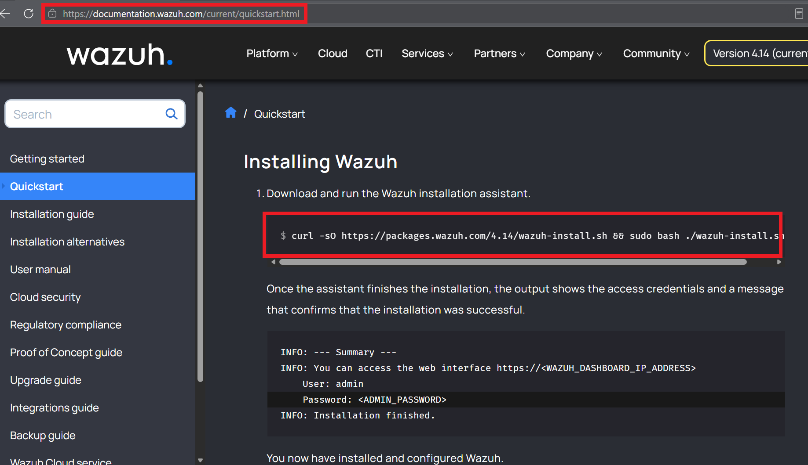

6. Download the installer with `curl`, make it executable:

   ```bash
   curl -sO https://packages.wazuh.com/4.7/wazuh-install.sh
   chmod +x wazuh-install.sh
   ```

   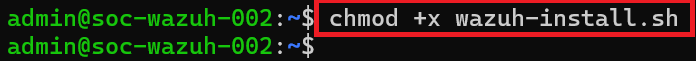

7. Confirm the installer is present and executable:

   ```bash
   ls -l
   ```

   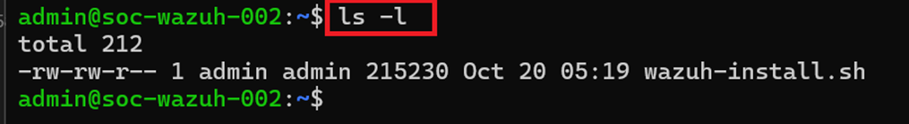

8. The `wazuh-install.sh` script is in place.

   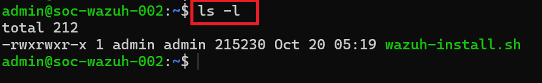

> 🔎 **Why there's no dedicated service account or install directory to create first (unlike Splunk).** In the Splunk lab I manually created the `splunk` service account and the `/opt/installers` directory, because Splunk's `.rpm` is a plain package — *you* decide where it lives and who runs it. Wazuh is different: the `wazuh-install.sh` script does all of that for you. Run with `sudo`, the turnkey all-in-one installer automatically **creates its own least-privilege service accounts** (`wazuh`, `wazuh-indexer`, `wazuh-dashboard` — each component runs under its own user), **installs into standard system paths** (`/var/ossec` for the manager, `/usr/share/wazuh-indexer`, `/usr/share/wazuh-dashboard`), and **generates all certificates and registers the `systemd` services**. The one-line difference: *Splunk ships a package you place and run; Wazuh ships an installer that places and runs itself.* Same security principle — dedicated least-privilege service accounts — Wazuh just automates it.

9. Run the all-in-one install (`-a` installs indexer + manager + dashboard together; `-i` skips the hardware pre-check on a VM):

   ```bash
   sudo bash ./wazuh-install.sh -a -i
   ```

   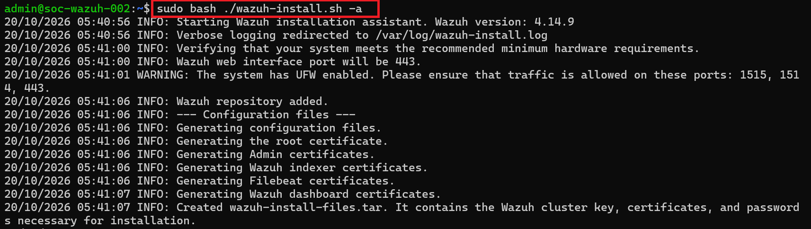

10. When it finishes, the installer prints the admin login. **Copy the generated password** — it's needed to log into the dashboard. *(It can also be recovered later from `wazuh-install-files.tar`.)*

    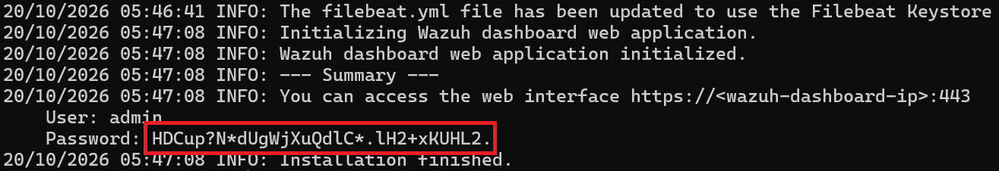

---

## Task 3 – Open the Firewall for Agent Traffic

11. Allow the dashboard and agent ports through UFW:

    ```bash
    sudo ufw allow 443/tcp
    sudo ufw allow 1514/tcp
    sudo ufw allow 1515/tcp
    ```

    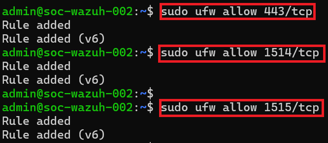

12. Reload and confirm the rules:

    ```bash
    sudo ufw reload
    sudo ufw status
    ```

    UFW shows **443, 1514 and 1515** allowed.

    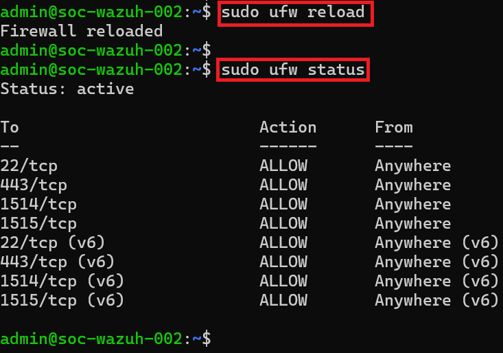

> 🔎 **What each port is for.** `443` is the web **dashboard** · `1515` is agent **enrollment** (where a new agent registers and exchanges keys) · `1514` is agent **event streaming** (where enrolled agents send their telemetry). An endpoint needs 1514 and 1515 to the manager; analysts need 443 to the dashboard.

13. Confirm Wazuh is listening on its ports:

    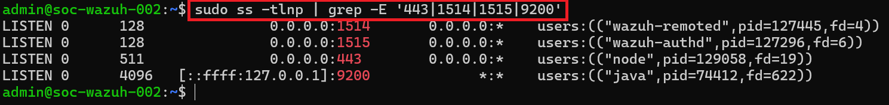

---

## Task 4 – Verify the Services

14. Confirm the **indexer** is active:

    ```bash
    sudo systemctl status wazuh-indexer
    ```

    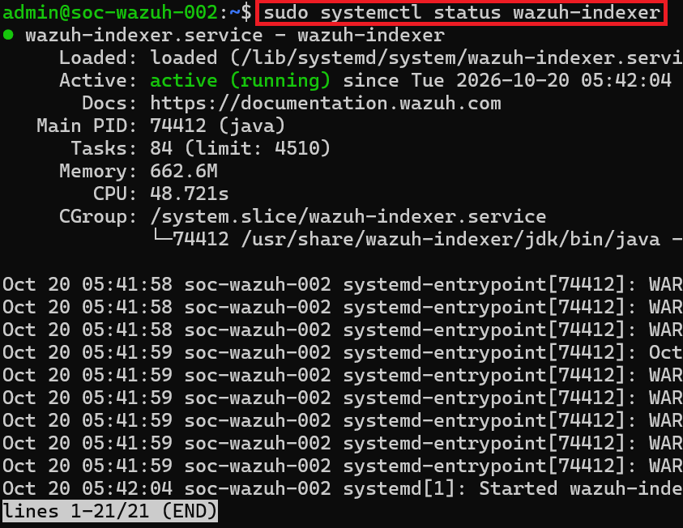

15. Confirm the **manager** is active:

    ```bash
    sudo systemctl status wazuh-manager
    ```

    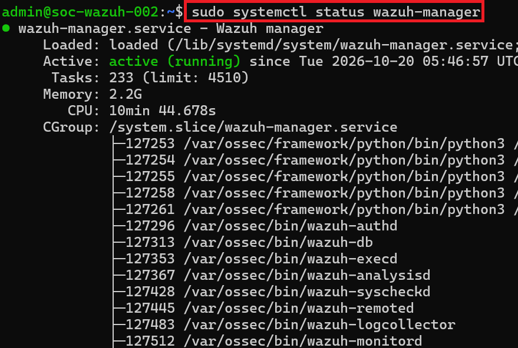

16. Confirm the **dashboard** is active:

    ```bash
    sudo systemctl status wazuh-dashboard
    ```

    All three components — indexer, manager and dashboard — are **active (running)**.

    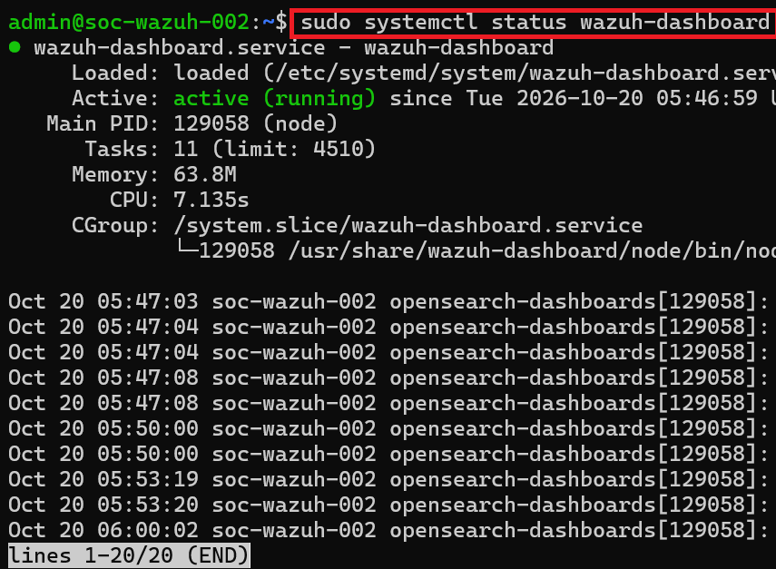

---

## Task 5 – Access the Dashboard

17. Open a browser and go to **`https://192.168.40.11`**.

    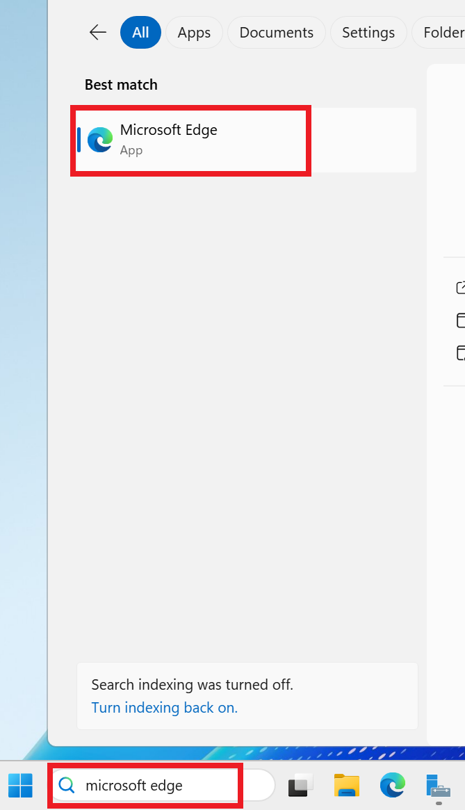

18. The browser warns about the self-signed certificate (expected for a fresh install) — choose **Advanced** and continue.

    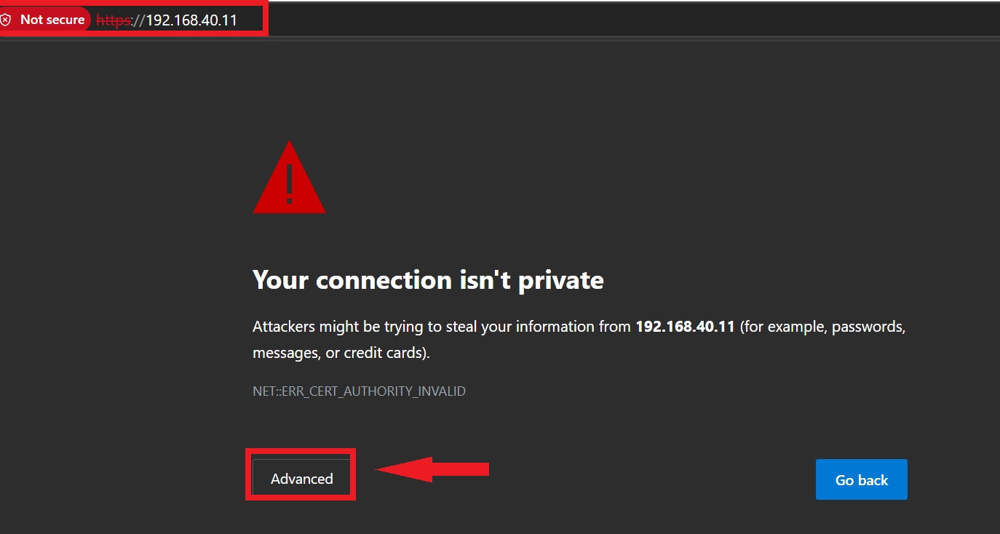

19. Log in with **`admin`** and the password from the install summary.

    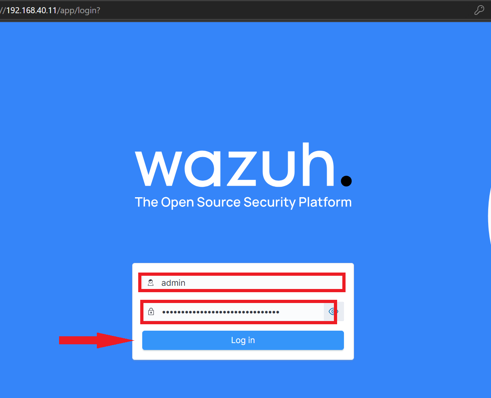

20. The Wazuh dashboard loads.

    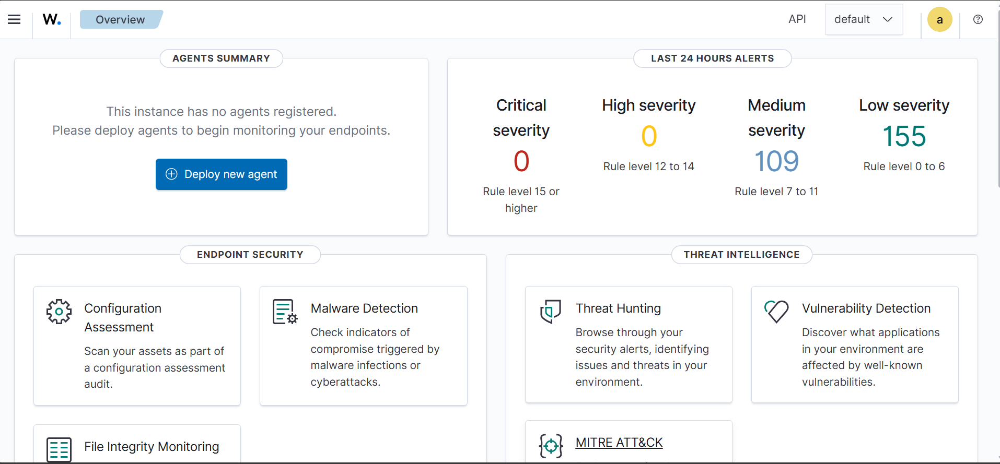

21. The overview shows the environment — currently **0 agents**, which is correct; endpoints are enrolled in Exercises 2 and 3.

    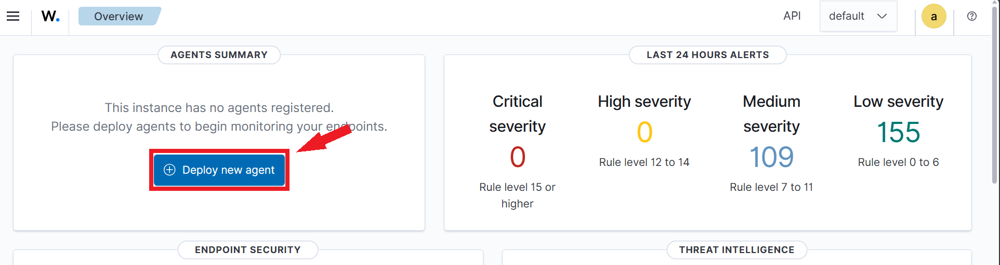

---

> ### 🎤 Stakeholder Takeaway
>
> "We now run a second, independent security-monitoring platform alongside our Splunk logging. Where Splunk gives us a searchable record of what happened, Wazuh actively watches each machine — flagging file changes, policy drift, and suspicious behavior — and raises alerts in real time. We stood the whole stack up on a single hardened Linux server using the vendor's own installer, which provisions its services under locked-down accounts automatically. It cost nothing in licensing, and it's ready to bring our endpoints under continuous watch."

---

[← Back to Lab Overview](../README.md) | [Next: Exercise 2 – Deploy a Windows Agent →](../exercise-2-deploy-a-windows-agent/README.md)
