# Exercise 2 – Deploy a Windows Agent

[← Back to Lab Overview](../README.md)

---

## Overview

Maintaining visibility across the many endpoints within our networking enfrastructure is vital for identifying suspicious activity and potential security threats.
Wazuh agents provide this visibility by collecting security events, system logs, file integrity changes, and authentication activity, then forwarding the information to a centralized SIEM platform for analysis.

In this exercise, the Wazuh agent is deployed on a Windows endpoint within the Polarized Systems SOC environment.
This establishes centralized security monitoring and enables the Windows endpoint to report security events for analysis and threat detection.

## Devices

- **soc-wazuh-002** – Ubuntu – Wazuh manager (192.168.40.11)
- **corp-win-svr-001** – Windows Server 2025 – the endpoint being enrolled (192.168.20.7)

---

## Task 1 – Generate the Agent Install Command

1. In the Wazuh dashboard, open **Agents → Deploy new agent**, and select the **Windows** package.

   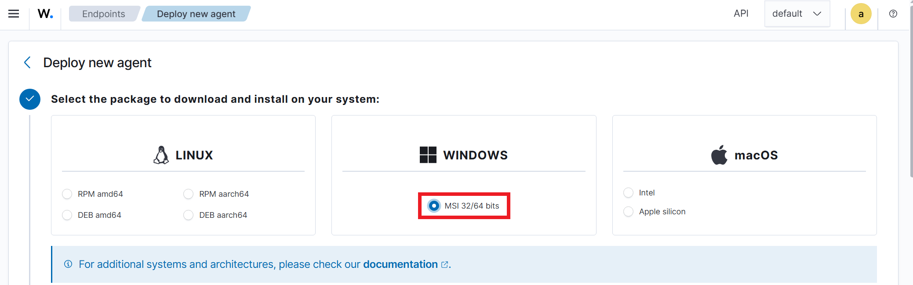

2. Set the **server address** to the manager's IP (`192.168.40.11`) and the **agent name** to `corp-win-svr-001`.

   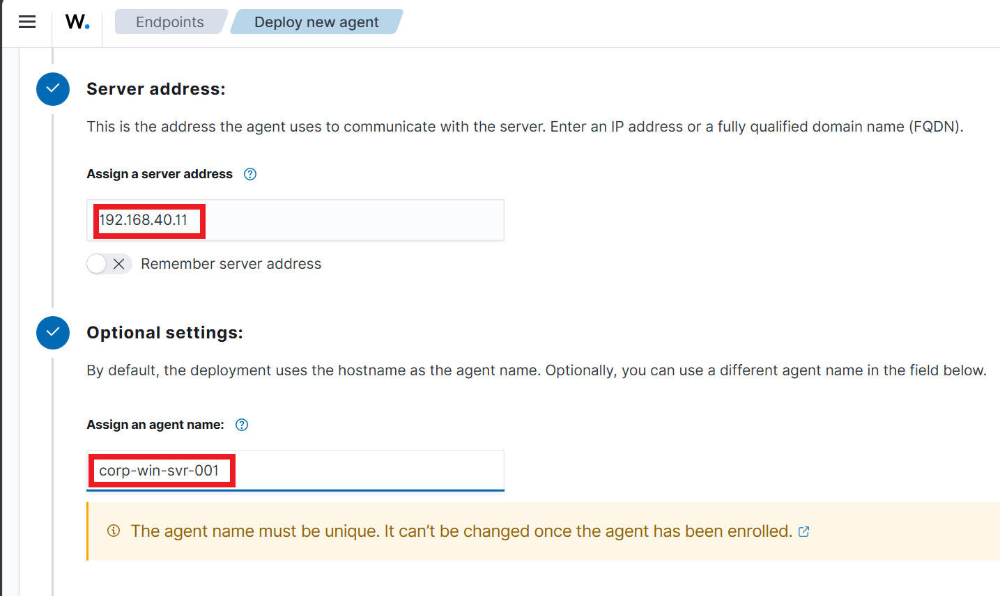

3. The dashboard generates the tailored PowerShell install command, with the manager IP and agent name baked in. Copy it.

   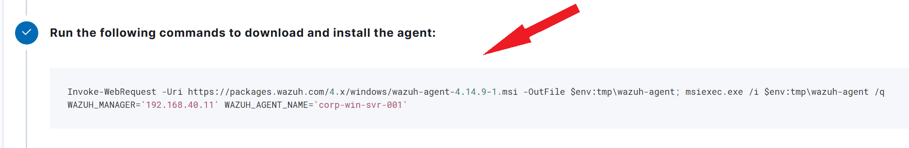

> **A cleaner path than the "copy into a text file" method.** The straightforward way to move this generated command to the endpoint is to simply open the Wazuh dashboard *in a browser on the Windows machine itself*, generate the command there, and paste it straight into PowerShell — no intermediate files or SSH hops needed. The command itself is self-contained: its `Invoke-WebRequest` downloads the agent `.msi` directly from the Wazuh package repository, so nothing is manually transferred between machines.

---

## Task 2 – Install the Agent on the Endpoint

4. On the manager, confirm the Wazuh services are running and ready to receive the enrollment.

   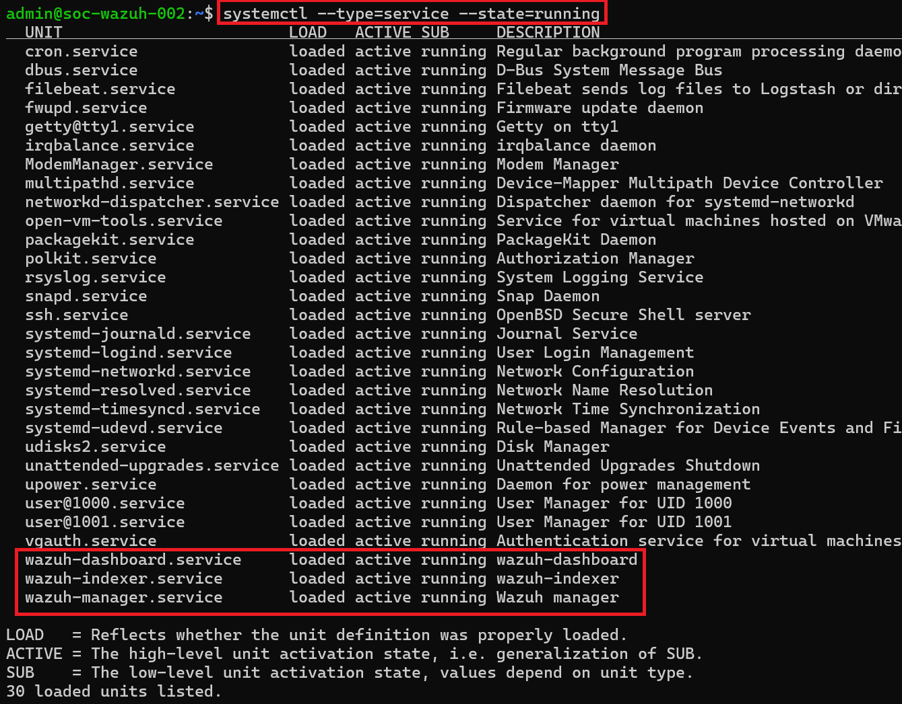

5. On **corp-win-svr-001**, open **Windows PowerShell as Administrator**.

   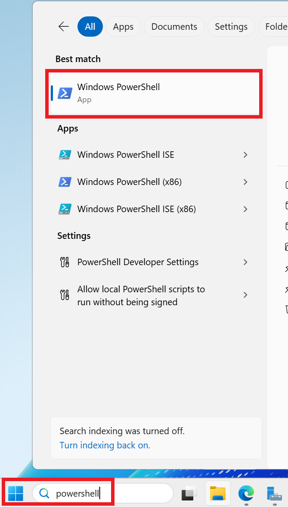

6. Paste and run the generated command. The `Invoke-WebRequest` downloads the agent MSI and `msiexec` installs it silently with the manager IP and agent name:

   ```powershell
   Invoke-WebRequest -Uri https://packages.wazuh.com/4.x/windows/wazuh-agent-4.14.9-1.msi -OutFile $env:tmp\wazuh-agent; msiexec.exe /i $env:tmp\wazuh-agent /q WAZUH_MANAGER='192.168.40.11' WAZUH_AGENT_NAME='corp-win-svr-001'
   ```

   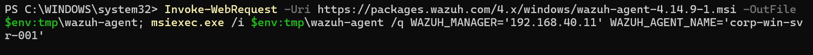

7. Start the agent service:

   ```powershell
   NET START Wazuh
   ```

   The service reports **"The Wazuh service was started successfully."**

   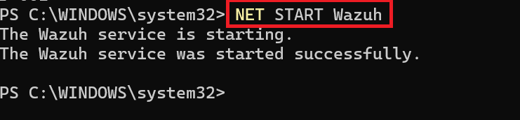

8. Confirm the service in the Windows **Services** console — open Services.

   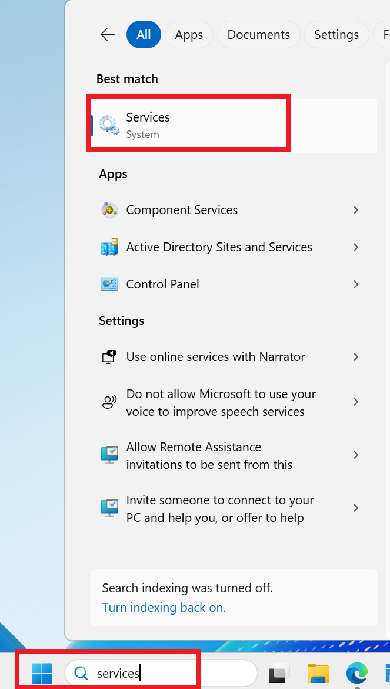

9. The **Wazuh** service is present and **Running**.

   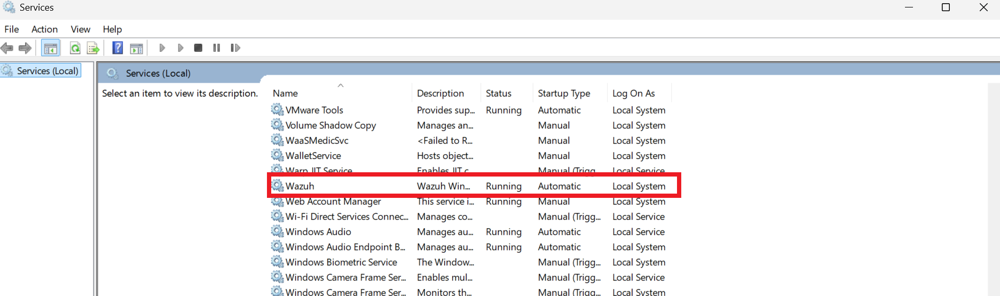

---

## Task 3 – Confirm the Agent Reporting

10. On the manager, the firewall is confirmed allowing the agent ports (1514/1515) so the enrollment can complete.

    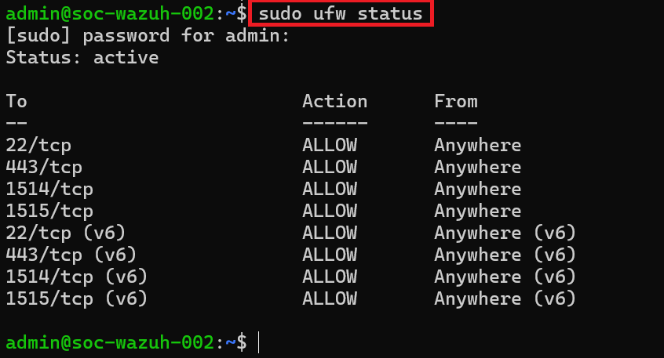

11. Back in the dashboard, the agent summary now shows **Active (1)** — `corp-win-svr-001` is connected and reporting.

    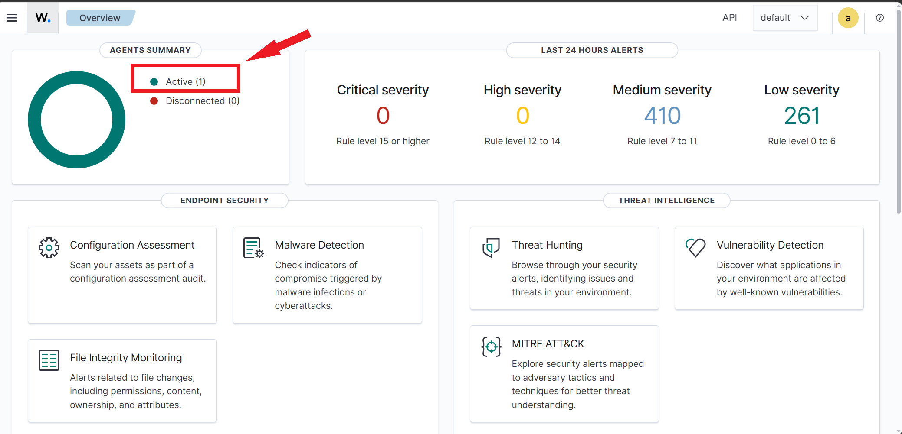

12. The agents list confirms **corp-win-svr-001** (Microsoft Windows Server 2025), version 4.14.9, status **active**.

    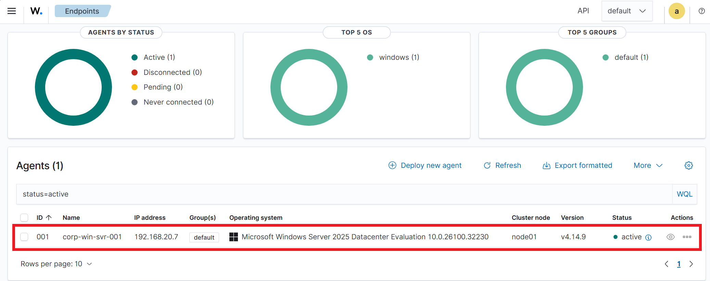

---

>
> We've now successfully deployed and registered a **Wazuh agent on a Windows Server**, establishing continuous endpoint monitoring within the Polarized Systems SOC environment.
>
> **Key Security Outcomes:**
>
> - **Centralized Visibility:** Windows security events, file changes, and system activity are monitored through Wazuh.
> - **Agent Management:** Verified successful agent connectivity and operational status.
> - **Scalability:** Demonstrated a repeatable deployment process for onboarding additional endpoints.

---

[← Previous: Exercise 1 – Deploy the Wazuh Server](../exercise-1-deploy-the-wazuh-server/README.md) | [Back to Lab Overview](../README.md) | [Next: Exercise 3 – Deploy a Linux Agent →](../exercise-3-deploy-a-linux-agent/README.md)
