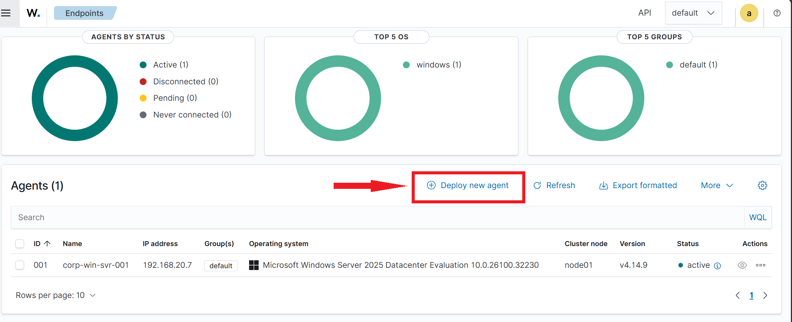
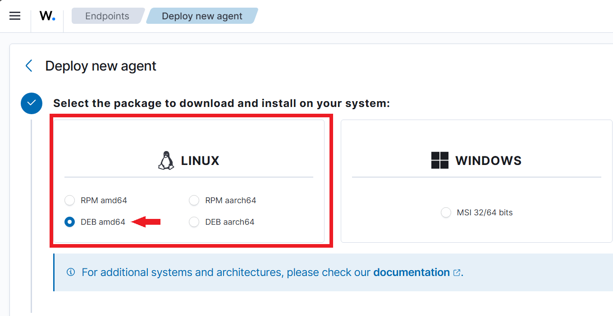
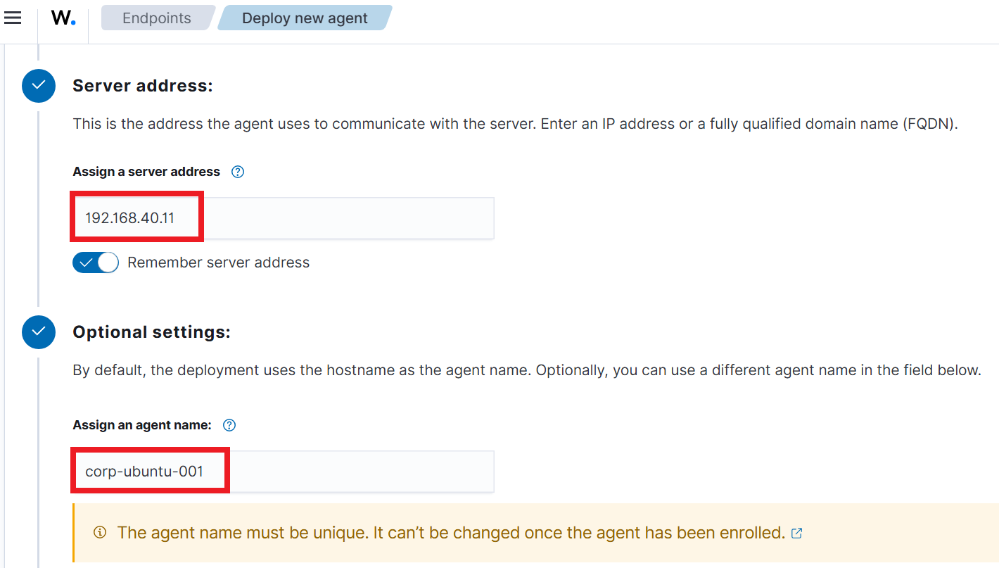
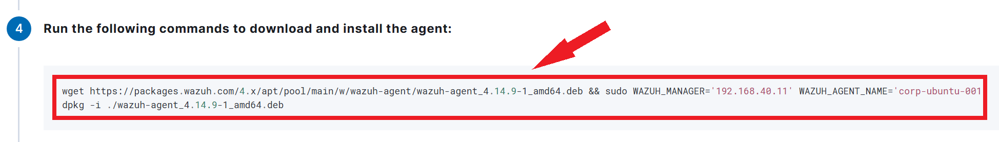
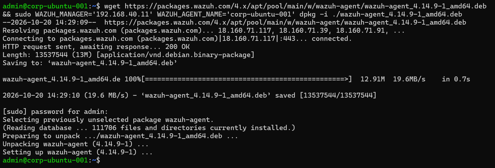
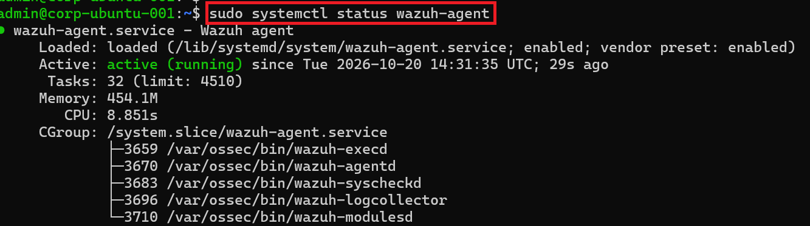
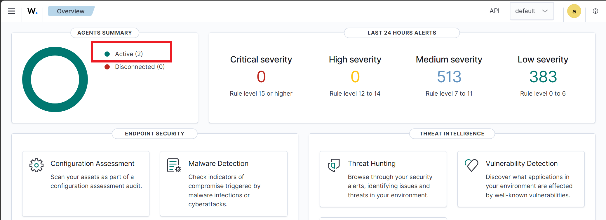
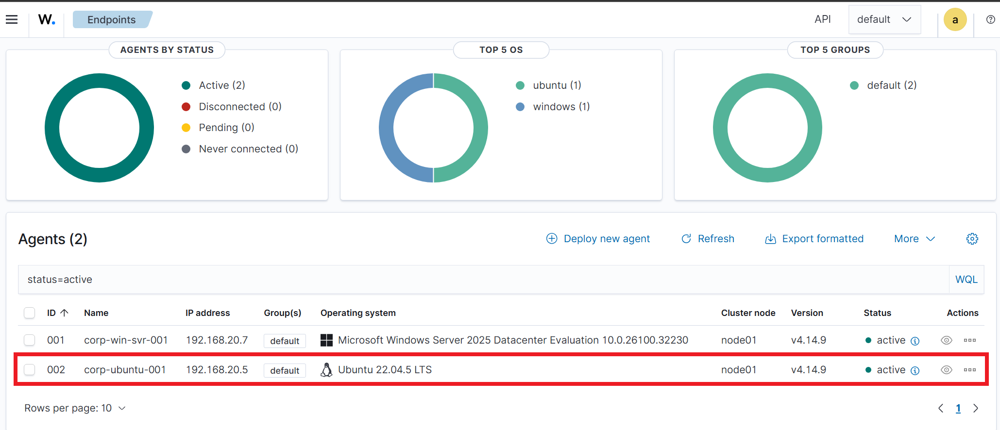

# Exercise 3 – Deploy a Linux Agent

[← Back to Lab Overview](../README.md)

---

## Overview

As a cybersecurity analyst, maintaining visibility across different operating systems is essential for effective enterprise security monitoring. Real-world environments rely on both **Windows and Linux infrastructure**, and a centralized SIEM must be capable of monitoring security events, authentication activity, and file integrity changes across both platforms.

Having successfully enrolled a Windows endpoint, I deployed and configured a **Wazuh Linux agent on `corp-ubuntu-001`** within the Polarized Systems SOC environment. This expanded centralized security visibility across Windows and Linux systems, strengthening **cross-platform threat detection, endpoint monitoring, and security operations**.

## Devices

- **soc-wazuh-002** – Ubuntu – Wazuh manager (192.168.40.11)
- **corp-ubuntu-001** – Ubuntu 22.04 LTS – the endpoint being enrolled (192.168.20.5)

---

## Task 1 – Generate the Agent Install Command

1. In the dashboard, open **Agents → Deploy new agent**.

   

2. Select the **Linux** package and choose **DEB amd64** (the correct package for Ubuntu).

   

3. Set the **server address** to `192.168.40.11` and the **agent name** to `corp-ubuntu-001`.

   

4. The dashboard generates the tailored install command. Copy it.

   

---

## Task 2 – Install the Agent on the Endpoint

5. On **corp-ubuntu-001**, open a terminal.

   

6. Paste and run the command. It downloads the `.deb` package with `wget` and installs it with `dpkg`, passing the manager IP and agent name:

   ```bash
   wget https://packages.wazuh.com/4.x/apt/pool/main/w/wazuh-agent/wazuh-agent_4.14.9-1_amd64.deb && sudo WAZUH_MANAGER='192.168.40.11' WAZUH_AGENT_NAME='corp-ubuntu-001' dpkg -i ./wazuh-agent_4.14.9-1_amd64.deb
   ```

   

7. Reload `systemd` so it picks up the new service unit:

   ```bash
   sudo systemctl daemon-reload
   ```

   

8. Enable the agent to start on boot:

   ```bash
   sudo systemctl enable wazuh-agent
   ```

   

9. Start the agent:

   ```bash
   sudo systemctl start wazuh-agent
   ```

   

10. Confirm the agent is running:

    ```bash
    sudo systemctl status wazuh-agent
    ```

    The service is **active (running)**.

    

> 🔎 **`enable` vs. `start`.** `start` runs the agent now; `enable` makes it come back automatically after a reboot. Both matter for a monitoring agent — an endpoint that stops reporting after a restart is a silent blind spot, so enabling it is what makes the coverage durable.

---

## Task 3 – Confirm Both Agents Reporting

11. Back in the dashboard, the agent summary now shows **Active (2)** — both endpoints connected.

    

12. The agents list confirms both: **corp-win-svr-001** (Windows Server 2025) and **corp-ubuntu-001** (Ubuntu 22.04 LTS), each version 4.14.9 and **active** — cross-platform visibility under a single SIEM.

    

---

> ### 🎤 Stakeholder Takeaway
>
> Successfully expanded **Wazuh security monitoring across Windows and Linux endpoints**, establishing centralized visibility within the Polarized Systems SOC environment.
>
> **Key Security Outcomes:**
>
> - **Cross-Platform Monitoring:** Integrated Windows Server and Ubuntu Linux endpoints into a single SIEM dashboard.
> - **Agent Management:** Verified successful connectivity and operational status across both systems.
> - **Scalability:** Established a repeatable process for onboarding additional enterprise endpoints.
>
> **Business Impact:** Improved threat detection capabilities, reduced security blind spots, and strengthened centralized monitoring across multiple operating systems.

---

[← Previous: Exercise 2 – Deploy a Windows Agent](../exercise-2-deploy-a-windows-agent/README.md) | [Back to Lab Overview](../README.md)
