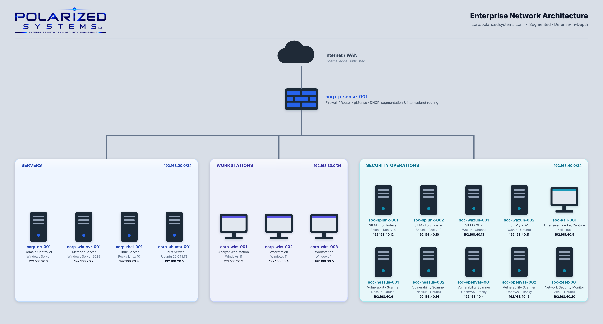

# Security Operations

Security operations is the day-in, day-out work of defense — watching the environment, cutting through the noise, and catching what doesn't belong before it turns into an incident.

The best SOCs don't just wait for alarms to go off; they already know what normal looks like, so anything out of place stands out fast.

Getting there takes real visibility — logs centralized, endpoints monitored, traffic understood — paired with the judgment to tell a true threat from a false alarm.

These projects are me building that visibility and sharpening that judgment, hands-on, across a full enterprise environment.

All work was performed in **Polarized Systems**, my enterprise lab environment: a Windows Active Directory domain (`corp.polarizedsystems.com`) with segmented server, workstation and Security Operations subnets routed through a pfSense firewall.

---

## Projects

| # | Project | What I Did | Key Tools / Sources |
|---|---------|------------|---------------------|
| 01 | [Threat Intelligence & Threat Gathering](01-threat-intelligence-and-threat-gathering/README.md) | Performed passive OSINT reconnaissance, gathered threat intelligence, hunted logon events and mapped activity to MITRE ATT&CK, with domain firewall logging | OSINT · MITRE ATT&CK · Windows Event Logs · pfSense |
| 02 | [Techniques to Determine Malicious Activity](02-techniques-to-determine-malicious-activity/README.md) | Hunted Windows event logs with PowerShell and monitored Linux logins, validated with simulated brute-force attacks | PowerShell · Windows Event Logs · Linux auth logs |
| 03 | [Identifying & Analyzing Malicious Activity](03-identifying-and-analyzing-malicious-activity/README.md) | Monitored resource utilization on Windows and Linux and detected Active Directory privilege escalation (Events 4728/4737) | Process Explorer · Event Viewer · Top · Htop · Active Directory |
| 04 | [Tools for Identifying Malicious Activity](04-tools-for-identifying-malicious-activity/README.md) | Captured live network traffic with Wireshark and tcpdump and validated domains and IPs against threat-intelligence services | Wireshark · tcpdump · WHOIS · AbuseIPDB · VirusTotal |
| 05 | [Centralized Logging & Endpoint Hardening](05-centralized-logging-and-endpoint-hardening/README.md) | Deployed Splunk on enterprise Linux for centralized logging, encrypted data at rest with BitLocker and enforced smart-card MFA | Splunk · Universal Forwarder · BitLocker · Active Directory |
| 06 | [Enterprise SIEM & Endpoint Monitoring with Wazuh](06-enterprise-siem-and-endpoint-monitoring-with-wazuh/README.md) | Deployed a Wazuh all-in-one SIEM and enrolled Windows and Linux agents for cross-platform endpoint monitoring | Wazuh · systemd · Windows MSI / Linux DEB agents |

---

## Skills Demonstrated

- Passive OSINT reconnaissance and threat-intelligence gathering
- Windows event-log hunting with PowerShell and Linux login monitoring
- Detecting Active Directory privilege escalation and account abuse
- Live packet capture and analysis with Wireshark and tcpdump
- Domain and IP reputation validation with WHOIS, AbuseIPDB and VirusTotal
- Centralized log collection with the Splunk and Wazuh SIEM platforms
- Endpoint hardening with BitLocker encryption and multi-factor authentication
- Mapping adversary activity to the MITRE ATT&CK framework

---

## Related Portfolios

- [Vulnerability Management](https://github.com/PolarizedSystems/Vulnerability-Management)
- [Incident Response](https://github.com/PolarizedSystems/Cybersecurity-Incident-Response)
- [Server Identity & Access Management](https://github.com/PolarizedSystems/Server-Identity-and-Access-Management)
